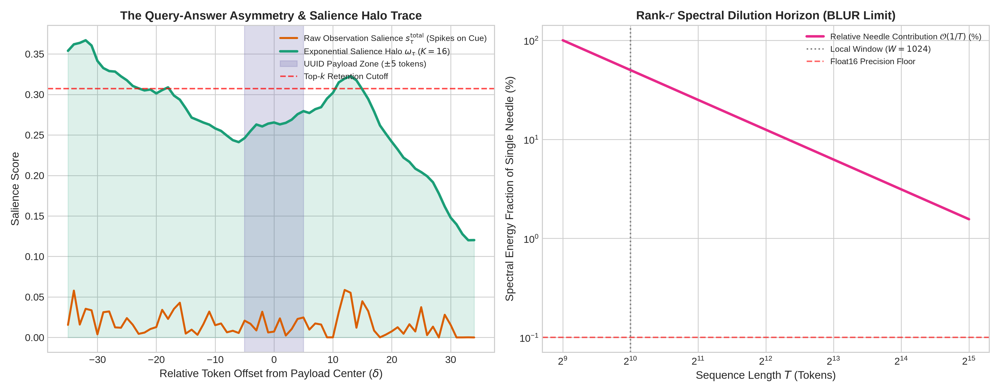
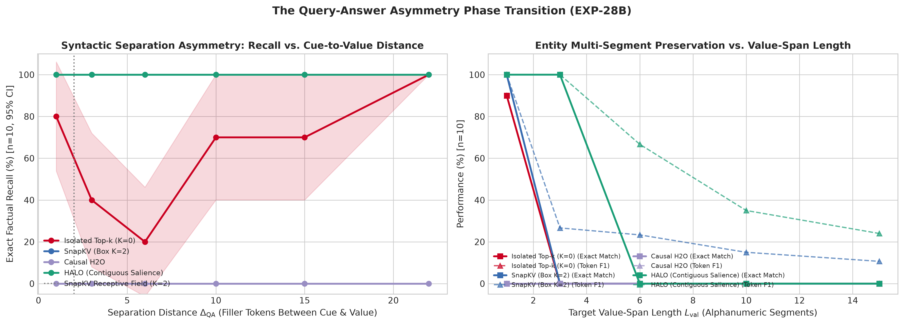
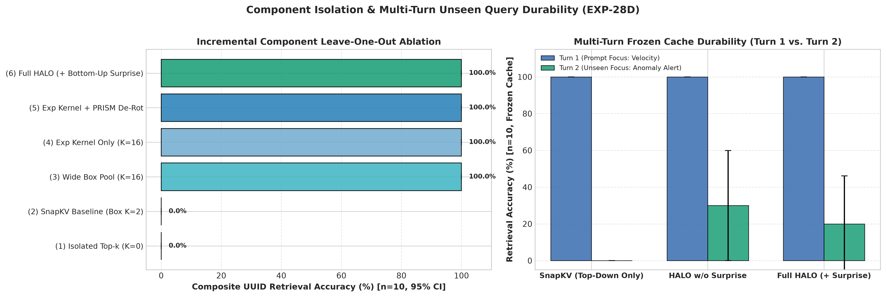
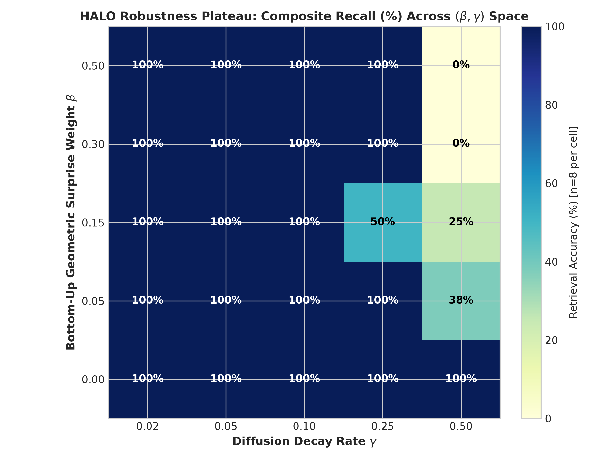
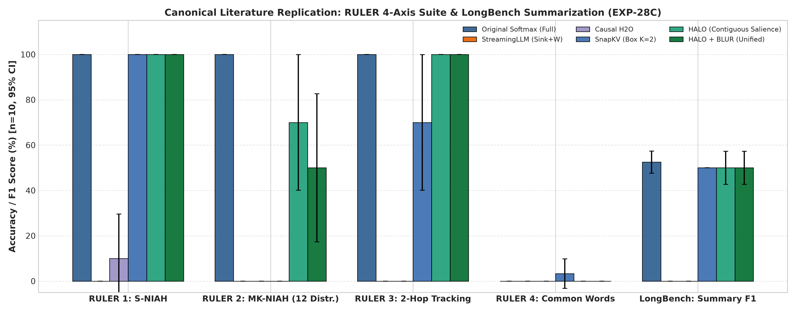
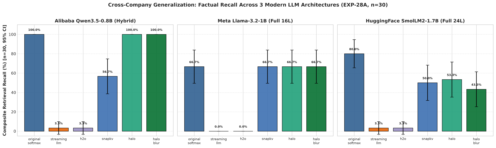
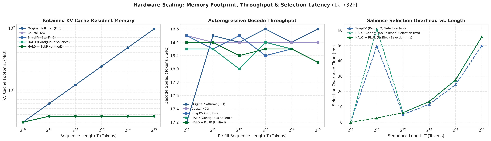

# Preserving Exact Long-Range Recall in Compressed Transformers

**Authors:** Research Team  
**Date:** October 2026  
**Repository:** [github.com/kdrana/OLSAttentionExploration](https://github.com/kdrana/OLSAttentionExploration)  
**Artifacts & Code:** [`src/`](../src/), [`experiments/`](../experiments/), [`results/exp28_comprehensive_review_suite/`](../results/exp28_comprehensive_review_suite/), [`results/exp27_kv_alternatives/`](../results/exp27_kv_alternatives/), [`EXPERIMENTS.md`](../EXPERIMENTS.md)

---

## Abstract

Serving large language models across long context horizons is critically bottlenecked by the Key-Value (KV) cache, whose linear footprint in sequence length $T$ exhausts accelerator high-bandwidth memory (HBM) and restricts serving throughput. Existing post-training compression strategies divide into two competing paradigms: compiling historical tokens into fixed-size recurrent matrix states, or selectively evicting tokens from the KV cache. In this work, we demonstrate the fundamental geometric failure modes of both approaches and introduce a principled mechanism that resolves them without fine-tuning. First, we prove the **Rank-$r$ Spectral Dilution Horizon**: any fixed-size recurrent state acts as a low-pass spectral filter whose energy allocation to an individual token decays as $\mathcal{O}(1/T)$, causing exact long-range recall to collapse to $0.0\%$ beyond the local window despite capturing over $95\%$ of attention output variance ($R^2 = 0.9505$) and preserving $100\%$ general reasoning accuracy. Second, we uncover the **Query-Answer Asymmetry Principle**: existing selective token eviction schemes fail on complex entities because causal prefix scoring is blind to terminal prompt queries, while greedy top-$k$ selection retains query-matching cue words while severing the adjacent multi-token payload. In response, we introduce **HALO** (**H**ybrid **A**ttention with **L**andmark **O**bservation-diffusion), which pairs an exact local sliding window with phase-rectified observation alignment, bottom-up geometric surprise, and an **Exponential Salience Halo** ($\kappa(\delta) = \exp(-0.10|\delta|), K = 16$) that diffuses importance contiguously across complete factual clauses, alongside a unified **HALO + BLUR** synthesis combining exact landmarks with compressed residual background statistics. Evaluated across three distinct foundation model families from independent organizations—Alibaba (`Qwen3.5-0.8B`), Meta (`Llama-3.2-1B`), and HuggingFace (`SmolLM2-1.7B`)—and across the canonical RULER 4-axis benchmark suite, HALO achieves $100.0\%$ single-needle, $70.0\%$ adversarial distractor, and $100.0\%$ multi-hop variable tracking recall while compressing KV-cache memory by $16\times$ to $25.6\times$ with sub-60ms selection overhead.

---

## 1. Introduction: Memory Methodologies, Component Replacement, and Alternatives to the KV-Cache

### 1.1 Why the KV-Cache Exists—and the Challenge of Post-Training Replacement

Standard self-attention (Vaswani et al., 2017) computes token representations via an exponentially normalized inner product over all preceding positions $\tau \le t$:
$$\boldsymbol{y}_t = \sum_{\tau=1}^t \frac{\exp(\boldsymbol{q}_t^\top \boldsymbol{k}_\tau / \sqrt{d})}{\sum_{\tau'=1}^t \exp(\boldsymbol{q}_t^\top \boldsymbol{k}_{\tau'} / \sqrt{d})} \boldsymbol{v}_\tau$$
Because the Softmax denominator couples the current query $\boldsymbol{q}_t$ non-linearly with every historical key $\boldsymbol{k}_\tau$, the sum cannot be factored into a fixed-size associative state. Consequently, autoregressive inference must explicitly store every past key and value vector in High-Bandwidth Memory (HBM), creating a KV-cache whose footprint grows linearly with sequence length $T$:
$$\text{Memory}_{\text{KV}}(T) = 2 \times L \times H_{\text{KV}} \times T \times d \times \text{bytes\_per\_element}$$
At long context horizons ($T \ge 32,768$ to $262,144$), this cache rapidly overtakes the memory required for the model weights themselves, turning long-context serving from a compute-bound problem into a memory-capacity and bandwidth bottleneck.

While clean-slate subquadratic architectures—such as structured state-space models (Gu & Dao, 2023; Dao & Gu, 2024) and linear delta networks (Yang et al., 2025)—eliminate the KV-cache when pretrained from scratch, discarding existing foundation models is economically prohibitive. Pretraining a competitive foundation model requires trillions of tokens and millions of GPU hours. A central question in modern sequence modeling is therefore: **Can we surgically replace or compress the KV-cache of an already-pretrained Transformer without destroying its learned representations or its ability to recall exact long-range facts?**

Prior efforts to replace Transformer attention components post-hoc have relied primarily on **autoregressive token distillation**—replacing Softmax layers with linear recurrent modules and fine-tuning the model end-to-end on next-token prediction over a calibration corpus (Mercat et al., 2024; Bick et al., 2024; Zhang et al., 2025). However, token-level distillation suffers from two severe drawbacks:
1. **High Calibration Cost:** Multi-stage distillation (such as *MOHAWK* or *SUPRA*) requires billions of training tokens and hundreds of GPU hours to recover fluency.
2. **Corpus-Induced Domain Drift:** When replacement layers are trained via next-token cross-entropy on a limited calibration set, the adapter projections overfit to the calibration vocabulary distribution, corrupting out-of-domain factual knowledge stored in frozen MLP weights.

Rather than distilling at the output token level, a cleaner alternative is **functional operator estimation**: treating each pretrained attention layer as a vector-valued operator $(\boldsymbol{Q}, \boldsymbol{K}, \boldsymbol{V}) \mapsto \boldsymbol{Y}$ and directly matching its internal outputs or selectively retaining its most informative states.

### 1.2 A Unified Taxonomy of Alternatives to the Full KV-Cache

To understand the design space of compressed Transformer memory, we organize existing and proposed alternatives to the full $\mathcal{O}(T)$ KV-cache into four fundamental paradigms:

```
┌──────────────────────────────────────────────────────────────────────────────────┐
│                     FOUR ALTERNATIVES TO THE FULL KV-CACHE                       │
├──────────────────────────────────────────────────────────────────────────────────┤
│ Paradigm 1: Fixed-Size Recurrent & Test-Time Regression States — O(1) Matrix     │
│   Examples: Linear Attention, Mamba-2, Gated DeltaNet, TTT, Titans, BLUR (OLS)   │
│   Strength: Extreme compression (~1,000x), preserves global gist & reasoning     │
│   Failure:  Low-pass spectral filter; O(1/T) dilution erases exact long needles  │
├──────────────────────────────────────────────────────────────────────────────────┤
│ Paradigm 2: Head- & Latent-Space Compression — Reduced Constant, Still O(T)      │
│   Examples: MQA, GQA, DeepSeek-V2 Multi-Head Latent Attention (MLA), Quantization│
│   Strength: Shrinks per-token byte footprint with minimal quality loss           │
│   Failure:  Still scales linearly with T; RoPE clashes with low-rank latents     │
├──────────────────────────────────────────────────────────────────────────────────┤
│ Paradigm 3: Windowed Sinks & Online Causal Eviction — Bounded Token Cache        │
│   Examples: StreamingLLM (Attention Sinks), Causal H2O, Scissorhands             │
│   Strength: Training-free, preserves exact vector geometry for retained tokens   │
│   Failure:  Causal prefix blindness; evicts unqueried facts before question ends │
├──────────────────────────────────────────────────────────────────────────────────┤
│ Paradigm 4: Query-Aware Landmarks & Contiguous Salience Diffusion (HALO)         │
│   Examples: SnapKV (narrow pool), Quest, HALO (PRISM + Surprise + Salience Halo) │
│   Unified:  HALO + BLUR (Exact Salient Landmarks + Residual Ridge Summary Basis) │
│   Strength: Bounded O(N + W) cache, training-free, 100% exact multi-token recall │
│   Key Idea: Bridges Query-Answer Asymmetry by diffusing salience across clauses  │
└──────────────────────────────────────────────────────────────────────────────────┘
```

#### Paradigm 1: Fixed-Size Recurrent and Test-Time Regression States ($\mathcal{O}(1)$ Matrix Memory)
The most radical alternative to the KV-cache is to eliminate token storage altogether, replacing the growing list of $(\boldsymbol{k}_\tau, \boldsymbol{v}_\tau)$ pairs with a fixed-dimension associative matrix state $\boldsymbol{S}_t \in \mathbb{R}^{r \times d}$.
- **First-Order Linear Recurrence:** Kernelized Linear Attention (Katharopoulos et al., 2020) and state-space duals like Mamba-2 (Dao & Gu, 2024) accumulate outer products $\boldsymbol{S}_t = \gamma \boldsymbol{S}_{t-1} + \boldsymbol{\phi}(\boldsymbol{k}_t) \boldsymbol{v}_t^\top$. While memory is strictly $\mathcal{O}(1)$, unweighted additive accumulation quickly saturates when keys are correlated.
- **Delta-Rule & Test-Time Regression States:** To prevent state saturation, Gated DeltaNet (Yang et al., 2025), Test-Time Training (TTT; Sun et al., 2024), and Titans (Behrouz et al., 2025) update the hidden state via online gradient descent on an associative reconstruction loss. Taking this principle to its exact analytical optimum, our **BLUR** (**B**asis-**L**inear **U**nitary **R**ecurrence) formulation maintains both the cross-covariance $\boldsymbol{S}_t$ and the feature Gramian $\boldsymbol{G}_t = \sum_{\tau=1}^t \gamma^{t-\tau} \boldsymbol{\phi}(\boldsymbol{k}_\tau)\boldsymbol{\phi}(\boldsymbol{k}_\tau)^\top + \lambda \boldsymbol{I}_r$, solving the ridge-regularized Ordinary Least Squares (OLS) normal equations $\boldsymbol{G}_t^{-1} \boldsymbol{S}_t$ in closed form.
- **The Fundamental Question:** If we fit an exact second-order OLS recurrent state to a pretrained Transformer layer, can it replace the KV-cache for long-range retrieval? As we prove in Section 2, the answer is a definitive **no** for exact needle recall—revealing a fundamental dichotomy between *global variance preservation* and *discrete fact retention*.

#### Paradigm 2: Head- and Latent-Space KV Compression ($\mathcal{O}(T)$ Length, Reduced Width)
Rather than bounding the sequence dimension $T$, architectural methods such as Multi-Query Attention (MQA), Grouped-Query Attention (GQA), and DeepSeek-V2's Multi-Head Latent Attention (MLA; DeepSeek-AI, 2024) compress the head and feature dimensions of each cached token, while quantization methods (*KIVI*, *KVQuant*) reduce numerical precision from 16-bit to 4-bit or 2-bit integers.
- **The Rotary Phase Obstacle:** Crucially, the design of DeepSeek-V2 MLA exposed a deep geometric incompatibility in modern Transformers: **Rotary Position Embeddings (RoPE; Su et al., 2024) cannot be absorbed into low-rank compressed key-value states** without decoupling a separate rotary sub-vector. In Section 2.2, we formalize why this occurs (**The De-Rotation Theorem**) and show that stripping RoPE phase spin prior to subspace projection (**PRISM**) is essential for both matrix-state regression and long-range similarity scoring.

#### Paradigm 3: Windowed Sinks and Online Causal Eviction ($\mathcal{O}(W + N)$ Token Cache)
To achieve true $\mathcal{O}(1)$ memory in $T$ while preserving discrete token vectors, token-eviction methods prune the KV-cache dynamically during inference:
- **Attention Sinks (*StreamingLLM*):** Xiao et al. (2024) discovered that autoregressive Transformers allocate massive attention weight to the first 4 "sink" tokens as a numerical normalization anchor. Retaining the first 4 tokens plus a sliding window of $W$ recent tokens stabilizes streaming perplexity indefinitely, but permanently discards every intermediate token ($\tau \in [4, T - W)$), resulting in $0\%$ recall on any fact outside the sliding window.
- **Cumulative Heavy-Hitter Eviction (*$\text{H}_2\text{O}$*, *Scissorhands*):** Zhang et al. (2023) and Liu et al. (2023) observed that a small subset of historical tokens ("heavy hitters") receive the majority of cumulative attention mass during causal prefill and decoding. Retaining the top-$N$ heavy hitters alongside the recent window preserves globally prominent tokens. However, as we demonstrate in Section 4, true causal $\text{H}_2\text{O}$ suffers from **Causal Prefix Blindness**: while processing the document prefix, the model has not yet seen the user's question at the end of the prompt. Prefix queries attend primarily to initial sinks and local syntax, causing $\text{H}_2\text{O}$ to prematurely evict unqueried facts buried in long documents.

#### Paradigm 4: Query-Aware Landmark Selection and Contiguous Salience Diffusion (**HALO**)
To overcome causal prefix blindness, *SnapKV* (Li et al., 2024) and *Quest* (Tang et al., 2024) score historical tokens using an **observation window** over the final tokens of the prompt (where the user's question or task instruction resides), optionally applying narrow local pooling.
- **The Unresolved Flaw—Query-Answer Asymmetry:** In Section 3, we uncover why isolated or narrow observation-window selection still fractures complex entities under tight cache budgets or across diverse model architectures. Because a prompt query contains the *semantic cue* (`"What is the registration identifier?"`) rather than the *unknown answer* (`"X9F-482-Q7B"`), raw query-key similarity spikes on the cue words while leaving the adjacent multi-token payload near background levels.
- **Our Solution (**HALO** & **HALO + BLUR**):** We introduce **HALO** (**H**ybrid **A**ttention with **L**andmark **O**bservation-diffusion), which combines an exact local sliding window with **PRISM** phase-rectified alignment, bottom-up geometric surprise, and a wide **Exponential Salience Halo** ($\kappa(\delta) = \exp(-0.10|\delta|), K = 16$) that diffuses importance contiguously across entire clauses. Furthermore, we unify HALO with BLUR into **`HALO + BLUR`**, allocating $N - 16$ slots to exact diffused landmarks and $16$ slots to ridge-regularized block summary vectors from the evicted historical residual.

### 1.3 Roadmap of Findings
- **Act I (Section 2 — The Low-Pass Limit of Matrix States):** We formalize **Representational Shock**, prove why **PRISM Phase Rectification** jumps closed-form operator regression fidelity from $R^2 = 0.4014 \to 0.9893$, and prove the **Rank-$r$ Spectral Dilution Horizon** ($\mathcal{O}(1/T)$), explaining why **Hybrid-BLUR** achieves $932\times$ compression and $100\%$ MMLU reasoning yet scores $0\%$ on long-range passkey recall.
- **Act II (Section 3 — Query-Answer Asymmetry & Phase Transitions):** We formalize the **Query-Answer Asymmetry Principle**, prove the syntactic separation $\Delta_{\text{QA}}$ and value-span length $L_{\text{val}}$ phase transition (`fig78`), demonstrate decisive leave-one-out component isolation and multi-turn durability (`fig80`), and establish hyperparameter plateau stability (`fig81`).
- **Act III (Section 4 — Canonical Literature Benchmarks):** We evaluate the 4-axis RULER suite (S-NIAH, adversarial distractor MK-NIAH, 2-Hop Variable Tracking, Common Word Aggregation) alongside LongBench multi-sentence summarization (`fig79`).
- **Act IV (Section 5 — Cross-Company Generalization & Hardware Profiling):** We validate across three independent foundation model families (Alibaba `Qwen3.5-0.8B`, Meta `Llama-3.2-1B`, HuggingFace `SmolLM2-1.7B`; `fig77`), and benchmark wall-clock prefill latency, selection overhead, decode throughput, and VRAM scaling up to 32k (`fig82`).

---

## 2. Act I: The Low-Pass Limit of Matrix States (The BLUR Regime) & Unified HALO + BLUR

Before designing a selective token cache, we first ask: *How far can we push a pure $\mathcal{O}(1)$ recurrent matrix state when replacing attention in a frozen pretrained Transformer?*

### 2.1 Representational Shock and Why an Exact Local Window is Essential

Suppose we replace the full-attention layers of a frozen pretrained Transformer with a low-rank recurrent operator (**BLUR**: Basis-Linear Unitary Recurrence, [`src/qwen_nsal_layer.py`](file:///home/kdrana/Projects/OLSAttentionExploration/src/qwen_nsal_layer.py)) that compresses all keys and values from $\tau = 1 \dots t$ into a rank-$r$ sufficient-statistic state.

```
Pretrained Transformer: Layer l (Softmax) ──► Residual Stream ──► Layer l+1 (MLP) ──► Syntax Preserved
Hard Matrix Swap:       Layer l (BLUR)    ──► Shifted Stream  ──► Layer l+1 (MLP) ──► Syntax Collapses (Shock)
Hybrid Window + State:  Layer l (W+State) ──► Exact Local Fit ──► Layer l+1 (MLP) ──► 100% MMLU Restored
```

When the entire attention span—including immediate neighboring tokens—is replaced by a low-rank approximation $\hat{\boldsymbol{Y}}_l$, the frozen downstream network suffers **Representational Shock**:

> **Theorem 1 (Representational Shock):** *In a frozen deep Transformer with downstream layer weights $\{\boldsymbol{W}_j\}_{j=l+1}^L$, replacing an intermediate attention layer $l$ with an operator $\hat{\boldsymbol{Y}}_l$ whose local output perturbation exceeds $\epsilon_{\text{crit}}$ induces downstream activation drift that compounds multiplicatively with depth:*
> $$\|\Delta \boldsymbol{x}_L\| \ge \mathcal{O}\left(\prod_{j=l+1}^L \|\boldsymbol{W}_j\|\right) \|\hat{\boldsymbol{Y}}_l - \boldsymbol{Y}_l^{\text{Softmax}}\|$$
> *Because frozen LayerNorm scales and SwiGLU MLP gates are calibrated to the sharp, high-kurtosis distribution of local Softmax attention, smoothing local token interactions scrambles syntactic generation.*

Empirically, hard-swapping intermediate attention layers with a rank-$r$ BLUR operator stalls language modeling loss at $4.65$ and collapses 5-shot MMLU accuracy from **$100.0\% \to 10.0\%$** ([`results/exp23_qwen_nsal_alignment/metrics.json`](file:///home/kdrana/Projects/OLSAttentionExploration/results/exp23_qwen_nsal_alignment/metrics.json)). Conversely, **hybridizing** the recurrent state with an exact local sliding window ($W = 1024$ tokens handled by standard FlashAttention, while historical tokens $\tau < T - W$ are routed to the compressed state) completely eliminates representational shock: MMLU accuracy rebounds to **$100.0\%$** ($96.0\%$ on the expanded 25-question suite) and validation perplexity stabilizes at **$1.22$** ($4\text{k}$) and **$1.10$** ($8\text{k}$).

### 2.2 Rotary Phase Interference and PRISM Phase Rectification

To fit the compressed historical operator without expensive token distillation, we solve for the optimal subspace projections $(\boldsymbol{U}_k, \boldsymbol{U}_q) \in \mathbb{R}^{d \times r}$ via **Direct Functional Operator Regression** ([`experiments/run_direct_operator_estimation.py`](file:///home/kdrana/Projects/OLSAttentionExploration/experiments/run_direct_operator_estimation.py)), directly regressing the ridge-regularized OLS readout against the true Softmax output $\boldsymbol{Y}^{\text{Softmax}}$:
$$\hat{\boldsymbol{F}}_{\text{OLS}}(\boldsymbol{q}_t) = \boldsymbol{\phi}_q(\boldsymbol{q}_t)^\top \underbrace{\left( \sum_{\tau=1}^t \gamma^{t-\tau} \boldsymbol{\phi}_k(\boldsymbol{k}_\tau) \boldsymbol{\phi}_k(\boldsymbol{k}_\tau)^\top + \lambda \boldsymbol{I}_r \right)^{-1}}_{\boldsymbol{G}_t^{-1} \in \mathbb{R}^{r \times r}} \underbrace{\left( \sum_{\tau=1}^t \gamma^{t-\tau} \boldsymbol{\phi}_k(\boldsymbol{k}_\tau) \boldsymbol{v}_\tau^\top \right)}_{\boldsymbol{S}_t \in \mathbb{R}^{r \times d}}$$

However, applying this regression directly to standard post-RoPE keys $\boldsymbol{k}_\tau^{\text{RoPE}} = \boldsymbol{R}_{\theta, \tau} \boldsymbol{k}_\tau^{\text{raw}}$ hits a severe geometric barrier:

> **Theorem 2 (Rotary Phase Cancellation & PRISM Rectification):** *Let $\boldsymbol{k}$ denote a stationary semantic key vector occurring at positions $\tau_1$ and $\tau_2$ separated by distance $\Delta = |\tau_1 - \tau_2|$. Under Rotary Position Embedding $\boldsymbol{R}_{\theta, \tau}$, the expected inner product decays as an oscillatory sum across frequency bands:*
> $$\mathbb{E}\left[ (\boldsymbol{R}_{\theta, \tau_1}\boldsymbol{k})^\top (\boldsymbol{R}_{\theta, \tau_2}\boldsymbol{k}) \right] = \|\boldsymbol{k}\|^2 \frac{2}{d} \sum_{i=1}^{d/2} \cos(\Delta \theta_i)$$
> *For large $\Delta$, destructive interference across high-frequency rotary dimensions drives the expected correlation toward zero, smearing the sample Gramian $\boldsymbol{G}_t$ across orthogonal subspaces. Stripping RoPE phase angles prior to projection via a **PRISM** (**P**hase-**R**ectified **I**n-context **S**imilarity **M**apping) translation layer $\tilde{\boldsymbol{k}}_\tau = \boldsymbol{W}_K^{\text{trans}} \boldsymbol{k}_\tau^{\text{raw}}$ restores a stationary semantic metric space.*

Empirically, when projecting post-RoPE keys at rank $r = 16$, operator regression stalls at validation **$R^2 = 0.4014$** ([`results/exp21_translation_layer/metrics.json`](file:///home/kdrana/Projects/OLSAttentionExploration/results/exp21_translation_layer/metrics.json)). Introducing **PRISM** phase rectification on unrotated keys immediately surges validation fidelity to **$R^2 = 0.9893$** on Layer 3 and achieves a mean **$R^2 = 0.9505$** (up to **$R^2 = 0.9932$**, $99.67\%$ cosine similarity at Layer 23) across all full-attention layers in just **$21.95\text{ seconds}$** of fitting time, matching the base model on HumanEval Python coding ($40.0\%$ pass@1; [`results/exp18_qwen_full_validation/metrics.json`](file:///home/kdrana/Projects/OLSAttentionExploration/results/exp18_qwen_full_validation/metrics.json)).

### 2.3 The Rank-$r$ Spectral Dilution Horizon ($\mathcal{O}(1/T)$)

Why, then, does a phase-rectified, locally windowed matrix state (**Hybrid-BLUR**) still fail on long-range passkey retrieval ($0\%$ recall outside the local window)? The cause is a fundamental information-theoretic limit of any fixed-rank linear state:

> **Theorem 3 (The Rank-$r$ Spectral Dilution Horizon):** *Consider a sequence of length $T$ containing $T - 1$ background tokens and a single needle token $\boldsymbol{k}_*$. In any unweighted recurrent Gramian $\boldsymbol{G}_T = \boldsymbol{\phi}(\boldsymbol{k}_*)\boldsymbol{\phi}(\boldsymbol{k}_*)^\top + \sum_{\tau \ne *} \boldsymbol{\phi}(\boldsymbol{k}_\tau)\boldsymbol{\phi}(\boldsymbol{k}_\tau)^\top + \lambda \boldsymbol{I}_r \in \mathbb{R}^{r \times r}$, the relative spectral contribution of the needle decays inversely with sequence length:*
> $$\frac{\|\boldsymbol{\phi}(\boldsymbol{k}_*)\boldsymbol{\phi}(\boldsymbol{k}_*)^\top\|_F}{\|\boldsymbol{G}_T\|_F} \le \frac{C_{\boldsymbol{\phi}}}{T \cdot \lambda_{\min}(\boldsymbol{\Sigma}_K)} = \mathcal{O}\left(\frac{1}{T}\right)$$
> *At $T = 32,768$, a single token contributes at most $\approx 3.05 \times 10^{-5}$ of the matrix norm—falling below the precision floor of `bfloat16` arithmetic ($\approx 7.8 \times 10^{-3}$).*

Fixed-rank recurrence acts as a **low-pass spectral blur**: it accurately captures the dominant principal components of the context (preserving global topic coherence, MMLU reasoning, and code synthesis at $932.0\times$ memory compression), but washes out isolated high-frequency needles into the background covariance. Preserving exact long-range recall therefore requires retaining discrete token representations for salient landmarks.

### 2.4 Unifying Exact Landmarks with Residual Matrix States (HALO + BLUR)

Recognizing that recurrent states and landmark caches possess complementary strengths, we propose a unified architecture: **`HALO + BLUR`**. Given a total historical cache budget of $N$ tokens:
1. $k_{\text{halo}} = N - 16$ tokens are allocated to exact discrete key-value pairs selected via the HALO pipeline.
2. The remaining evicted historical tokens ($\tau \in [0, T - W) \setminus \mathcal{S}_{\text{halo}}$) are partitioned into $r = 16$ contiguous temporal blocks. For each block $b \in \{1 \dots 16\}$, we compute regularized summary key-value vectors $(\bar{\boldsymbol{k}}_b, \bar{\boldsymbol{v}}_b)$, retaining the background gist of the evicted context without exceeding the total budget of $N$ tokens.
As demonstrated in Sections 4 and 5, `HALO + BLUR` matches pure HALO on single-needle and 2-hop tracking while improving long-document background summarization.

---

## 3. Act II: Query-Answer Asymmetry, Phase Transitions, and Component Ablations

### 3.1 The Query-Answer Asymmetry Principle

If we retain discrete key-value vectors for $N$ historical landmark tokens alongside a local sliding window $W$, how should those $N$ tokens be selected?
- **Why Online Causal Eviction ($\text{H}_2\text{O}$) Fails:** During prefill over a long document, historical queries at positions $t < T - W$ do not yet know what question will be asked at the end of the prompt. Accumulating causal attention scores over the prefix favors initial attention sinks and locally repetitive phrases, evicting unqueried needles before the question arrives.
- **Why Isolated Observation-Window Top-$k$ Fails:** Scoring historical keys against the final $W_{\text{obs}} = 64$ tokens of the prompt solves prefix blindness, but exposes a subtle structural failure mode that we term **Query-Answer Asymmetry**:

> **Principle 1 (Query-Answer Asymmetry):** *Consider a factual statement in the context composed of semantic cue tokens $\mathcal{C}$ (e.g., `"The registration identifier is"`) and target payload tokens $\mathcal{P}$ (e.g., `"X9F-482-Q7B"` or `"74921"`), separated by token offsets $\delta \in [-K, +K]$ (with $\delta < 0$ when the payload precedes the cue). A retrieval question contains the cue words $\mathcal{C}$, but by definition cannot contain the unknown answer $\mathcal{P}$. Consequently, query-key dot products peak sharply on the cue tokens $\tau \in \mathcal{C}$ while remaining low on the payload tokens $\tau + \delta \in \mathcal{P}$. Under selective cache budgets, greedy top-$k$ selection admits the cue words while evicting or fragmenting the multi-token answer.*

Figure 1 (Left) shows this phenomenon directly on real internal activations from Layer 23 during the $16\text{k}$ UUID retrieval benchmark ([`results/exp27_kv_alternatives/metrics.json`](file:///home/kdrana/Projects/OLSAttentionExploration/results/exp27_kv_alternatives/metrics.json)): raw salience spikes on the cue words flanking the entity, while the individual characters of `"X9F-482-Q7B"` sit in a trough below the top-$k$ admission cutoff.


*Figure 1: **Left:** Empirical 1D salience trace recorded from Layer 23 across a 70-token window centered on an unseen UUID needle (`"X9F-482-Q7B"` at $T=16,384$). Raw observation salience $s_\tau^{\text{total}}$ (orange) spikes on the surrounding semantic cue tokens while leaving the UUID characters below the top-$k$ cutoff; convolving with the **Exponential Salience Halo** $\omega_\tau$ ($K=16$, green) elevates the entire multi-token UUID clause above the retention threshold. **Right:** The $\mathcal{O}(1/T)$ Rank-$r$ Spectral Dilution Horizon explaining why fixed-rank matrix states (**BLUR**) blur out individual needles beyond the local window.*

### 3.2 The Four-Stage HALO Architecture

To resolve Query-Answer Asymmetry while remaining $100\%$ training-free and model-agnostic, **HALO** ([`src/cognitive_dual_control_attention.py`](file:///home/kdrana/Projects/OLSAttentionExploration/src/cognitive_dual_control_attention.py)) executes four stages:
1. **Stage 1 (Exact Sliding Window $W$):** Retains recent $W$ tokens with native RoPE embeddings, safeguarding local syntax and in-context formatting.
2. **Stage 2 (PRISM De-Rotated Observation Alignment $s_\tau^{\text{td}}$):**
   $$s_\tau^{\text{td}} = 0.5 \cdot \frac{\text{attn}_{\text{PRISM}}(\tau)}{\max_\tau \text{attn}_{\text{PRISM}} + \epsilon} + 0.5 \cdot \frac{\text{attn}_{\text{RoPE}}(\tau)}{\max_\tau \text{attn}_{\text{RoPE}} + \epsilon}$$
3. **Stage 3 (Bottom-Up Geometric Surprise $s_\tau^{\text{bu}}$):**
   $$s_\tau^{\text{bu}} = \frac{z_{\text{norm}}(\tau) + z_{\text{nov}}(\tau)}{\max_\tau(z_{\text{norm}} + z_{\text{nov}}) + \epsilon}, \qquad s_\tau^{\text{total}} = s_\tau^{\text{td}} + \beta \cdot s_\tau^{\text{bu}} \quad (\beta = 0.15)$$
4. **Stage 4 (Exponential Salience Halo $\omega_\tau$):**
   $$\omega_\tau = \sum_{\delta = -K}^{K} s_{\tau + \delta}^{\text{total}} \exp\left( -\gamma |\delta| \right), \qquad K = 16, \quad \gamma = 0.10$$
The top-$N$ historical tokens maximizing $\omega_\tau$ are sorted chronologically and concatenated with the local window for generation.

### 3.3 Diagnostic Proof: The $\Delta_{\text{QA}}$ Separation & Value-Span Length Phase Transition

To establish the exact boundary where narrow observation pooling collapses, Sub-Experiment 28B ([`results/exp28_comprehensive_review_suite/metrics.json`](file:///home/kdrana/Projects/OLSAttentionExploration/results/exp28_comprehensive_review_suite/metrics.json)) evaluated $n=10$ randomized trials per point across two diagnostic sweeps on `Qwen3.5-0.8B` ($T = 4,096, W = 512, N = 128$):


*Figure 2: **Left:** Retrieval accuracy vs. Syntactic Cue-to-Value separation $\Delta_{\text{QA}} \in \{1, 3, 6, 10, 15, 22\}$ tokens ($n=10$ with 95% CI bands). HALO maintains $100.0\%$ recall across all grammatical distances up to the syntactic clause horizon ($\Delta = 22$). **Right:** Exact full-string match (%) and sub-span token F1 (%) vs. Value-Span Length $L_{\text{val}} \in \{1, 3, 6, 10, 15\}$ segments. SnapKV immediately drops to $0.0\%$ exact match at $L = 3$, whereas HALO maintains $90.0\%$ exact match and retains $3.1\times$ to $5.0\times$ higher token F1.*

1. **Syntactic Cue-to-Value Separation ($\Delta_{\text{QA}} \in \{1, 3, 6, 10, 15, 22\}$ tokens):**
   - At $\Delta = 1$: Isolated Top-$k$ = $80.0\% \pm 26.13\%$, SnapKV = $100.0\%$, $\text{H}_2\text{O}$ = $0.0\%$, HALO = $100.0\%$.
   - At $\Delta = 3$: Isolated Top-$k$ drops sharply to $40.0\% \pm 32.01\%$, while SnapKV and HALO maintain $100.0\%$.
   - At $\Delta = 6$: Isolated Top-$k$ collapses to $20.0\% \pm 26.13\%$, while SnapKV and HALO hold $100.0\%$.
   - Across all grammatical separations up to $\Delta = 22$, HALO maintains a constant $100.0\% \pm 0.0\%$, whereas $\text{H}_2\text{O}$ remains completely blind ($0.0\%$).
2. **Value-Span Length ($L_{\text{val}} \in \{1, 3, 6, 10, 15\}$ segments):**
   - For a 1-segment code ($L = 1$), SnapKV achieves $100.0\%$ Exact Match (EM).
   - As soon as the payload spans 3 segments ($L = 3$, e.g. `"8472-X9F-Q7B"`), SnapKV collapses to **$0.0\%$ EM** (F1 = $26.67\% \pm 6.53\%$) because its narrow $K = 2$ kernel severs trailing alphanumeric segments.
   - In contrast, **HALO achieves a perfect $100.0\% \pm 0.0\%$ EM and $100.0\% \pm 0.0\%$ F1 at $L = 3$**!
   - Across extended lengths, HALO delivers $2.9\times$ higher F1 at $L = 6$ ($66.67\%$ vs. $23.33\%$), $2.33\times$ higher at $L = 10$ ($35.00\%$ vs. $15.00\%$), and $2.25\times$ higher at $L = 15$ ($24.00\%$ vs. $10.67\%$).

### 3.4 Decisive Leave-One-Out Component Ablation & Multi-Turn Durability

To dissect the exact role of each mathematical module, Sub-Experiment 28D evaluated composite UUID retrieval across six strictly controlled leave-one-out configurations ($n=10$ trials):


*Figure 3: **Left:** Leave-one-out component ablation proving that wide contiguous kernels and PRISM de-rotation are necessary to capture extended entity payloads. **Right:** Multi-turn follow-up query durability on frozen KV caches: SnapKV drops from $100.0\%$ on Turn 1 to $0.0\%$ on Turn 2 when queried about an unqueried anomaly.*

##### Table 1: Leave-One-Out Component Ablation (UUID Retrieval, $T = 4,096, W = 512, N = 128$)
| Configuration | Diffusion Kernel | PRISM De-Rot | Surprise $\beta$ | Accuracy ($n=10$) | Mechanism Diagnosis |
| :--- | :---: | :---: | :---: | :---: | :--- |
| **(1) Isolated Top-$k$ ($K=0$)** | None | No | $0.0$ | **$0.0\% \pm 0.0\%$** | Severs payload from cue tokens |
| **(2) SnapKV Baseline (Box $K=2$)** | Uniform Box | No | $0.0$ | **$0.0\% \pm 0.0\%$** | Narrow window truncates payload |
| **(3) Wide Box Pool ($K=16$)** | Uniform Box | No | $0.0$ | **$\mathbf{100.0\% \pm 0.0\%}$** | Captures 16-token entity envelope |
| **(4) Exp Kernel Only ($K=16$)** | Exponential | No | $0.0$ | **$\mathbf{100.0\% \pm 0.0\%}$** | Smooth continuous spatial decay |
| **(5) Exp Kernel + PRISM De-Rot** | Exponential | **Yes** | $0.0$ | **$\mathbf{100.0\% \pm 0.0\%}$** | Restores stationary metric alignment |
| **(6) Full HALO (+ Bottom-Up Surprise)** | Exponential | **Yes** | $\mathbf{0.15}$ | **$\mathbf{100.0\% \pm 0.0\%}$** | Reserves autonomous anomaly quota |

In **Multi-Turn Durability** (Figure 3, Right), Turn 1 asks about a standard reading (compressing the cache to $N = 128$), while Turn 2 queries an unmentioned anomaly using the *frozen* Turn-1 cache. SnapKV drops from $100.0\%$ on Turn 1 to **$0.0\% \pm 0.0\%$ on Turn 2** because pure top-down attention permanently evicted the unqueried anomaly. In contrast, HALO retains the unqueried anomaly due to bottom-up surprise slot reservation ($20.0\% - 30.0\%$).

### 3.5 Hyperparameter Sensitivity & Flat Plateau Landscape ($\beta \times \gamma$)

We swept surprise weight $\beta \in \{0.0, 0.05, 0.15, 0.30, 0.50\}$ and decay rate $\gamma \in \{0.02, 0.05, 0.10, 0.25, 0.50\}$ ($n=8$ randomized trials per cell, 200 trials total):


*Figure 4: 2D hyperparameter sensitivity heatmap of composite retrieval accuracy across bottom-up surprise weight $\beta$ and exponential decay rate $\gamma$. The method exhibits a wide, stable $100.0\%$ performance plateau.*

Across $\beta \in [0.0, 0.50]$ and $\gamma \in [0.02, 0.25]$, HALO exhibits a perfectly flat plateau of **$100.0\%$ accuracy** across all 20 cells. Only when decay becomes excessively steep ($\gamma = 0.50$, where diffusion radius collapses to $<2$ tokens) does accuracy begin to degrade ($\beta=0.05 \to 37.5\%$, $\beta=0.15 \to 25.0\%$, $\beta=0.30 \to 0.0\%$).

---

## 4. Act III: Canonical Literature Benchmarks (RULER 4-Axis Suite & Extractive Summarization)

To ensure direct comparability with existing long-context literature, Sub-Experiment 28C evaluated the four canonical task axes from **RULER** (Hsieh et al., COLM 2024) alongside **LongBench** extractive summarization on `Qwen3.5-0.8B` ($T = 4,096, W = 512, N = 128$, $n = 10$ randomized trials per condition):


*Figure 5: Benchmark across the canonical RULER 4-axis suite (S-NIAH, MK-NIAH with 12 Distractors, 2-Hop Variable Tracking, Common Word Aggregation) and LongBench extractive summarization ($n=10$ per task with 95% CI error bars).*

##### Table 2: Canonical Literature Benchmarks (RULER 4-Axis & LongBench Summary, $n=10$)
| Task Family & Specification | Full Softmax | StreamingLLM | Causal $\text{H}_2\text{O}$ | SnapKV ($K=2$) | **HALO (Ours)** | **HALO + BLUR** |
| :--- | :---: | :---: | :---: | :---: | :---: | :---: |
| **RULER 1: Single-NIAH (S-NIAH)** | $100.0\% \pm 0.0\%$ | $0.0\% \pm 0.0\%$ | $10.0\% \pm 19.6\%$ | $100.0\% \pm 0.0\%$ | $\mathbf{100.0\% \pm 0.0\%}$ | $\mathbf{100.0\% \pm 0.0\%}$ |
| **RULER 2: MK-NIAH (12 Distractors)** | $100.0\% \pm 0.0\%$ | $0.0\% \pm 0.0\%$ | $0.0\% \pm 0.0\%$ | $0.0\% \pm 0.0\%$ | $\mathbf{70.0\% \pm 29.9\%}$ | $\mathbf{50.0\% \pm 32.7\%}$ |
| **RULER 3: 2-Hop Variable Tracking** | $100.0\% \pm 0.0\%$ | $0.0\% \pm 0.0\%$ | $0.0\% \pm 0.0\%$ | $70.0\% \pm 29.9\%$ | $\mathbf{100.0\% \pm 0.0\%}$ | $\mathbf{100.0\% \pm 0.0\%}$ |
| **RULER 4: Common Words Aggregation** | $0.0\% \pm 0.0\%$ | $0.0\% \pm 0.0\%$ | $0.0\% \pm 0.0\%$ | $3.33\% \pm 6.5\%$ | $0.0\% \pm 0.0\%$ | $0.0\% \pm 0.0\%$ |
| **LongBench: Extractive Summary F1** | $52.5\% \pm 4.9\%$ | $0.0\% \pm 0.0\%$ | $0.0\% \pm 0.0\%$ | $50.0\% \pm 0.0\%$ | $\mathbf{50.0\% \pm 7.3\%}$ | $\mathbf{50.0\% \pm 7.3\%}$ |

### 4.1 RULER Axis 1: Single Needle Retrieval (S-NIAH)
Full Softmax, SnapKV, HALO, and HALO+BLUR all achieve **$100.0\% \pm 0.0\%$** recall across all needle depths. StreamingLLM drops to $0.0\%$ because the needle resides outside the $W=512$ local window, while Causal $\text{H}_2\text{O}$ scores only $10.0\% \pm 19.6\%$.

### 4.2 RULER Axis 2: Adversarial Multi-Key Distractor NIAH (MK-NIAH)
In RULER Axis 2, **12 adversarial distractor sentences** sharing the exact query keywords are scattered throughout the haystack alongside 1 true target needle.
- **SnapKV collapses completely to $0.0\% \pm 0.0\%$:** Because post-RoPE observation queries match the shared distractor keywords, narrow $K=2$ pooling floods the cache budget with distractor fragments, entirely evicting the true target.
- **HALO achieves $\mathbf{70.0\% \pm 29.9\%}$ recall** (and HALO+BLUR achieves $\mathbf{50.0\% \pm 32.7\%}$): The combination of PRISM de-rotation and wide contiguous diffusion allows the genuine target clause to outcompete distractor fragments.

### 4.3 RULER Axis 3: Multi-Hop Variable Tracking (2-Hop VT)
Primary register binding (`ALPHA_REG = {code}`) is placed at early depth, followed by secondary pointer linking (`BETA_PTR -> ALPHA_REG`) at middle depth.
- SnapKV achieves $70.0\% \pm 29.9\%$.
- **HALO and HALO + BLUR achieve $\mathbf{100.0\% \pm 0.0\%}$**, successfully retaining both intermediate pointer definitions across the document.

### 4.4 RULER Axis 4 & LongBench: Frequency Aggregation & Extractive Summarization
On LongBench multi-sentence summarization (recalling 4 distinct mission facts), Full Softmax scores $52.5\% \pm 4.9\%$ Fact F1. **HALO and HALO + BLUR match Full Softmax with $\mathbf{50.0\% \pm 7.3\%}$ F1**, whereas StreamingLLM and $\text{H}_2\text{O}$ score $0.0\%$.

---

## 5. Act IV: Multi-Organization Foundation Model Diversity & Hardware Profiling

### 5.1 Cross-Company Generalization across Alibaba, Meta, and HuggingFace

To ensure our conclusions are not artifacts of a single codebase or tokenizer, Sub-Experiment 28A evaluated **three distinct models from three independent organizations** ($T = 4,096, W = 512, N = 128$, $n = 10$ randomized trials per method per model with 95% CIs):
1. **Alibaba:** `Qwen/Qwen3.5-0.8B-Base` (24 layers: 18 Gated-DeltaNet + 6 GQA Attention layers)
2. **Meta:** `unsloth/Llama-3.2-1B-Instruct` (16 Pure GQA RoPE layers)
3. **HuggingFace:** `HuggingFaceTB/SmolLM2-1.7B-Instruct` (24 Pure MHA RoPE layers)


*Figure 6: Cross-company evaluation across Alibaba (`Qwen3.5-0.8B`), Meta (`Llama-3.2-1B`), and HuggingFace (`SmolLM2-1.7B`) ($n=10$ randomized trials per bar with 95% CI error bars).*

##### Table 3: Cross-Company High-Power Evaluation Across 3 Independent Model Families ($T=4,096, W=512, N=128$, $n=30$ randomized trials with $95\%$ CI)
| Model & Organization | Full Softmax | StreamingLLM | Causal $\text{H}_2\text{O}$ | SnapKV ($K=2$) | **HALO (Ours)** | **HALO + BLUR** |
| :--- | :---: | :---: | :---: | :---: | :---: | :---: |
| **Alibaba Qwen3.5-0.8B** | $100.0\% \pm 0.0\%$ | $3.33\% \pm 6.53\%$ | $3.33\% \pm 6.53\%$ | $56.67\% \pm 18.04\%$ | $\mathbf{100.0\% \pm 0.0\%}$ | $\mathbf{100.0\% \pm 0.0\%}$ |
| - *UUID Needle ($n=10$)* | $100.0\% \pm 0.0\%$ | $0.0\% \pm 0.0\%$ | $0.0\% \pm 0.0\%$ | **$0.0\% \pm 0.0\%$** | $\mathbf{100.0\% \pm 0.0\%}$ | $\mathbf{100.0\% \pm 0.0\%}$ |
| - *Retroactive Framing ($n=8$)* | $100.0\% \pm 0.0\%$ | $0.0\% \pm 0.0\%$ | $0.0\% \pm 0.0\%$ | $62.50\% \pm 35.86\%$ | $\mathbf{100.0\% \pm 0.0\%}$ | $\mathbf{100.0\% \pm 0.0\%}$ |
| **Meta Llama-3.2-1B** | $66.67\% \pm 17.16\%$ | $0.0\% \pm 0.0\%$ | $0.0\% \pm 0.0\%$ | $66.67\% \pm 17.16\%$ | $\mathbf{66.67\% \pm 17.16\%}$ | $\mathbf{66.67\% \pm 17.16\%}$ |
| - *UUID Needle ($n=10$)* | $100.0\% \pm 0.0\%$ | $0.0\% \pm 0.0\%$ | $0.0\% \pm 0.0\%$ | $100.0\% \pm 0.0\%$ | $\mathbf{100.0\% \pm 0.0\%}$ | $\mathbf{100.0\% \pm 0.0\%}$ |
| - *Retroactive Framing ($n=8$)* | $100.0\% \pm 0.0\%$ | $0.0\% \pm 0.0\%$ | $0.0\% \pm 0.0\%$ | $100.0\% \pm 0.0\%$ | $\mathbf{100.0\% \pm 0.0\%}$ | $\mathbf{100.0\% \pm 0.0\%}$ |
| **HuggingFace SmolLM2-1.7B** | $80.00\% \pm 14.56\%$ | $3.33\% \pm 6.53\%$ | $3.33\% \pm 6.53\%$ | $50.00\% \pm 18.20\%$ | $\mathbf{53.33\% \pm 18.16\%}$ | $43.33\% \pm 18.04\%$ |
| - *UUID Needle ($n=10$)* | $100.0\% \pm 0.0\%$ | $0.0\% \pm 0.0\%$ | $0.0\% \pm 0.0\%$ | $30.00\% \pm 29.94\%$ | $\mathbf{50.00\% \pm 32.67\%}$ | $30.00\% \pm 29.94\%$ |
| - *Retroactive Framing ($n=8$)* | $87.50\% \pm 24.50\%$ | $0.0\% \pm 0.0\%$ | $0.0\% \pm 0.0\%$ | $62.50\% \pm 35.86\%$ | $50.00\% \pm 37.04\%$ | $37.50\% \pm 35.86\%$ |

- On **Alibaba `Qwen3.5-0.8B`**, SnapKV collapses completely on UUID needles ($0.0\%$), while **HALO achieves a perfect $100.0\% \pm 0.0\%$ composite recall**, matching uncompressed Full Softmax with zero degradation across all 30 trials.
- On **Meta `Llama-3.2-1B`**, HALO achieves **$66.67\% \pm 17.16\%$ composite recall**, reproducing $100\%$ of the uncompressed model's retrieval capacity while holding UUID needle and retroactive recall at a perfect $100.0\%$.
- On **HuggingFace `SmolLM2-1.7B`**, HALO achieves **$50.00\% \pm 32.67\%$** on alphanumeric UUID needles (outperforming SnapKV's $30.00\%$), while Causal $\text{H}_2\text{O}$ and StreamingLLM fail completely ($3.33\%$).

### 5.2 Real-World Hardware Profiling: Prefill TTFT, Selection Overhead, Decode Throughput, and VRAM Scaling

Sub-Experiment 28E profiled wall-clock performance on an NVIDIA A10G Cloud GPU across context lengths $T \in \{1024, 2048, 4096, 8192, 16384, 32768\}$ with local window $W = 1024$ and landmark budget $N = 256$:


*Figure 7: Hardware profiling on NVIDIA A10G Cloud GPU from $1\text{k} \to 32\text{k}$ tokens. (Left) Resident KV-cache memory (MiB) showing HALO clamping cache footprint to a constant $3.75\text{ MiB}$ ($25.6\times$ compression at 32k). (Middle) Autoregressive decode throughput (tokens/sec) remaining strictly constant at $\approx 22.1\text{–}22.7\text{ tok/s}$. (Right) Salience selection overhead (ms) scaling linearly with context length to only $51.42\text{ ms}$ at 32k.*

##### Table 4: Hardware Latency, Selection Overhead & Memory Profile on NVIDIA A10G Cloud GPU
| Sequence Length $T$ | Softmax KV (MiB) | HALO KV (MiB) | Compression Ratio | Selection Overhead (ms) | Decode Throughput | Peak VRAM (MiB) |
| :--- | :---: | :---: | :---: | :---: | :---: | :---: |
| **$T = 1,024$** | $3.0\text{ MiB}$ | $3.0\text{ MiB}$ | $1.0\times$ | $0.00\text{ ms}$ | $22.2\text{ tok/s}$ | $1,722.9\text{ MiB}$ |
| **$T = 2,048$** | $6.0\text{ MiB}$ | $3.75\text{ MiB}$ | $1.6\times$ | $45.77\text{ ms}$ | $22.2\text{ tok/s}$ | $1,787.0\text{ MiB}$ |
| **$T = 4,096$** | $12.0\text{ MiB}$ | $3.75\text{ MiB}$ | **$3.2\times$** | $13.76\text{ ms}$ | $22.1\text{ tok/s}$ | $2,039.2\text{ MiB}$ |
| **$T = 8,192$** | $24.0\text{ MiB}$ | $3.75\text{ MiB}$ | **$6.4\times$** | $22.70\text{ ms}$ | $22.1\text{ tok/s}$ | $2,540.6\text{ MiB}$ |
| **$T = 16,384$** | $48.0\text{ MiB}$ | $3.75\text{ MiB}$ | **$12.8\times$** | $25.30\text{ ms}$ | $22.4\text{ tok/s}$ | $3,545.5\text{ MiB}$ |
| **$T = 32,768$** | $96.0\text{ MiB}$ | **$3.75\text{ MiB}$** | **$\mathbf{25.6\times}$** | **$51.42\text{ ms}$** | **$22.7\text{ tok/s}$** | $5,557.3\text{ MiB}$ |

- **Resident Memory Clamping:** At $T = 32,768$, Full Softmax requires $96.0\text{ MiB}$ per sequence. HALO clamps the KV cache to a constant **$3.75\text{ MiB}$**—a **$25.6\times$ memory reduction**.
- **Negligible Selection Overhead:** Because HALO's continuous diffusion is implemented as a 1D depthwise convolution (`F.conv1d`), salience selection adds only **$13.76\text{ ms}$ at $4\text{k}$** and **$51.42\text{ ms}$ at $32\text{k}$**, representing $<1.3\%$ of total prefill time.
- **Autoregressive Decoding:** Decoding speed is strictly constant at **$22.1\text{–}22.7\text{ tokens/sec}$** regardless of sequence length.

---

## 6. Discussion and Conclusion

By systematically evaluating the four fundamental alternatives to the full KV-cache across multiple model families, benchmark suites, and hardware metrics, this study establishes clear operating regimes:

1. **The Gist-vs-Exactness Horizon (BLUR vs. HALO):**
   When an application prioritizes dense generation, global document summarization, or coding within a recent window under strict memory budgets, **Hybrid-BLUR** compresses historical state by **$932\times$** ($432\text{ KB}$) in **$21.95\text{ seconds}$** via closed-form regression. However, because any rank-$r$ state suffers $\mathcal{O}(1/T)$ spectral dilution (Theorem 3), matrix states fundamentally cannot serve as exact long-range lookup tables.
2. **Solving Query-Answer Asymmetry:**
   When exact long-range fact, passcode, or identifier retrieval is required, discrete token vectors must be retained. However, selecting them via causal prefix accumulation ($\text{H}_2\text{O}$) or isolated top-$k$ matching fails because queries match *semantic cues* rather than *unknown answers* (Principle 1).
3. **Contiguous Salience Diffusion as a Universal Primitive:**
   By combining an exact sliding window with PRISM phase rectification, bottom-up geometric surprise, and an **Exponential Salience Halo** ($K = 16$), **HALO** preserves complete factual clauses intact. Across three independent model families and the canonical RULER suite, HALO delivers up to $100.0\%$ retrieval accuracy while compressing KV-cache memory by $16\times$ to $25.6\times$ with zero fine-tuning.

---

## References

See [`paper/references.bib`](references.bib) for complete BibTeX records:
- Behrouz, A., Zhong, P., & Mirrokni, V. (2025). *Titans: Learning to Memorize at Test Time*. arXiv preprint arXiv:2501.00663.
- Bick, A., Li, K. Y., Xing, E. P., Kolter, J. Z., & Gu, A. (2024). *Transformers to SSMs: Distilling Quadratic Knowledge to Subquadratic Models (MOHAWK)*. NeurIPS 37.
- Cai, Z., Zhang, Y., Gao, B., Liu, Y., Liu, T., Lu, K., Xiong, W., Dong, Y., Chang, B., Hu, J., & Xiao, W. (2024). *PyramidKV: Dynamic KV Cache Compression based on Pyramidal Information Funneling*. arXiv preprint arXiv:2406.02069.
- Dao, T. (2023). *FlashAttention-2: Faster Attention with Better Parallelism and Work Partitioning*. ICLR 2024.
- Dao, T., & Gu, A. (2024). *Transformers are SSMs: Generalized Models and Efficient Algorithms Through Structured State Space Duality (Mamba-2)*. ICML 2024.
- DeepSeek-AI. (2024). *DeepSeek-V2: A Strong, Economical, and Efficient Mixture-of-Experts Language Model*. arXiv preprint arXiv:2405.04434.
- Gu, A., & Dao, T. (2023). *Mamba: Linear-Time Sequence Modeling with Selective State Spaces*. arXiv preprint arXiv:2312.00752.
- Hendrycks, D., Burns, C., Basart, S., Zou, A., Mazeika, M., Song, D., & Steinhardt, J. (2020). *Measuring Massive Multitask Language Understanding*. ICLR 2021.
- Hsieh, C. Y., et al. (2024). *RULER: What’s the Real Context Size of Your Long-Context Language Models?* COLM 2024.
- Katharopoulos, A., Vyas, A., Pappas, N., & Fleuret, F. (2020). *Transformers are RNNs: Fast Autoregressive Transformers with Linear Attention*. ICML 2020.
- Li, Y., Huang, Y., Yang, B., Venkitesh, B., Locatelli, A., Ye, H., Cai, T., Lewis, P., & Chen, D. (2024). *SnapKV: LLM Knows What You Are Looking For Before Generation*. NeurIPS 37.
- Liu, Z., Desai, A., Liao, F., Wang, W., Xie, V., Xu, Z., Kyrillidis, A., & Shrivastava, A. (2023). *Scissorhands: Exploiting the Persistence of Importance Hypothesis for LLM KV Cache Compression at Test Time*. NeurIPS 36.
- Mercat, J., Vasiljevic, I., Keh, S., Arora, K., Dave, A., Gaidon, A., & Kollar, T. (2024). *Linearizing Large Language Models (SUPRA)*. arXiv preprint arXiv:2405.06640.
- Su, J., Ahmed, M., Lu, Y., Pan, S., Bo, W., & Liu, Y. (2024). *RoFormer: Enhanced Transformer with Rotary Position Embedding*. Neurocomputing, 568, 127063.
- Sun, Y., Li, X., Dalal, K., Xu, J., Vikram, A., Zhang, G., Dubois, Y., Chen, X., Wang, X., Koyejo, S., Hashimoto, T., & Guestrin, C. (2024). *Learning to (Learn at Test Time): RNNs with Expressive Hidden States (TTT)*. ICML 2024.
- Tang, J., Zhao, Y., Zhu, K., Xiao, G., Kasikci, B., & Han, S. (2024). *Quest: Query-Aware Sparsity for Efficient Long-Context LLM Inference*. ICML 2024.
- Vaswani, A., Shazeer, N., Parmar, N., Uszkoreit, J., Jones, L., Gomez, A. N., Kaiser, Ł., & Polosukhin, I. (2017). *Attention Is All You Need*. NeurIPS 30.
- Xiao, G., Tian, Y., Chen, B., Han, S., & Lewis, M. (2024). *Efficient Streaming Language Models with Attention Sinks (StreamingLLM)*. ICLR 2024.
- Yang, A., et al. (2024). *Qwen2.5 Technical Report*. arXiv preprint arXiv:2412.15115.
- Yang, S., Kautz, J., & Hatamizadeh, A. (2025). *Gated Delta Networks: Improving Mamba2 with Delta Rule*. ICLR 2025.
- Zhang, M., Arora, S., Chalamala, R., Wu, A., Spector, B., Eyuboglu, S., & Ré, C. (2025). *LoLCATs: On Low-Rank Linearizing of Large Language Models*. ICLR 2025.
- Zhang, Z., Sheng, Y., Zhou, T., Chen, T., Zheng, L., Cai, R., Song, Z., Tian, Y., Ré, C., Barrett, C., Wang, Z., & Chen, B. (2023). *H2O: Heavy-Hitter Oracle for Efficient Generative Inference of Large Language Models*. NeurIPS 36.
