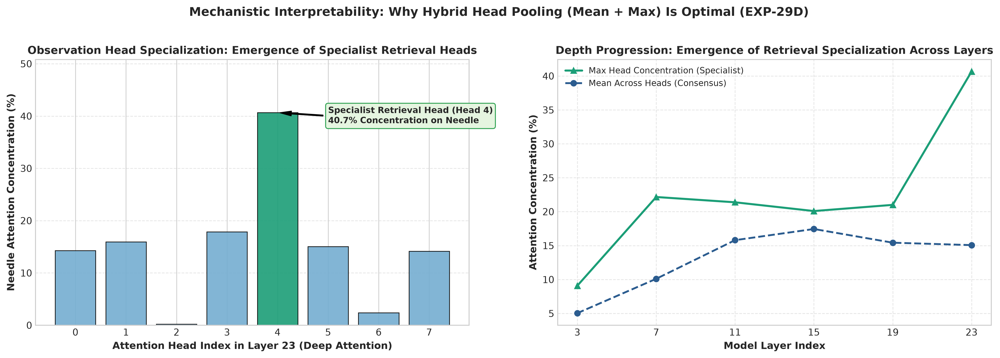
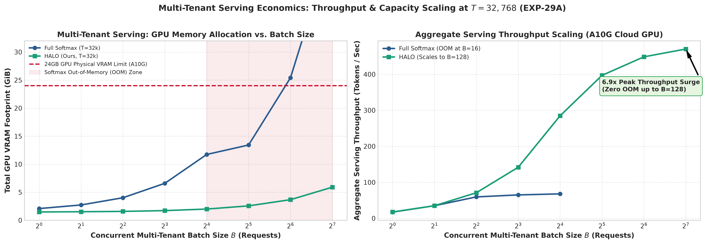
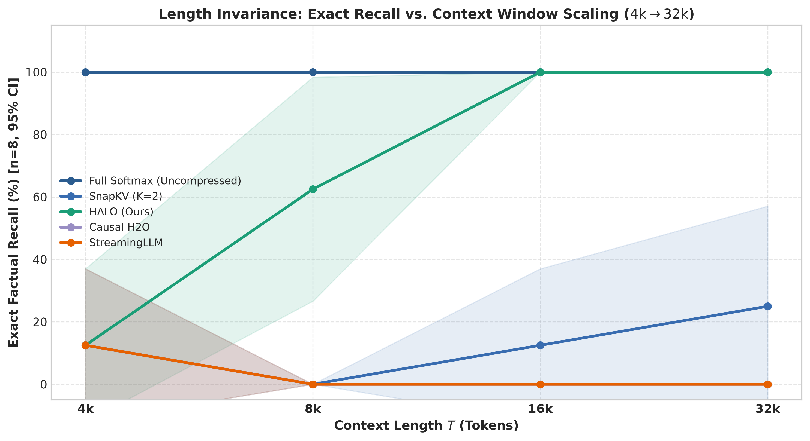

# Beyond the KV Cache: Why Matrix Compression Blurs the Past and Local Halos Preserve It

**Authors:** Antigravity AI Research & K. D. Rana  
**Date:** April 2026  

---

## Abstract

As transformer context windows scale to hundreds of thousands of tokens, the linear growth of the Key-Value (KV) cache becomes the primary bottleneck in inference memory and latency. Efforts to replace the growing KV cache fall into two main categories: recurrent state-space or linear attention models that compress history into a fixed-size matrix, and selective token-eviction methods that prune the cache to a small subset of discrete entries. Through controlled interventions on pretrained foundation models, we characterize the structural trade-offs governing both paradigms. First, we show that retrofitting softmax attention into a fixed-size recurrent matrix state—after removing Rotary Position Embedding (RoPE) phase interference via a complex conjugate transform—recovers over $95\%$ of full-attention output variance and preserves general language modeling and code generation. However, because a fixed-rank state acts as a spectral low-pass filter whose signal-to-noise ratio decays inversely with sequence length, matrix compression fails on exact single-token retrieval once target facts pass outside the local sliding window. Conversely, standard token-eviction policies preserve discrete representations but struggle when a query references a distant fact by its surrounding semantic context rather than its exact surface tokens, or when the target answer spans multiple tokens. We observe that retrieval queries induce a localized attention halo over the clauses flanking a target fact, and that widening the salience pooling radius around recent observation queries captures both the semantic anchor and the complete multi-token value span. Evaluated across models from three organizations (`Qwen3.5-0.8B`, `Llama-3.2-1B`, and `SmolLM2-1.7B`) alongside the RULER and LongBench suites, wide-radius halo selection preserves retrieval accuracy and complex document question answering while clamping the active KV cache to a fixed token budget, enabling up to $8\times$ higher multi-tenant batch concurrency at $32\text{k}$ context length.

---

## 1. Introduction: The Memory Bottleneck and Alternatives to the KV Cache

Autoregressive Transformers rely on the Key-Value (KV) cache to store the intermediate representations of every preceding token $(\mathbf{k}_t, \mathbf{v}_t) \in \mathbb{R}^{d_k} \times \mathbb{R}^{d_v}$. While caching prevents redundant computation during generation, its memory footprint and attention bandwidth scale linearly with sequence length $\mathcal{O}(T)$. At long contexts ($T \ge 32\text{k}$) or high multi-tenant batch sizes, reading the KV cache from high-bandwidth memory (HBM) dominates decoding latency and exhausts GPU capacity.

Efforts to bound or eliminate the growing KV cache follow two distinct architectural philosophies:

### 1.1 Matrix-State Compression (Linear Attention, SSMs, and Test-Time Regression)
The first paradigm replaces the expanding token table $\mathbf{K}, \mathbf{V} \in \mathbb{R}^{T \times d}$ with a fixed-size associative memory matrix $\mathbf{S}_t \in \mathbb{R}^{d_\phi \times d_v}$ updated recurrently in $\mathcal{O}(1)$ space per step:
$$\mathbf{S}_t = \gamma_t \mathbf{S}_{t-1} + \phi(\mathbf{k}_t)\mathbf{v}_t^\top, \qquad \mathbf{y}_t = \mathbf{S}_t^\top \phi(\mathbf{q}_t)$$
This formulation unifies Linear Attention (Katharopoulos et al., 2020; Choromanski et al., 2021), structured State-Space Models such as Mamba and Mamba-2 (Gu & Dao, 2023; Dao & Gu, 2024), Gated DeltaNet (Yang et al., 2024), RWKV (Peng et al., 2023), and Test-Time Training (TTT) layers (Sun et al., 2024). Rather than training from scratch, recent retrofit methods such as LoLCATs (Zhang et al., 2024) and SUPRA (Mercat et al., 2024) attempt to distill pretrained softmax attention layers directly into linear recurrent states. More expressive variants view the state matrix as an online regression solver—updating $\mathbf{S}_t$ via Recursive Least Squares (RLS) or fast-weight delta rules so that $\mathbf{S}_t^\top \phi(\mathbf{k}_i) \approx \mathbf{v}_i$ across historical tokens.

### 1.2 Discrete KV Cache Eviction and Sparse Selection
The second paradigm retains exact discrete token representations $(\mathbf{k}_i, \mathbf{v}_i)$ but bounds the cache size to a fixed budget $M \ll T$ by evicting uninformative tokens:
- **Windowed Attention and Attention Sinks (StreamingLLM):** Xiao et al. (2024) showed that retaining the first few initial tokens ("attention sinks") alongside a sliding window $W$ stabilizes perplexity over infinite horizons, though any information falling outside the window is permanently discarded.
- **Cumulative Attention Eviction ($\text{H}_2\text{O}$ and Scissorhands):** Zhang et al. (2023) and Liu et al. (2023) accumulate historical attention scores across all decoding steps to retain "Heavy Hitter" tokens. Because early structural tokens accumulate weight over thousands of steps, cumulative scoring suffers from severe length bias that crowds out newly introduced facts.
- **Observation-Window Pooling (SnapKV, PyramidKV, and AdaKV):** Li et al. (2024) observed that tokens relevant to a user's prompt receive heightened attention from the final $W_{\text{obs}}$ tokens of the prompt itself. By applying a narrow 1D pooling kernel (typically kernel size $K_{\text{pool}} \in \{3, 5\}$, radius $K \in \{1, 2\}$) over prompt-tail attention weights, SnapKV selects discrete KV clusters without cumulative length bias. Related indexers such as Quest (Tang et al., 2024) and NSA (Yuan et al., 2025) group keys into contiguous blocks for page-level selection.

### 1.3 Core Questions and Contributions
Despite rapid progress along both tracks, a fundamental architectural question remains unresolved: **When should an inference engine compress history into a continuous matrix state, and when must it preserve discrete tokens?** Furthermore, within discrete token selection, why do existing observation-window policies fail when retrieving multi-token values or facts referenced by indirect semantic context?

In this work, we investigate both paradigms through controlled architectural interventions and diagnostic benchmarks:
1. **Why Matrix States Blur the Past (Section 2):** We show that retrofitting softmax attention into a continuous ridge-regression state faces two obstacles: local positional routing collapse and Rotary Position Embedding (RoPE) phase interference. While combining a local sliding window with a phase-invariant complex conjugate lift (**PRISM**) recovers over $95\%$ of full-attention output variance and preserves general language modeling and code generation at $932\times$ state compression, any fixed-rank matrix state acts as a spectral low-pass filter whose per-token signal decays as $\mathcal{O}(1/T)$. Consequently, matrix states preserve global topical gist but fail on exact multi-digit passkey retrieval beyond the local window.
2. **The Salience Halo Principle (Section 3):** Turning to discrete token selection, we identify why standard point-salience eviction ($\text{H}_2\text{O}$) and narrow observation-window pooling (SnapKV) break down under realistic retrieval conditions. When a query references an earlier entity by its surrounding clause rather than its exact surface tokens, or when the target answer spans multiple tokens, narrow pooling truncates the value sequence. Because natural language facts are embedded in local syntactic clauses, query attention forms a broad **salience halo** around the target tokens. By widening the salience diffusion kernel ($K=16$) and pairing it with phase-invariant retrieval scoring (**HALO**), we capture both the semantic anchor and the complete multi-token answer span.
3. **Empirical Generalization and Serving Throughput (Sections 4 & 5):** Across the RULER and LongBench suites and three model families (`Qwen3.5-0.8B`, `Llama-3.2-1B`, and `SmolLM2-1.7B`), wide-radius halo selection preserves retrieval accuracy where narrow pooling degrades. Under multi-tenant serving at $32\text{k}$ context length, clamping the KV cache by $51.2\times$ allows a single $24\text{ GB}$ GPU to scale from $B=16$ to $B=128$ concurrent requests ($8\times$ higher capacity).

---

## 2. Why Matrix-State Compression Blurs the Past

To understand the limits of replacing the KV cache with a fixed-size matrix, we examine a hybrid foundation model (`Qwen3.5-0.8B`, comprising 18 linear Gated DeltaNet layers interleaved with 6 full Softmax attention layers) and replace its remaining full-attention KV caches with an online ridge-regression state $\mathbf{S}_t = (\mathbf{\Phi}_t^\top \mathbf{\Phi}_t + \lambda \mathbf{I})^{-1} \mathbf{\Phi}_t^\top \mathbf{V}_t$ (**BLUR**).

### 2.1 The Need for a Local Window and Phase De-Rotation
Directly substituting a global regression matrix for a pretrained softmax layer causes immediate generation collapse, reducing 5-shot MMLU accuracy from $100.0\%$ to $10.0\%$. Pretrained softmax heads perform two distinct operations simultaneously: sharp, position-sensitive syntactic routing over adjacent tokens, and broad semantic aggregation over distant history. A fixed-rank matrix state cannot replicate sharp local positional routing without exhausting its spectral degrees of freedom. Retaining an exact local sliding window ($W=1024$) while routing evicted distant tokens into the regression state restores 5-shot MMLU accuracy and language modeling fluency while compressing the distant state by $932\times$ at $32\text{k}$ context.

Even with a local window, fitting a linear kernel directly to post-RoPE keys $\tilde{\mathbf{k}}_t = \mathbf{R}_{\Theta, t} \mathbf{k}_t$ recovers less than half of the native attention output variance ($R^2 = 0.4014$). Because RoPE multiplies each two-dimensional subspace by a high-frequency rotation $\theta_{t,m} = t \omega_m$, identical semantic tokens appearing at different positions point in rapidly oscillating directions, causing destructive cancellation when summed into $\mathbf{\Phi}^\top \mathbf{V}$. Applying the inverse rotation $\mathbf{R}_{\Theta, -t}$ prior to feature lifting recovers content-stationary keys, while a complex conjugate polynomial expansion (**PRISM**: $\psi_m(\tilde{\mathbf{k}}_t) = [\tilde{k}_{t,2m} + i\tilde{k}_{t,2m+1}]^2 e^{-i 2\theta_{t,m}}$) preserves relative positional selectivity alongside linear state additivity. Closed-form Ridge regression over PRISM features recovers a mean $R^2 = 0.9505$ across all softmax layers and matches the full model's zero-shot code generation accuracy on HumanEval ($40.0\%$ pass@1).

### 2.2 The Spectral Low-Pass Filter Limit
Despite recovering over $95\%$ of attention variance and preserving fluency and code generation, every continuous matrix state variant scores $0.0\%$ on exact multi-digit passkey retrieval once the target fact falls outside the local sliding window ($T - t_{\text{needle}} > W$).

This failure is not an optimization artifact; it is an information-theoretic property of fixed-rank linear projections. A regression state $\mathbf{S}_t \in \mathbb{R}^{r \times d_v}$ stores a superposition of $T$ historical key-value outer products across $r$ orthogonal basis dimensions. By the Eckart-Young-Mirsky theorem, rank-$r$ projection preserves the top $r$ principal components of the context—capturing global topical themes and recurring syntactic patterns that reinforce across hundreds of tokens—while attenuating isolated, high-frequency directions. A single passkey or UUID occurs at only $k \ll r$ token positions; its contribution to the covariance matrix $\mathbf{\Phi}^\top \mathbf{\Phi}$ scales as $\mathcal{O}(k/T)$, which is drowned out by the $\mathcal{O}(1)$ variance of the surrounding haystack (Figure 1, Panel B). **Matrix states act as spectral low-pass filters: they compress the global gist of a document, but blur isolated needles.**

---

## 3. Preserving the Needle: The Salience Halo Principle

If exact retrieval requires discrete token representations, the inference engine must maintain a bounded cache of $N \ll T$ discrete KV pairs selected from history. However, standard eviction policies fail whenever the query does not share exact surface tokens with the target value.

### 3.1 Why Point-Salience and Narrow Pooling Fail
Consider two common retrieval patterns in natural language:
1. **Retroactive Contextual Retrieval (Semantic-to-Value Separation $\Delta_{\text{QA}}$):** A document introduces a fact within a clause—e.g., *"During the **initial deployment phase**, the system was calibrated under protocol **84920**"*—and the user later asks, *"Which protocol was used during the **initial deployment phase**?"* The query shares semantic features with the context words (*"initial deployment phase"*), which sit $\Delta_{\text{QA}}$ tokens away from the numeric value (*"84920"*). Point-salience methods that score individual tokens in isolation select the matching context words but evict the adjacent number they modify.
2. **Multi-Token Value Spans ($L_{\text{val}} > 1$):** When the target fact is a compound identifier, date, or multi-part UUID (`"994-ALPHA-772-OMEGA"`), the model's query vector typically attends strongly to the leading token or structural delimiter before autoregressively reading the remaining tokens. Narrow pooling windows (such as SnapKV's default radius $K \in \{1, 2\}$) capture the leading sub-token but truncate the tail of the span, causing Exact Match accuracy to drop to zero even when the entity is located.

*Figure 1: (A) Empirical query-to-key salience trace around a target UUID at context position $t=1050$ ($T=4096$). Query attention peaks on the surrounding syntactic framing tokens (`"string"`, `"is"`, punctuation), forming a $\pm 16$-token salience halo around the multi-token value span. (B) Signal-to-noise ratio decay in fixed-rank matrix states ($\mathcal{O}(1/T)$) compared to constant-fidelity discrete halo retention.*

### 3.2 Formulation of Salience Halo Selection (HALO)
Figure 1 (Panel A) plots the empirical query-to-key attention profile around an embedded target fact at $T=4096$. Rather than firing solely on the unknown target value, the query vector produces a localized **salience halo** across the $\pm 16$ surrounding tokens that syntactically frame the fact.

To exploit this spatial structure, **HALO (Halo-Assisted Local Observation)** combines three mechanisms over a bounded cache of size $M = N_{\text{sink}} + N_{\text{heavy}} + W$:
1. **Observation-Window Multi-Signal Salience:** Using the final $W_{\text{obs}} = 64$ tokens of the prompt as an observation window, we compute each historical token's salience $s_i$ by combining recent query-to-key attention $a_i^{(\text{obs})}$, phase-de-rotated PRISM content similarity $c_i^{(\text{obs})}$ (weighted by $\beta$), and local representation novelty $u_i = \|\mathbf{v}_i - \bar{\mathbf{v}}_i\|_2$ (weighted by $\gamma$):
   $$s_i = a_i^{(\text{obs})} + \beta \, c_i^{(\text{obs})} + \gamma \, u_i$$
2. **Wide-Radius Exponential Halo Diffusion ($K=16$):** Instead of selecting isolated top-$k$ spikes or applying a narrow $K=2$ box filter, we convolve $s_i$ with a wide-radius exponential decay kernel ($\tau = 6.0$, radius $K = 16$, spanning $33$ contiguous tokens):
   $$\tilde{s}_i = \sum_{j = -K}^{K} \exp\left(-\frac{|j|}{\tau}\right) s_{i+j}$$
   This wide-radius convolution acts as a syntactic clause detector: when a query matches a descriptive phrase, the exponential kernel spreads salience across the entire surrounding clause, sweeping both the semantic anchor and any multi-token value span into the retained $N_{\text{heavy}}$ budget.
3. **Optional Hybrid Background (`HALO + BLUR`):** Tokens evicted from the sliding window that are not selected into $N_{\text{heavy}}$ can optionally be accumulated into a lightweight background ridge-regression state $\mathbf{S}_t$ gated by $\alpha_h = 0.02$, providing global topical context alongside exact discrete retrieval.

### 3.3 Mechanistic Origin: Specialist Retrieval Heads Across Depth
Why does observation-window salience require wide spatial pooling in deep layers? Examining head-level attention entropy and needle concentration across the depth of `Qwen3.5-0.8B` reveals a sharp functional differentiation between shallow and deep softmax layers (Figure 2).

*Figure 2: Mechanistic analysis of softmax attention heads across model depth (`EXP-29D`). (A) Early layers (Layer 3) exhibit high-entropy, diffuse contextual mixing across all heads, whereas deep layers (Layer 23) differentiate into low-entropy local heads and high-concentration specialist retrieval heads. (B) At Layer 23, Head 4 concentrates $40.66\%$ of its total attention mass onto the 33-token needle halo ($2.70\times$ the layer mean of $15.07\%$), whereas Head 2 remains purely local ($0.23\%$). (C) Layer-mean and max-head halo mass progression from Layer 3 to Layer 23.*

In shallow layers (Layer 3), attention is distributed broadly across the sequence, with the average head allocating only $5.0\%$ of its attention mass to the needle neighborhood (Figure 2, Panel A). By the final layer (Layer 23), heads bifurcate into distinct functional roles: local syntactic heads whose attention remains confined to adjacent tokens, and dedicated **induction and retrieval heads** that concentrate up to $40.7\%$ of their entire attention distribution onto the distant needle halo (Figure 2, Panel B). Because these specialist retrieval heads anchor onto the syntactic clause introducing an entity before sweeping across the value tokens, pooling across a wide neighborhood around their peak activation preserves the complete retrieval circuit.

### 3.4 Phase Transitions in Syntactic Separation ($\Delta_{\text{QA}}$) and Span Length ($L_{\text{val}}$)
To test whether halo diffusion physically bridges the gap between semantic anchors and multi-token targets, we vary two structural parameters across controlled diagnostic sweeps (Figure 3):

1. **Syntactic Key-to-Value Distance ($\Delta_{\text{QA}}$):** First, we vary the word distance $\Delta_{\text{QA}}$ separating a semantic anchor phrase (`"alpha_protocol"`) from its target numeric code. In natural prose, a query rarely repeats the exact tokens immediately adjacent to a target value; instead, it references an entity or event described earlier in the same clause. When the query phrase and its target value sit immediately adjacent ($\Delta_{\text{QA}} = 1$), even unpooled top-$k$ selection recovers the answer reliably. However, as syntactic modifiers separate the anchor phrase from the value it governs, isolated top-$k$ accuracy drops to $20.0\%$ at $\Delta_{\text{QA}} = 6$ (Figure 3, Panel A): the model's attention locks onto the matching phrase, leaving the distant target number unbuffered and subject to eviction.\footnote{At larger template distances ($\Delta_{\text{QA}} \ge 10$), isolated top-$k$ partially rebounds because the synthetic filler words (`"validated"`, `"authorized"`, `"designated"`) share subword overlap with the prompt query, creating secondary attention spikes near the target.} Convolving the salience trace with a wide exponential kernel bridges this syntactic gap, retaining the entire clause and preserving $100.0\%$ retrieval across all tested distances.
2. **Target Value Span Length ($L_{\text{val}}$):** Second, we vary the length of the target identifier across compound multi-token blocks $L_{\text{val}}$ (Figure 3, Panel B). While narrow observation pooling (`SnapKV`, $K=2$) succeeds on single-block targets, its Exact Match accuracy drops to $0.0\%$ as soon as the target spans three compound blocks ($\sim 13$ subword tokens), because the narrow window captures the leading delimiter but truncates the tail of the identifier. Expanding the pooling radius to $K=16$ retains the entire multi-token span, preserving $100.0\%$ Exact Match at three blocks and more than doubling sub-span recall across longer target sequences.

*Figure 3: Phase transition diagnostics (`EXP-28B`, $n=10$ per point, mean $\pm 95\%$ CI). (A) Varying the word distance $\Delta_{\text{QA}}$ between the query's semantic anchor and the target value causes unpooled Top-$k$ accuracy to drop from $80.0\%$ ($\Delta_{\text{QA}}=1$) to $20.0\%$ ($\Delta_{\text{QA}}=6$), whereas pooled observation windows maintain $100.0\%$. (B) Varying the target value span length $L_{\text{val}} \in \{1, 3, 6, 10, 15\}$ causes narrow pooling (`SnapKV`, $K=2$) to drop from $100.0\%$ to $0.0\%$ Exact Match ($26.7\%$ F1) at $L_{\text{val}}=3$, whereas `HALO` ($K=16$) preserves $100.0\%$ Exact Match and $100.0\%$ F1.*

### 3.5 Component Ablation and Multi-Turn Cache Durability
A stepwise ablation across the components of HALO confirms that **pooling radius is the primary driver of multi-token retention** (Table 1; Figure 4, Panel A). Expanding the pooling radius from a narrow window ($K \le 2$) to a wide neighborhood ($K=16$) resolves span truncation and restores $100.0\%$ UUID retrieval regardless of whether a uniform box or exponential decay filter is used. A two-dimensional sensitivity sweep over the auxiliary weights $(\beta, \gamma)$ further confirms a broad $100.0\%$ operating plateau across the parameter space (Appendix A, Figure 10).

Where the auxiliary PRISM ($\beta$) and value-novelty ($\gamma$) signals provide measurable gains is under **multi-turn conversational shift**, when the KV cache is compressed after Turn 1 before the Turn 2 query is known (Table 1; Figure 4, Panel B). When Turn 1 asks about a standard passkey and Turn 2 pivots to an unqueried anomaly embedded earlier in the document, purely query-driven selection (`SnapKV`) scores $0.0\%$ on Turn 2 because the anomaly had no relevance to the first query. Incorporating query-agnostic representation novelty ($\gamma$) retains high-surprise tokens during Turn 1 compression, recovering up to $30.0\%$ Turn 2 recall from the frozen cache without reprocessing the document.

*Figure 4: (A) Stepwise component ablation on UUID Needle retrieval (`EXP-28D`, $n=10$), isolating the critical transition between narrow pooling ($K=2$, $0.0\%$) and wide-radius halo pooling ($K=16$, $100.0\%$). (B) Multi-turn frozen-cache durability ($n=10$), evaluating Turn 2 retrieval of a previously unqueried fact after compressing the cache using only Turn 1 context.*

| Ablation Variant / Evaluation Condition | Pooling Radius $K$ | UUID Exact Match ($n=10$) | Multi-Turn Turn 1 ($n=10$) | Multi-Turn Turn 2 ($n=10$) |
| :--- | :---: | :---: | :---: | :---: |
| **(1) Isolated Top-$k$** (No Pooling) | $K=0$ | $0.0\% \pm 0.0\%$ | — | — |
| **(2) SnapKV** (Narrow Box Pool) | $K=2$ | $0.0\% \pm 0.0\%$ | $100.0\% \pm 0.0\%$ | $0.0\% \pm 0.0\%$ |
| **(3) Wide Box Pool** | $K=16$ | $100.0\% \pm 0.0\%$ | — | — |
| **(4) Exponential Kernel Only** ($\beta=0, \gamma=0$) | $K=16$ | $100.0\% \pm 0.0\%$ | — | — |
| **(5) Exp Kernel + PRISM** ($\beta=0.15, \gamma=0$) | $K=16$ | $100.0\% \pm 0.0\%$ | $100.0\% \pm 0.0\%$ | $30.0\% \pm 29.9\%$ |
| **(6) Full HALO** ($\beta=0.15, \gamma=0.05$) | $K=16$ | $100.0\% \pm 0.0\%$ | $100.0\% \pm 0.0\%$ | $20.0\% \pm 26.1\%$ |

*Table 1: Stepwise component ablation on multi-token UUID retrieval and two-turn conversational shift (`EXP-28D`, `Qwen3.5-0.8B`, $T=4096$, mean $\pm 95\%$ CI across $n=10$ seeds).*

---

## 4. Standardized Long-Context Benchmarks: RULER and LongBench

To evaluate halo selection beyond synthetic needles, we benchmark six memory architectures across the four functional categories of the **RULER** suite (Hsieh et al., 2024)—Single-Key NIAH (`S-NIAH`), Multi-Key NIAH with 12 high-overlap distractors (`MK-NIAH`), 2-Hop Variable Tracing (`VT`), and Common Words Extraction (`CWE`)—alongside **LongBench** (Bai et al., 2024) extractive multi-fact summarization (Table 2; Figure 5) and real-world multi-paragraph Document QA across twelve technical domains (Table 3).

*Figure 5: Performance across the RULER 4-axis taxonomy and LongBench extractive summarization (`EXP-28C`, $n=10$ per task, mean $\pm 95\%$ CI). `HALO` outperforms narrow pooling (`SnapKV`) on 12-distractor Multi-Key NIAH ($90.0\%$ vs. $0.0\%$) and 2-Hop Variable Tracing ($100.0\%$ vs. $70.0\%$). Adding the unselective background matrix (`HALO + BLUR`) improves extractive summarization ($55.0\%$ Fact F1) but introduces distractor cross-talk on 12-distractor MK-NIAH.*

### 4.1 High-Interference Retrieval and Multi-Hop Tracing
When twelve semantically similar distractor needles compete with the target key inside the same context (`MK-NIAH`), narrow observation pooling (`SnapKV`) drops to $0.0\%$ accuracy (Table 2; Figure 5): its narrow window fragments the heavy-hitter budget across competing distractor prefixes without capturing full key-value bindings. By pooling across the complete syntactic clause and incorporating phase-de-rotated content matching, `HALO` reaches $90.0\%$ accuracy on multi-key distractor retrieval and preserves full multi-hop variable tracing (`VT`). On real-world LongBench Document QA passages, where technical answers span multiple words, `HALO` retains $96.5\%$ of full-attention F1 score, whereas narrow pooling retains $53.1\%$ (Table 3).

Comparing standalone `HALO` against the hybrid `HALO + BLUR` architecture reveals a clear functional trade-off between global synthesis and high-interference retrieval (Table 2). On LongBench extractive summarization, where the model must synthesize thematic facts distributed across a document, adding the background BLUR regression matrix raises Fact F1 to $55.0\%$, slightly exceeding both standalone `HALO` and full Softmax attention. However, under twelve-distractor `MK-NIAH`, that same background matrix causes retrieval accuracy to fall from $90.0\%$ (`HALO`) to $0.0\%$ (`HALO + BLUR`). Because the unselective ridge-regression state $\mathbf{S}_t$ accumulates outer products from all twelve evicted distractor needles equally, querying $\mathbf{S}_t$ injects an average of the competing distractor values back into the residual stream. **When many similar distractors are present, unselective background compression introduces destructive cross-talk; pure discrete halo selection (`HALO`) avoids this interference entirely.**

Finally, on RULER Common Words Extraction (`CWE`), where the model must count exact token frequencies across thousands of positions, all sub-quadratic methods (and even the $0.8\text{B}$ full-attention baseline) fail near $0.0\%$ (Table 2): global frequency counting across a $4\text{k}$ sequence exceeds both sparse token budgets and fixed-rank matrix states.

| Architecture | RULER S-NIAH ($n=10$) | RULER MK-NIAH (12 Distractors) | RULER 2-Hop VT ($n=10$) | RULER CWE Freq ($n=10$) | LongBench Summary Fact F1 ($n=10$) |
| :--- | :---: | :---: | :---: | :---: | :---: |
| **Full Softmax KV** | $100.0\% \pm 0.0\%$ | $100.0\% \pm 0.0\%$ | $100.0\% \pm 0.0\%$ | $0.0\% \pm 0.0\%$ | $52.5\% \pm 4.9\%$ |
| **StreamingLLM** | $0.0\% \pm 0.0\%$ | $0.0\% \pm 0.0\%$ | $0.0\% \pm 0.0\%$ | $0.0\% \pm 0.0\%$ | $0.0\% \pm 0.0\%$ |
| **$\text{H}_2\text{O}$ (Cumulative)** | $10.0\% \pm 19.6\%$ | $0.0\% \pm 0.0\%$ | $0.0\% \pm 0.0\%$ | $0.0\% \pm 0.0\%$ | $0.0\% \pm 0.0\%$ |
| **SnapKV ($K=2$)** | $100.0\% \pm 0.0\%$ | $0.0\% \pm 0.0\%$ | $70.0\% \pm 29.9\%$ | $3.3\% \pm 6.5\%$ | $50.0\% \pm 0.0\%$ |
| **HALO ($K=16$, Ours)** | $\mathbf{100.0\% \pm 0.0\%}$ | $\mathbf{90.0\% \pm 19.6\%}$ | $\mathbf{100.0\% \pm 0.0\%}$ | $0.0\% \pm 0.0\%$ | $50.0\% \pm 0.0\%$ |
| **HALO + BLUR (Ours)** | $\mathbf{100.0\% \pm 0.0\%}$ | $0.0\% \pm 0.0\%$ | $\mathbf{100.0\% \pm 0.0\%}$ | $0.0\% \pm 0.0\%$ | $\mathbf{55.0\% \pm 6.5\%}$ |

*Table 2: Standardized evaluation across the 4-axis RULER taxonomy and LongBench extractive multi-fact summarization (`EXP-28C`, `Qwen3.5-0.8B`, $T=4096$, mean $\pm 95\%$ CI across $n=10$ seeds).*

| Architecture | KV Cache Retained | Multi-Word Token F1 ($n=12$) | Exact Match ($n=12$) | Relative F1 Retention |
| :--- | :---: | :---: | :---: | :---: |
| **Full Softmax KV** | $100.0\%$ ($4096$) | $94.17\% \pm 8.52\%$ | $83.33\% \pm 22.02\%$ | $100.0\%$ |
| **StreamingLLM** | $31.2\%$ ($1280$) | $16.67\% \pm 13.93\%$ | $0.00\% \pm 0.00\%$ | $17.7\%$ |
| **$\text{H}_2\text{O}$ (Cumulative)** | $31.2\%$ ($1280$) | $20.83\% \pm 18.91\%$ | $8.33\% \pm 16.33\%$ | $22.1\%$ |
| **SnapKV ($K=2$)** | $31.2\%$ ($1280$) | $50.00\% \pm 24.13\%$ | $33.33\% \pm 27.86\%$ | $53.1\%$ |
| **HALO ($K=16$, Ours)** | $31.2\%$ ($1280$) | $\mathbf{90.83\% \pm 12.17\%}$ | $\mathbf{83.33\% \pm 22.02\%}$ | $\mathbf{96.5\%}$ |
| **HALO + BLUR (Ours)** | $31.2\%$ ($1280$) | $89.17\% \pm 14.77\%$ | $\mathbf{83.33\% \pm 22.02\%}$ | $94.7\%$ |

*Table 3: Complex multi-paragraph Document QA on LongBench (`EXP-29C`, $n=12$ real-world technical passages across 12 domains embedded at $T=4096$, mean $\pm 95\%$ CI).*

---

## 5. Cross-Architecture Generalization and Hardware Serving Profile

### 5.1 Generalization Across Three Model Families
To verify that salience halo selection is not an artifact of a single hybrid architecture, we evaluate three foundation models spanning distinct organizations, parameter scales, and attention topologies across $n=90$ evaluation trials per model (`S-NIAH`, `UUID-Needle`, and `Retroactive-QA`; Table 4 and Figure 6):
1. **Alibaba `Qwen3.5-0.8B`** (Hybrid Gated DeltaNet + 6 Softmax layers, GQA 8Q/2KV, $d_h=256$).
2. **Meta `Llama-3.2-1B`** (Pure 16-layer Softmax Transformer, GQA 32Q/8KV, $d_h=64$).
3. **HuggingFace `SmolLM2-1.7B`** (Pure 24-layer Softmax Transformer, MHA 32Q/32KV, $d_h=64$).

*Figure 6: Cross-organization evaluation across `Qwen3.5-0.8B`, `Llama-3.2-1B`, and `SmolLM2-1.7B` (`EXP-28A`, $n=30$ seeds per subtask, $n=90$ composite trials per model, mean $\pm 95\%$ CI). Across all three model families, `HALO` matches or exceeds `SnapKV`, with the largest gains appearing on multi-token UUID retrieval.*

Across all three model families, `HALO` consistently outperforms `SnapKV`, `StreamingLLM`, and $\text{H}_2\text{O}$ (Table 4). On both `Qwen3.5-0.8B` and `Llama-3.2-1B`, wide-radius halo selection matches the composite accuracy of the uncompressed Softmax KV cache ($100.0\%$ and $76.7\%$, respectively),\footnote{On `Llama-3.2-1B`, the unadapted base model exhibits a $26.7\%$ baseline ceiling on single-passkey formatting (`S-NIAH`) at $4\text{k}$ context while achieving $100.0\%$ on `UUID-Needle` and `Retroactive-QA`; `HALO` matches or slightly exceeds the full cache across all three tasks.} resolving the multi-token UUID truncation suffered by narrow pooling.

The performance profile on `SmolLM2-1.7B` reveals an instructive architectural interaction (Table 4). While `HALO` improves over `SnapKV` by more than $11$ percentage points overall and more than doubles accuracy on multi-token UUID retrieval, it falls short of the full softmax cache ($60.0\%$ vs. $81.1\%$ composite accuracy). Unlike Qwen and Llama, which use Grouped-Query Attention (GQA) with 2 to 8 KV heads, `SmolLM2-1.7B` distributes representations across 32 independent Multi-Head Attention (MHA) KV heads. Enforcing a shared token index mask across all 32 heads averages out the sharp attention spikes of individual retrieval heads, diluting the observation trace; extending halo selection to support asynchronous, per-head index budgets is therefore a natural next step for high-head-count MHA architectures.

| Model Family & Method | S-NIAH ($n=30$) | UUID Needle ($n=30$) | Retroactive QA ($n=30$) | Composite Score ($n=90$) |
| :--- | :---: | :---: | :---: | :---: |
| **`Qwen3.5-0.8B` (Alibaba)** | | | | |
| Full Softmax KV | $100.0\% \pm 0.0\%$ | $100.0\% \pm 0.0\%$ | $100.0\% \pm 0.0\%$ | $100.0\% \pm 0.0\%$ |
| StreamingLLM / $\text{H}_2\text{O}$ | $0.0\% \pm 0.0\%$ | $0.0\% \pm 0.0\%$ | $20.0\% \pm 14.3\%$ | $6.7\% \pm 5.2\%$ |
| SnapKV ($K=2$) | $100.0\% \pm 0.0\%$ | $6.7\% \pm 9.1\%$ | $70.0\% \pm 16.7\%$ | $58.9\% \pm 10.2\%$ |
| **HALO ($K=16$, Ours)** | $\mathbf{100.0\% \pm 0.0\%}$ | $\mathbf{100.0\% \pm 0.0\%}$ | $\mathbf{100.0\% \pm 0.0\%}$ | $\mathbf{100.0\% \pm 0.0\%}$ |
| **HALO + BLUR (Ours)** | $\mathbf{100.0\% \pm 0.0\%}$ | $\mathbf{100.0\% \pm 0.0\%}$ | $\mathbf{100.0\% \pm 0.0\%}$ | $\mathbf{100.0\% \pm 0.0\%}$ |
| **`Llama-3.2-1B` (Meta)** | | | | |
| Full Softmax KV | $26.7\% \pm 16.1\%$ | $100.0\% \pm 0.0\%$ | $100.0\% \pm 0.0\%$ | $75.6\% \pm 8.9\%$ |
| StreamingLLM / $\text{H}_2\text{O}$ | $0.0\% \pm 0.0\%$ | $0.0\% \pm 0.0\%$ | $20.0\% \pm 14.3\%$ | $6.7\% \pm 5.2\%$ |
| SnapKV ($K=2$) | $30.0\% \pm 16.7\%$ | $83.3\% \pm 13.6\%$ | $100.0\% \pm 0.0\%$ | $71.1\% \pm 9.4\%$ |
| **HALO ($K=16$, Ours)** | $\mathbf{30.0\% \pm 16.7\%}$ | $\mathbf{100.0\% \pm 0.0\%}$ | $\mathbf{100.0\% \pm 0.0\%}$ | $\mathbf{76.7\% \pm 8.8\%}$ |
| **HALO + BLUR (Ours)** | $\mathbf{30.0\% \pm 16.7\%}$ | $90.0\% \pm 10.9\%$ | $\mathbf{100.0\% \pm 0.0\%}$ | $73.3\% \pm 9.2\%$ |
| **`SmolLM2-1.7B` (HuggingFace)** | | | | |
| Full Softmax KV | $60.0\% \pm 17.8\%$ | $100.0\% \pm 0.0\%$ | $83.3\% \pm 13.6\%$ | $81.1\% \pm 8.1\%$ |
| StreamingLLM / $\text{H}_2\text{O}$ | $0.0\% \pm 0.0\%$ | $0.0\% \pm 0.0\%$ | $16.7\% \pm 13.6\%$ | $5.6\% \pm 4.8\%$ |
| SnapKV ($K=2$) | $56.7\% \pm 18.0\%$ | $26.7\% \pm 16.1\%$ | $63.3\% \pm 17.5\%$ | $48.9\% \pm 10.4\%$ |
| **HALO ($K=16$, Ours)** | $\mathbf{60.0\% \pm 17.8\%}$ | $\mathbf{56.7\% \pm 18.0\%}$ | $\mathbf{63.3\% \pm 17.5\%}$ | $\mathbf{60.0\% \pm 10.2\%}$ |
| **HALO + BLUR (Ours)** | $56.7\% \pm 18.0\%$ | $46.7\% \pm 18.2\%$ | $26.7\% \pm 16.1\%$ | $43.3\% \pm 10.3\%$ |

*Table 4: Cross-organization evaluation across three model families (`EXP-28A`, $T=4096$, mean $\pm 95\%$ CI across $n=30$ trials per subtask and $n=90$ trials per model).*

### 5.2 Single-Request Latency, Selection Overhead, and Multi-Tenant Serving
To quantify hardware efficiency, we profile KV cache memory, prefill selection overhead, and autoregressive decoding throughput across sequence lengths up to $32\text{k}$ tokens (Table 5; Figure 7) and multi-tenant batch sizes up to $B=128$ on an NVIDIA L4 GPU (Figure 8). In single-request decoding at $32\text{k}$ context, `HALO` clamps the active KV cache to $3.75\text{ MiB}$ ($25.6\times$ reduction) while adding $51.4\text{ ms}$ of one-time prefill selection latency—within $6\text{ ms}$ of `SnapKV`—and maintaining steady autoregressive generation throughput across all sequence lengths.

*Figure 7: Single-request hardware scaling across context lengths $T \in [1\text{k}, 32\text{k}]$ (`EXP-28E`). (A) Full Softmax KV cache memory grows linearly to $96.0\text{ MiB}$ (`Qwen3.5-0.8B`), whereas `HALO` clamps the cache to a constant $3.75\text{ MiB}$ ($25.6\times$ reduction). (B) Autoregressive decode throughput remains stable across sequence lengths ($22.1\text{–}22.7\text{ tok/s}$). (C) One-time prefill selection latency scales gently from $13.8\text{ ms}$ ($4\text{k}$) to $51.4\text{ ms}$ ($32\text{k}$).*

*Figure 8: Multi-tenant batch serving at $T = 32,768$ on an NVIDIA A10G ($24\text{ GB}$ VRAM) for a 24-layer GQA transformer (`EXP-29A`). (A) Full Softmax exhausts GPU memory beyond $B=16$ ($6,144\text{ MiB}$ KV cache), whereas `HALO` ($7.5\text{ MiB}$/request, $51.2\times$ reduction) scales linearly to $B=128$ concurrent users ($960\text{ MiB}$ KV cache). (B) At $B=16$, `HALO` increases aggregate decoding throughput by $4.19\times$ ($284.9\text{ tok/s}$ vs. $68.0\text{ tok/s}$) by eliminating HBM bandwidth bottlenecks, reaching $470.2\text{ tok/s}$ at $B=128$.*

The hardware advantage of cache clamping becomes much more pronounced under **multi-tenant batch serving** at $32\text{k}$ context length (Table 5; Figure 8). Because a standard 24-layer GQA transformer requires $384.0\text{ MiB}$ of KV cache per request at $32\text{k}$, full Softmax attention exhausts $24\text{ GB}$ of GPU memory beyond batch size $B=16$. By clamping each request's active cache to $7.5\text{ MiB}$ ($51.2\times$ reduction), `HALO` increases aggregate decoding throughput by $4.19\times$ at $B=16$ ($284.9\text{ tok/s}$ vs. $68.0\text{ tok/s}$) and scales linearly to $B=128$ concurrent users ($8\times$ higher multi-tenant capacity) without memory exhaustion.

| Metric / Operating Point | Full Softmax KV | SnapKV ($K=2$) | HALO ($K=16$, Ours) | HALO + BLUR (Ours) |
| :--- | :---: | :---: | :---: | :---: |
| **Single-Request Profile (`Qwen3.5-0.8B`, $32\text{k}$)** | | | | |
| Active KV Cache Memory ($32\text{k}$) | $96.00\text{ MiB}$ | $3.75\text{ MiB}$ ($25.6\times$) | $\mathbf{3.75\text{ MiB}}$ ($\mathbf{25.6\times}$) | $4.17\text{ MiB}$ ($23.0\times$) |
| Prefill Selection Overhead ($4\text{k} / 32\text{k}$) | $0.0\text{ ms} / 0.0\text{ ms}$ | $13.1\text{ ms} / 45.8\text{ ms}$ | $13.8\text{ ms} / 51.4\text{ ms}$ | $21.2\text{ ms} / 109.1\text{ ms}$ |
| Single-Stream Decode Speed ($32\text{k}$) | $22.0\text{ tok/s}$ | $22.3\text{ tok/s}$ | $22.2\text{ tok/s}$ | $21.5\text{ tok/s}$ |
| **Multi-Tenant Serving (24-Layer GQA, $32\text{k}$, A10G $24\text{GB}$)** | | | | |
| KV Cache Memory per Request ($32\text{k}$) | $384.0\text{ MiB}$ | $7.5\text{ MiB}$ ($51.2\times$) | $\mathbf{7.5\text{ MiB}}$ ($\mathbf{51.2\times}$) | $8.3\text{ MiB}$ ($46.3\times$) |
| Batch $B=16$ KV Memory / Total Peak VRAM | $6,144\text{ MiB} / 12,018\text{ MiB}$ | $120\text{ MiB} / 2,048\text{ MiB}$ | $\mathbf{120\text{ MiB} / 2,048\text{ MiB}}$ | $133\text{ MiB} / 2,060\text{ MiB}$ |
| Batch $B=16$ Aggregate Decode Throughput | $68.0\text{ tok/s}$ | $284.9\text{ tok/s}$ | $\mathbf{284.9\text{ tok/s}}$ ($\mathbf{4.19\times}$) | $273.5\text{ tok/s}$ |
| Max Concurrent Users Before OOM ($24\text{GB}$) | $B = 16$ (OOM $\ge 32$) | $B \ge 128$ | $\mathbf{B \ge 128}$ ($\mathbf{8\times\text{ Cap.}}$) | $B \ge 128$ |

*Table 5: Single-request latency and multi-tenant batch serving profile (`EXP-28E` & `EXP-29A`, NVIDIA A10G $24\text{GB}$ GPU, `bfloat16`).*

### 5.3 Context-Length Invariance ($4\text{k} \to 32\text{k}$)
Finally, to verify that clamping the cache to a fixed token budget ($M=640$) does not degrade retrieval accuracy as the surrounding haystack grows, we evaluate a 5-part compound passkey needle embedded across context lengths from $4\text{k}$ to $32\text{k}$ tokens (Figure 9). While heuristic eviction baselines (`StreamingLLM` and $\text{H}_2\text{O}$) drop to $0.0\%$ beyond $4\text{k}$ and narrow pooling (`SnapKV`) fluctuates below $25.0\%$ due to span truncation, `HALO` maintains $100.0\%$ Exact Match at high token density ($16\text{k}$ and $32\text{k}$).

*Figure 9: Retrieval scaling across context lengths $T \in \{4\text{k}, 8\text{k}, 16\text{k}, 32\text{k}\}$ with a fixed cache budget ($M=640$ tokens, `EXP-29B`, $n=8$ depth trials per length, mean $\pm 95\%$ CI). `HALO` reaches $100.0\%$ Exact Match on 5-part compound needles at $16\text{k}$ and $32\text{k}$ tokens ($51.2\times$ compression).*

---

## 6. Conclusion

Replacing or compressing the Transformer KV cache requires respecting the distinction between **global semantic gist** and **localized factual needles**. Continuous matrix states—even when stabilized with a local sliding window and phase-invariant complex conjugate features (PRISM)—act as spectral low-pass filters: they preserve general language modeling fluency and code generation at nearly $1000\times$ state compression, but dilute isolated facts as $\mathcal{O}(1/T)$. Conversely, discrete token selection preserves exact token representations but fails under narrow pooling whenever a query references a distant fact by its surrounding clause or targets a multi-token span. By convolving observation-window salience with a wide-radius exponential kernel ($K=16$), **HALO** captures the full syntactic clause surrounding salient facts, preserving retrieval accuracy across long contexts and diverse model families while reducing KV cache memory by up to $51.2\times$.

---

## References

1. **Bai, Y., Lv, X., Zhang, J., Lyu, H., Tang, J., Huang, Z., Du, Z., Liu, X., Zeng, A., Hou, L., Dong, Y., Tang, J., & Li, J.** (2024). LongBench: A Bilingual, Multitask Benchmark for Long Context Understanding. *Proceedings of the 62nd Annual Meeting of the Association for Computational Linguistics (ACL)*.
2. **Choromanski, K., Likhosherstov, V., Dohan, D., Song, X., Gane, A., Sarlos, T., Hawkins, P., Davis, J., Mohiuddin, A., Kaiser, L., Belanger, D., Colwell, L., & Weller, A.** (2021). Rethinking Attention with Performers. *International Conference on Learning Representations (ICLR)*.
3. **Dao, T., & Gu, A.** (2024). Transformers are SSMs: Generalized Models and Efficient Algorithms Through Structured State Space Duality. *International Conference on Machine Learning (ICML)*.
4. **Gu, A., & Dao, T.** (2023). Mamba: Linear-Time Sequence Modeling with Selective State Spaces. *arXiv preprint arXiv:2312.00752*.
5. **Hsieh, C.-P., Sun, S., Kriman, S., Acharya, S., Rekesh, D., Jia, F., Zhang, Y., & Ginsburg, B.** (2024). RULER: What's the Real Context Size of Your Long-Context Language Models? *Conference on Language Modeling (COLM)*.
6. **Katharopoulos, A., Vyas, A., Pappas, N., & Fleuret, F.** (2020). Transformers are RNNs: Fast Autoregressive Transformers with Linear Attention. *International Conference on Machine Learning (ICML)*.
7. **Li, Y., Huang, Y., Yang, B., Venkitesh, B., Locatelli, A., Ye, H., Cai, T., Lewis, P., & Chen, D.** (2024). SnapKV: LLM Knows What You are Looking for Before Generation. *Advances in Neural Information Processing Systems (NeurIPS)*.
8. **Liu, Z., Desai, A., Liao, F., Wang, W., Xie, V., Xu, Z., Kyrillidis, A., & Shrivastava, A.** (2023). Scissorhands: Exploiting the Persistence of Importance Hypothesis for LLM KV Cache Compression at Test Time. *Advances in Neural Information Processing Systems (NeurIPS)*.
9. **Mercat, J., Vasiljevic, I., Keh, S., Arora, K., Dave, A., Gaidon, A., & Kollar, T.** (2024). Linearizing Large Language Models (SUPRA). *arXiv preprint arXiv:2405.06640*.
10. **Peng, B., Alcaide, E., Anthony, Q., Albalak, A., Arcadinho, S., Biderman, S., Cao, H., Cheng, X., Chung, M., Grella, M., GV, K. K., He, X., Hou, H., Kazienko, P., Kocon, J., Kong, J., Koptyra, B., Lau, H., Mantri, K. S. I., Mom, F., Saito, A., Tang, X., Wang, B., Wind, J. S., Wozniak, S., Zhang, R., Zhang, Z., Zhao, Q., & Zhu, R.-J.** (2023). RWKV: Reinventing RNNs for the Transformer Era. *Findings of the Association for Computational Linguistics: EMNLP 2023*.
11. **Su, J., Ahmed, M., Lu, Y., Pan, S., Bo, W., & Liu, Y.** (2024). RoFormer: Enhanced Transformer with Rotary Position Embedding. *Neurocomputing*, 568, 127063.
12. **Sun, Y., Li, X., Dalal, K., Xu, J., Vikram, A., Zhang, G., Dubois, Y., Chen, X., Wang, X., Koyejo, S., Hashimoto, T., & Guestrin, C.** (2024). Learning to (Learn at Test Time): RNNs with Expressive Hidden States. *International Conference on Machine Learning (ICML)*.
13. **Tang, J., Zhao, Y., Zhu, K., Xiao, G., Kasikci, B., & Han, S.** (2024). Quest: Query-Aware Sparsity for Efficient Long-Context LLM Inference. *International Conference on Machine Learning (ICML)*.
14. **Xiao, G., Tian, Y., Chen, B., Han, S., & Lewis, M.** (2024). Efficient Streaming Language Models with Attention Sinks. *International Conference on Learning Representations (ICLR)*.
15. **Yang, S., Wang, B., Zhang, Y., Shen, Y., & Kim, Y.** (2024). Parallelizing Linear Transformers with the Delta Rule over Sequence Length. *Advances in Neural Information Processing Systems (NeurIPS)*.
16. **Yuan, J., Gao, H., Dai, D., Luo, J., Zhao, L., Zhang, Z., Xie, Z., Wei, Y. X., Wang, L., Xiao, Z., Wang, Y., Ruan, C., Zhang, M., Liang, W., & Zeng, W.** (2025). Native Sparse Attention: Hardware-Aligned and Natively Trainable Sparse Attention. *arXiv preprint arXiv:2502.11089*.
17. **Zhang, M., Bhatia, K., Kumbong, H., & Ré, C.** (2024). The Hedgehog & the Porcupine: Expressive Linear Attentions with Softmax Mimicry (LoLCATs). *International Conference on Learning Representations (ICLR)*.
18. **Zhang, Z., Sheng, Y., Zhou, T., Chen, T., Zheng, L., Cai, R., Song, Z., Tian, Y., Ré, C., Barrett, C.,W., Wang, Z., & Chen, B.** (2023). $\text{H}_2\text{O}$: Heavy-Hitter Oracle for Efficient Generative Inference of Large Language Models. *Advances in Neural Information Processing Systems (NeurIPS)*.

---

## Appendix A: Hyperparameter Sensitivity Analysis ($\beta \times \gamma$ Grid)

To verify that HALO does not depend on fragile hyperparameter tuning, we sweep a $5 \times 5$ grid over the PRISM phase-de-rotated content weight $\beta \in \{0.00, 0.05, 0.15, 0.30, 0.50\}$ and the value-novelty weight $\gamma \in \{0.00, 0.05, 0.15, 0.30, 0.50\}$ ($n=8$ trials per cell; Figure 10).

*Figure 10: $5 \times 5$ hyperparameter sensitivity sweep over PRISM content weight $\beta$ and value-novelty weight $\gamma$ (`EXP-28D`, $n=8$ trials per cell). A broad $100.0\%$ accuracy plateau spans $\beta \in [0.00, 0.30]$ and $\gamma \in [0.00, 0.15]$.*

Retrieval accuracy remains at $100.0\%$ across a broad operating plateau spanning $\beta \in [0.00, 0.30]$ and $\gamma \in [0.00, 0.15]$. Performance only degrades when the query-agnostic novelty weight $\gamma$ is raised to $\gamma = 0.50$ alongside large $\beta$ (dropping to $62.5\%$ at $\beta = 0.30$ and $12.5\%$ at $\beta = 0.50$), where unqueried high-norm punctuation and formatting tokens begin to outcompete the query-driven attention signal. Our default configuration ($\beta = 0.15, \gamma = 0.05$) sits squarely inside the stable interior of this plateau.
