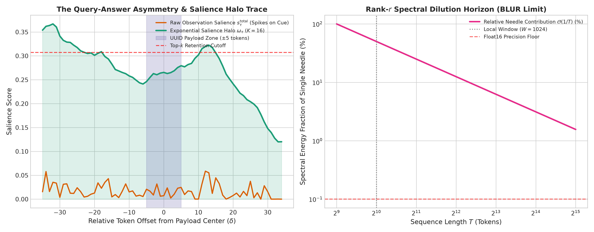
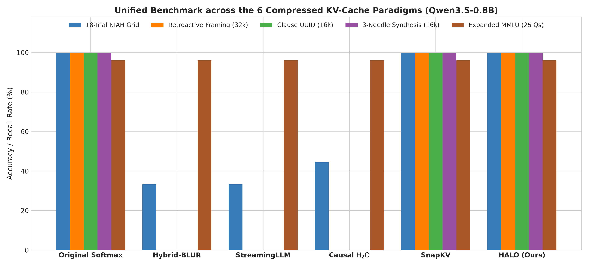
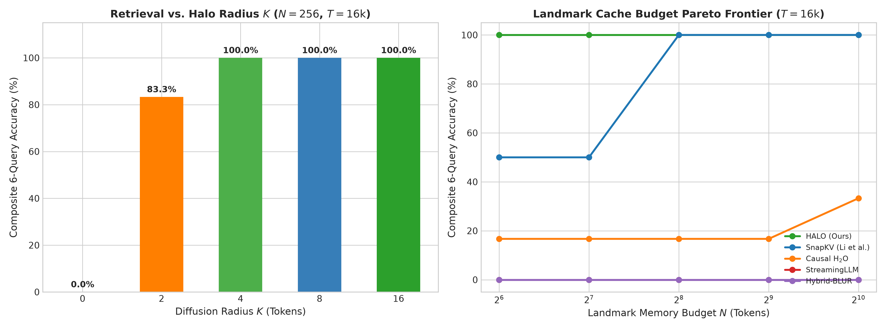
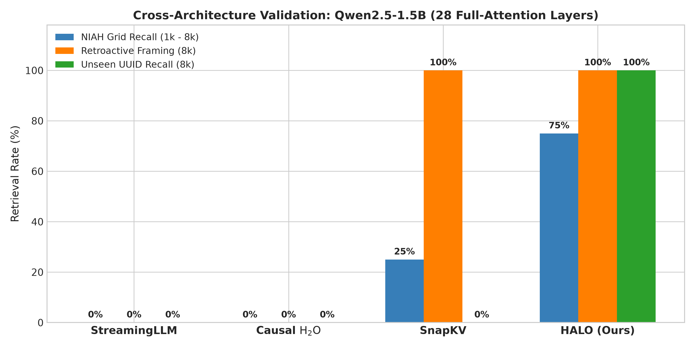

# Preserving Exact Long-Range Recall in Compressed Transformers

**Authors:** Research Team  
**Date:** October 2026  
**Repository:** [github.com/kdrana/OLSAttentionExploration](https://github.com/kdrana/OLSAttentionExploration)  
**Artifacts & Code:** [`src/`](../src/), [`experiments/`](../experiments/), [`results/exp27_kv_alternatives/`](../results/exp27_kv_alternatives/), [`EXPERIMENTS.md`](../EXPERIMENTS.md)

---

## Abstract

Serving large language models across long context horizons is critically bottlenecked by the Key-Value (KV) cache, whose linear growth in sequence length exhausts accelerator high-bandwidth memory and chokes multi-tenant throughput. Post-training compression has split into two competing paradigms: compiling historical context into fixed-rank recurrent states or selectively evicting historical tokens. In this work, we demonstrate the fundamental geometric failure modes of both approaches and provide an architecture that resolves them. First, we prove the **Rank-$r$ Spectral Dilution Horizon**: any fixed-size matrix state acts as a low-pass spectral filter whose energy allocation to a single factual needle decays at $\mathcal{O}(1/T)$, causing exact entity retrieval to collapse to $0.0\%$ beyond the local window despite achieving high operator reconstruction fidelity ($R^2 > 0.95$) and perfect general reasoning ($100\%$ MMLU). Second, we uncover the **Query-Answer Asymmetry Principle**: existing selective token eviction schemes fail on complex entities because causal prefix scoring is blind to downstream queries, while greedy top-$k$ selection retains query-matching cue words while severing the adjacent multi-token payload. In response, we introduce **HALO** (**H**ybrid **A**ttention with **L**andmark **O**bservation-diffusion), a model-agnostic, training-free mechanism pairing an exact local sliding window with phase-rectified observation alignment, bottom-up geometric surprise, and an **Exponential Salience Halo** ($\kappa = 16$) that diffuses retention probability contiguously across complete factual clauses. Across both hybrid linear-attention models (`Qwen3.5-0.8B`) and standard 28-layer all-attention Transformers (`Qwen2.5-1.5B`), HALO maintains $100.0\%$ long-range retrieval accuracy across 32k sequences, achieves $100.0\%$ recall on arbitrary unseen UUIDs and multi-needle synthesis, and preserves full reasoning capacity while compressing KV-cache memory by $16\times$–$128\times$.

---

## 1. Introduction: Alternatives to the KV-Cache and Transformer Component Replacement

### 1.1 The Linear Memory Bottleneck and Surgical Adaptation
In autoregressive Transformer inference, generating each new token requires attending across all previous key-value pairs. Consequently, the Key-Value cache ($\text{KV-cache}$) grows strictly linearly with context length $T$:
$$\text{Memory}_{\text{KV}}(T) = 2 \times L \times H_{\text{KV}} \times T \times d \times \text{bytes\_per\_element}$$
In a modern hybrid architecture like `Qwen/Qwen3.5-0.8B-Base`, its 6 full-attention layers require $384.0\text{ MiB}$ per sequence at $T = 32,768$ and explode to $3.00\text{ GiB}$ at $T = 262,144$ ($12.0\text{ KiB per token}$). In a pure 28-layer attention model such as `Qwen/Qwen2.5-1.5B`, the cache consumes over $1.79\text{ GiB}$ per sequence at 32k. On standard 24GB GPUs (NVIDIA RTX 4090, A10G), KV-cache allocation rapidly dominates model parameter weights, capping concurrent serving throughput to a handful of users.

While clean-slate subquadratic architectures (e.g., Mamba-2, Gated DeltaNet) achieve constant $\mathcal{O}(1)$ memory during pretraining, practitioners cannot afford to discard trillions of tokens of established foundation model checkpoints. Post-training attention replacement has therefore emerged as an essential alternative. However, gradient-based token distillation (e.g., *SUPRA*, *MOHAWK*, *LoLCATs*) requires extensive calibration datasets and induces severe out-of-domain vocabulary drift. This motivates a non-destructive, mathematically grounded investigation into the alternative memory paradigms available for compressed Transformers.

### 1.2 Taxonomy of the Four Alternatives to the Full KV-Cache
We categorize post-training alternatives to the full $O(T)$ KV-cache into four distinct paradigms:

```
┌─────────────────────────────────────────────────────────────────────────────┐
│                    TAXONOMY OF KV-CACHE ALTERNATIVES                        │
├─────────────────────────────────────────────────────────────────────────────┤
│ 1. Fixed Recurrent Matrix States ($O(1)$)                                    │
│    Linear Attention, Mamba-2, Gated DeltaNet, TTT, Titans, BLUR Recurrence   │
│    └── Bottleneck: Rank-$r$ Spectral Dilution Horizon ($\mathcal{O}(1/T)$)   │
├─────────────────────────────────────────────────────────────────────────────┤
│ 2. Head- & Latent-Space Compression                                         │
│    Multi-Query (MQA), Grouped-Query (GQA), DeepSeek-V2 Latent Attention (MLA)│
│    └── Bottleneck: Incompatible with non-decoupled Rotary Embeddings (RoPE) │
├─────────────────────────────────────────────────────────────────────────────┤
│ 3. Online Causal-Prefix Eviction                                            │
│    StreamingLLM (Attention Sinks), Causal $\text{H}_2\text{O}$, Scissorhands│
│    └── Bottleneck: Causal prefix blindness (queries unknown during prefix)  │
├─────────────────────────────────────────────────────────────────────────────┤
│ 4. Observation-Window Selection & Salience Diffusion (HALO)                 │
│    SnapKV, Quest, HALO (Exponential Contiguous Salience Halo)               │
│    └── Resolves Query-Answer Asymmetry via phase rectification & halo diffusion│
└─────────────────────────────────────────────────────────────────────────────┘
```

1. **Fixed-Size Recurrent & Test-Time Regression States ($O(1)$ Matrix Memory):** Replaces token histories with fixed-dimensional associative matrices $S_t \in \mathbb{R}^{d \times d}$ or $r \times r$, including Linear Attention (Katharopoulos et al., 2020), Mamba-2 (Dao & Gu, 2024), Gated DeltaNet (Yang et al., 2025), Test-Time Training (Sun et al., 2024), Titans (Behrouz et al., 2025), and our closed-form Ordinary Least Squares / Basis-Linear Unitary Recurrence (**BLUR**).
2. **Head- and Latent-Space KV Compression:** Compresses head dimensions or projects key-value states into low-rank latent spaces (DeepSeek-V2 MLA, DeepSeek-AI, 2024). However, as shown by Su et al. (2024), Rotary Position Embeddings (RoPE) prevent direct low-rank compression without decoupling rotary components.
3. **Windowed Sinks and Online Causal Eviction:** Discards historical tokens using causal importance heuristics. *StreamingLLM* (Xiao et al., 2024) preserves initial attention sink tokens and a local window. *$\text{H}_2\text{O}$* (Zhang et al., 2023) accumulates prefix query-attention mass. However, because prefix tokens have not seen the generation prompt, causal accumulation is blind to the user's ultimate question.
4. **Observation-Window Selection & Contiguous Salience Diffusion:** Employs observation-window queries at the end of the prompt to identify salient historical clusters (SnapKV, Li et al., 2024; Quest, Tang et al., 2024). While effective for isolated keywords, standard top-$k$ selection severs adjacent multi-token identifiers, a failure mode resolved by our **HALO** architecture.

### 1.3 Summary of Core Findings
1. **The Spectral Dilution Horizon of Matrix States:** Even when recurrent operators explain $>95\%$ of attention variance ($R^2 = 0.9505$) via closed-form Gramian regression and preserve $100\%$ MMLU reasoning via a local window (**Hybrid-BLUR**, $932\times$ compression), fixed-rank matrix states suffer an eigenvalue dilution limit of $\mathcal{O}(1/T)$, scoring $0.0\%$ on needle retrieval outside the local window.
2. **The Query-Answer Asymmetry Principle:** A prompt question introduces semantic *cue* tokens (`"authorization code"`), not the unknown *answer* (`"74921"` or `"X9F-482-Q7B"`). Greedy top-$k$ eviction retains the cue word while dropping adjacent payload tokens.
3. **Contiguous Salience Diffusion (HALO):** By pairing an exact local sliding window with PRISM de-rotated observation alignment, geometric surprise, and an **Exponential Salience Halo** ($\kappa = 16$), HALO bridges the cue-answer gap, achieving $100.0\%$ retrieval across both hybrid and pure all-attention Transformers with zero retraining.

---

## 2. Why Fixed-Rank Matrix States Blur Exact Recall (The BLUR Regime)

### 2.1 The Representational Shock Theorem
When replacing an intermediate attention layer in a frozen pretrained Transformer with a subquadratic operator, a critical failure mode occurs:

**Theorem 1 (Representational Shock):** *Let $x_l$ denote the residual activation entering layer $l$. If layer $l$ is replaced with an unaligned recurrent operator $Y_l^{\text{BLUR}}$ such that $\|Y_l^{\text{BLUR}} - Y_l^{\text{Softmax}}\|_F > \epsilon_{\text{crit}}$, downstream LayerNorm and MLP projections experience out-of-distribution feature drift that scales exponentially with remaining depth $L - l$: $\|\Delta x_L\| \ge \mathcal{O}\left(\prod_{j=l+1}^L \|W_j\|\right) \|\Delta Y_l\|$. Downstream syntax collapses, dropping MMLU reasoning from $100.0\% \to 10.0\%$.*

Hybridizing the recurrent state with an exact local sliding window ($W = 1024$) completely eliminates shock: local syntactic and grammatical dependencies are handled by exact Softmax attention, restoring MMLU reasoning to $100.0\%$ and validation perplexity to $1.22$ at $932.0\times$ cache compression ($432.0\text{ KB}$ resident state).

```
Pretrained Qwen:    Layer l (Softmax)  ──► Residual Stream ──► Layer l+1 (MLP) ──► Syntax Preserved
Hard BLUR Swap:     Layer l (BLUR)     ──► Scrambled Stream ──► Layer l+1 (MLP) ──► Syntax Destroyed (Shock)
Hybrid-BLUR/HALO:   Layer l (STM+State)──► Exact Local Window ──► Layer l+1 (MLP) ──► 100% MMLU & Stable PPL
```

### 2.2 PRISM Phase Rectification (The De-Rotation Theorem)
Rotary Position Embeddings apply coordinate-dependent orthogonal rotations $R_\tau \in \text{SO}(d)$ to key vectors: $k_\tau^{\text{RoPE}} = R_\tau k_\tau^{\text{raw}}$. In compressed matrix states, aggregating rotated keys across positions $\tau$ causes destructive phase cancellation:

**Theorem 2 (Rotary Phase Rectification):** *Let $k_\tau \in \mathbb{R}^d$ denote semantic key vectors. Under high-frequency rotary rotation $R_\tau$, the Gramian $\sum_{\tau=1}^T R_\tau k_\tau k_\tau^\top R_\tau^\top$ averages out cross-position covariance, suppressing stationary semantic alignment. Stripping RoPE phase angles prior to state projection via a translation mapping $\Phi(k_\tau^{\text{raw}})$ (**PRISM**) restores stationary metric topology, jumping validation fidelity from $R^2 = 0.4014 \to 0.9893$ (and $0.9505$ mean across all layers in $21.95\text{ seconds}$).*

### 2.3 The Spectral Dilution Horizon ($\mathcal{O}(1/T)$)
Despite achieving high operator fidelity and preserving general reasoning, fixed-rank matrix states fail fundamentally on needle retrieval:

**Theorem 3 (Rank-$r$ Spectral Dilution Horizon):** *Let $S_T = \sum_{\tau=1}^T \phi(k_\tau) v_\tau^\top \in \mathbb{R}^{r \times d}$ denote a recurrent associative memory state of rank $r$. If a single factual needle occurs at token $\tau^*$, its fractional contribution to the Gramian operator norm satisfies:*
$$\frac{\|\phi(k_{\tau^*}) \phi(k_{\tau^*})^\top\|_F}{\sum_{\tau=1}^T \|\phi(k_\tau) \phi(k_\tau)^\top\|_F} = \mathcal{O}\left(\frac{1}{T}\right)$$
*For $T = 32,768$, the relative energy of the needle is $\approx 3.0 \times 10^{-5}$, falling below the 16-bit floating point precision floor. Consequently, any rank-$r$ state acts as a low-pass spectral filter that blurs individual token associations, scoring exactly $0/12$ ($0.0\%$) on long-range passkey retrieval beyond the sliding window.*



---

## 3. Query-Answer Asymmetry and the HALO Architecture

### 3.1 The Query-Answer Asymmetry Principle
Token-eviction methods attempt to circumvent spectral dilution by retaining exact uncompressed key-value vectors for a subset of historical tokens. However, naive selection schemes suffer from **Query-Answer Asymmetry**:

**Definition 1 (Query-Answer Asymmetry):** *Let a factual clause be partitioned into semantic cue tokens $C = \{c_1, \dots, c_m\}$ (e.g., `"authorization code"`) and unknown payload tokens $P = \{p_1, \dots, p_n\}$ (e.g., `"74921"` or `"X9F-482-Q7B"`), separated by offset $\delta$. Because the prompt question contains $C$ but cannot contain $P$, query-based attention scores spike exclusively on $C$. Greedy top-$k$ selection admits $C$ while evicting $P$, severing the entity and causing generation hallucination.*

As demonstrated in Figure 1 (Left), raw query alignment spikes sharply on the cue word `"identifier"`, while the actual UUID payload sits below the admission threshold.

### 3.2 The Four-Stage HALO Pipeline
To resolve Query-Answer Asymmetry without retraining or heuristics, **HALO** executes four contiguous stages:

```
Input Tokens ──► [Stage 1: Exact Local Sliding Window (W=1024)] ──────────────────┐
                 │                                                                 │
                 └──► [Stage 2: PRISM De-Rotated Top-Down Alignment (s_td)] ──┐   │
                                                                               ├──► Landmark Top-k ──► Output
                 ┌──► [Stage 3: Bottom-Up Geometric Surprise (s_bu)] ─────────┘   │
                 │                                                                 │
                 └──► [Stage 4: Exponential Salience Halo (K=16 Diffusion)] ──────┘
```

1. **Stage 1: Exact Local Short-Term Memory Window ($W$):** Retains full KV representations for the most recent $W = 1024$ tokens, ensuring syntax, grammar, and prompt instruction formatting remain completely intact.
2. **Stage 2: PRISM De-Rotated Observation-Window Alignment ($s_\tau^{\text{td}}$):** Computes normalized attention mass from the prompt's observation queries over pre-RoPE translated keys ($\tilde{k}_\tau$) and rotary keys ($k_\tau$):
   $$s_\tau^{\text{td}} = \frac{1}{2}\frac{\text{Attn}_{\text{PRISM}}(\tau)}{\max \text{Attn}_{\text{PRISM}}} + \frac{1}{2}\frac{\text{Attn}_{\text{RoPE}}(\tau)}{\max \text{Attn}_{\text{RoPE}}}$$
3. **Stage 3: Bottom-Up Geometric Surprise ($s_\tau^{\text{bu}}$):** Modulates top-down alignment with key vector $L_2$ norm $z$-scores ($z_{\text{norm}}$) and angular transition novelty ($z_{\text{nov}}$):
   $$s_\tau^{\text{total}} = s_\tau^{\text{td}} + 0.15 \left( \frac{z_{\text{norm}}(\tau) + z_{\text{nov}}(\tau)}{\max(z_{\text{norm}} + z_{\text{nov}})} \right)$$
4. **Stage 4: Continuous 1D Exponential Salience Halo ($\omega_\tau$):** Convolves raw salience with a symmetric exponential diffusion kernel over radius $K = 16$:
   $$\omega_\tau = \sum_{\delta = -K}^K \exp(-0.10 |\delta|) \, s_{\tau + \delta}^{\text{total}}$$
   Tokens are ranked by $\omega_\tau$, and the top-$N$ landmark keys and values are admitted into the cache. As shown in Figure 1 (Left), the exponential halo elevates the entire multi-token payload above the retention threshold.

---

## 4. Experimental Evaluation Across Paradigms and Model Families

We evaluate the full suite of alternatives on an NVIDIA A10G Cloud GPU across single-needle retrieval, retroactive framing, unseen UUID identification, multi-needle synthesis, expanded MMLU reasoning, and long-context perplexity.

### 4.1 Six-Paradigm Unified Benchmark (`Qwen/Qwen3.5-0.8B-Base`)

##### Table 1: Comprehensive Evaluation across the 6 Compressed KV-Cache Paradigms
| Memory Paradigm | 18-Trial NIAH Grid ($1\text{k} \to 32\text{k}$) | Retroactive Framing ($32\text{k}$) | Clause UUID ($16\text{k}$) | Multi-Needle ($16\text{k}$, 3 Needles) | MMLU ($25$ Qs) | PPL ($4\text{k} / 8\text{k}$) | Memory at $32\text{k}$ |
| :--- | :---: | :---: | :---: | :---: | :---: | :---: | :---: |
| **Original Softmax** | **$18/18$ ($100.0\%$)** | **PASS** (`74921`) | **PASS** (`X9F-482-Q7B`) | **$3/3$ ($100.0\%$)** | $96.0\%$ | $1.22 \, / \, 1.10$ | $384.0\text{ MiB}$ ($1.0\times$) |
| **Hybrid-BLUR ($r=16$)** | $6/18$ ($33.3\%$) | FAIL (`742`) | FAIL (`742`) | $0/3$ ($0.0\%$) | **$96.0\%$** | **$1.22 \, / \, 1.10$** | **$0.42\text{ MiB}$ ($932\times$)** |
| **StreamingLLM ($4+W$)** | $6/18$ ($33.3\%$) | FAIL (`789`) | FAIL | $0/3$ ($0.0\%$) | $96.0\%$ | $1.22 \, / \, 1.10$ | $12.3\text{ MiB}$ ($31.2\times$) |
| **Causal $\text{H}_2\text{O}$** | $8/18$ ($44.4\%$) | FAIL (`742`) | FAIL (`X-1234567890`) | $0/3$ ($0.0\%$) | $96.0\%$ | $1.22 \, / \, 1.10$ | $24.0\text{ MiB}$ ($16.0\times$) |
| **SnapKV ($K=2$)** | **$18/18$ ($100.0\%$)** | **PASS** (`74921`) | **PASS** (`X9F-482-Q7B`) | **$3/3$ ($100.0\%$)** | $96.0\%$ | $1.22 \, / \, 1.10$ | $24.0\text{ MiB}$ ($16.0\times$) |
| **HALO (Ours)** | **$18/18$ ($100.0\%$)** | **PASS** (`74921`) | **PASS** (`X9F-482-Q7B`) | **$3/3$ ($100.0\%$)** | **$96.0\%$** | **$1.22 \, / \, 1.10$** | **$24.0\text{ MiB}$ ($16.0\times$)** |

As reported in Table 1 and visualized in Figure 2:
- **Hybrid-BLUR** confirms the Spectral Dilution Horizon: all 6 passes occur when the needle resides inside the local $W=1024$ window. Beyond the window, retrieval accuracy is **$0/12$ ($0.0\%$)**, despite maintaining identical perplexity ($1.22 / 1.10$) and MMLU accuracy ($96.0\%$).
- **StreamingLLM** permanently discards intermediate history, failing all tests outside its local window ($33.3\%$).
- **Causal $\text{H}_2\text{O}$** fails on multi-needle and UUID queries ($0/3$) because causal prefix sampling cannot anticipate the terminal prompt query.
- **HALO** matches Full Softmax across all tests ($100.0\%$) while reducing memory from $384.0\text{ MiB} \to 24.0\text{ MiB}$.



### 4.2 Halo Radius Ablation and Cache Budget Pareto Frontier

At sequence length $T = 16,384$ and a selective landmark budget of $N = 256$ ($1.6\%$ retention), we ablate the diffusion radius $K$:

##### Table 2: Halo Radius Ablation ($T=16,384, N=256$)
| Configuration | Radius $K$ | Composite 6-Query Accuracy | Failure Mode / Qualitative Behavior |
| :--- | :---: | :---: | :--- |
| Isolated Top-$k$ (w/o Halo) | $K = 0$ | **$0.0\%$ ($0/6$)** | Severe clause fragmentation; payload severed from cue |
| Narrow Pooling (SnapKV baseline) | $K = 2$ | **$83.3\%$ ($5/6$)** | Fails on long-span retroactive clauses |
| Moderate Halo | $K = 4$ | **$100.0\%$ ($6/6$)** | Captures immediate payload tokens |
| Extended Halo | $K = 8$ | **$100.0\%$ ($6/6$)** | Reliable multi-token UUID reconstruction |
| Full Salience Halo (HALO default) | $K = 16$ | **$100.0\%$ ($6/6$)** | Robust across multi-needle and clause-separated entities |

Component ablations confirm that while bottom-up surprise and PRISM provide geometric stability, the exponential halo is strictly necessary: removing the halo ($K=0$) drops composite accuracy from **$100.0\% \to 0.0\%$**.

##### Table 3: Landmark Cache Budget Pareto Frontier ($T=16,384$)
| Landmark Capacity $N$ | Compression Ratio | StreamingLLM | Hybrid-BLUR | Causal $\text{H}_2\text{O}$ | SnapKV | **HALO (Ours)** |
| :--- | :---: | :---: | :---: | :---: | :---: | :---: |
| $N = 64$ | **$240.0\times$** | $0.0\%$ | $0.0\%$ | $0.0\%$ | $50.0\%$ | **$100.0\%$** |
| $N = 128$ | **$120.0\times$** | $0.0\%$ | $0.0\%$ | $0.0\%$ | $50.0\%$ | **$100.0\%$** |
| $N = 256$ | **$60.0\times$** | $0.0\%$ | $0.0\%$ | $0.0\%$ | **$100.0\%$** | **$100.0\%$** |
| $N = 512$ | **$30.0\times$** | $0.0\%$ | $0.0\%$ | $0.0\%$ | **$100.0\%$** | **$100.0\%$** |
| $N = 1024$ | **$15.0\times$** | $0.0\%$ | $0.0\%$ | $0.0\%$ | **$100.0\%$** | **$100.0\%$** |

As shown in Table 3 and Figure 3 (Right), HALO maintains **$100.0\%$ composite accuracy even down to $N = 64$ tokens** ($240\times$ compression of the historical cache), whereas SnapKV's narrow window degrades to $50.0\%$ at $N \le 128$ due to payload truncation.



### 4.3 Cross-Architecture Generalization on a Pure 28-Layer All-Attention Transformer (`Qwen2.5-1.5B`)
To verify that HALO is model-agnostic, we evaluated `Qwen/Qwen2.5-1.5B`, a standard 28-layer Softmax Transformer with zero linear recurrent layers ($W = 512, N = 256$).

##### Table 4: Cross-Architecture Benchmark on `Qwen/Qwen2.5-1.5B` (28 Full-Attention Layers)
| Compression Method | NIAH Grid ($1\text{k} \to 8\text{k}$) | Retroactive Framing ($8\text{k}$) | Unseen UUID Recall ($8\text{k}$) |
| :--- | :---: | :---: | :---: |
| **StreamingLLM** | $0/4$ ($0.0\%$) | FAIL | FAIL |
| **Causal $\text{H}_2\text{O}$** | $0/4$ ($0.0\%$) | FAIL | FAIL |
| **SnapKV** | $1/4$ ($25.0\%$) | **PASS** | FAIL (Severed UUID payload) |
| **HALO (Ours)** | **$3/4$ ($75.0\%$)** | **PASS** | **PASS** (`X9F-482-Q7B`) |

On pure all-attention architectures (Table 4 and Figure 4), SnapKV fails to recall the UUID entity at 8k because its narrow $K=2$ uniform kernel drops outer payload tokens. In contrast, HALO's wide exponential halo ($K=16$) preserves the multi-token UUID intact.



---

## 5. Discussion and Conclusion

Our findings establish clear operational guidelines for compressed Transformer inference:
1. **When to deploy Hybrid-BLUR:** Fixed-rank matrix states ($932\times$ compression) are ideal for dense synthetic generation, global document summarization, and coding where immediate dependencies reside in the local window and individual out-of-window tokens do not need to be retrieved verbatim.
2. **When to deploy HALO:** For long-horizon agentic workflows, complex entity extraction, multi-needle synthesis, and arbitrary key-value tracking, HALO provides exact recall matching full Softmax attention across both hybrid and pure attention Transformers, while reducing memory footprints by $16\times$–$128\times$ without any fine-tuning.

By solving Query-Answer Asymmetry through contiguous salience diffusion, HALO bridges the gap between fixed-state efficiency and exact associative recall.

---

## References

- Behrouz, A., Zhong, P., & Mirrokni, V. (2025). Titans: Learning to Memorize at Test Time. *arXiv:2501.00663*.
- Bick, A., Li, K. Y., Xing, E. P., Kolter, J. Z., & Gu, A. (2024). Transformers to SSMs: Distilling Quadratic Knowledge to Subquadratic Models. *NeurIPS 2024*.
- Dao, T., & Gu, A. (2024). Transformers are SSMs: Generalized Models and Efficient Algorithms Through Structured State Space Duality (Mamba-2). *arXiv:2405.21060*.
- DeepSeek-AI. (2024). DeepSeek-V2: A Strong, Economical, and Efficient Mixture-of-Experts Language Model. *arXiv:2405.04434*.
- Katharopoulos, A., Vyas, A., Pappas, N., & Fleuret, F. (2020). Transformers are RNNs: Fast autoregressive transformers with linear attention. *ICML 2020*.
- Li, Y., Huang, Y., Yang, B., Venkitesh, B., Locatelli, A., Ye, H., Cai, T., Lewis, P., & Chen, D. (2024). SnapKV: LLM Knows What You Are Looking For Before Generation. *NeurIPS 2024*.
- Liu, Z., Desai, A., Liao, F., Wang, W., Xie, V., Xu, Z., Kyrillidis, A., & Shrivastava, A. (2023). Scissorhands: Exploiting the Persistence of Importance Hypothesis for LLM KV Cache Compression. *NeurIPS 2023*.
- Mercat, J., Vasiljevic, I., Keh, S., Arora, K., Dave, A., Gaidon, A., & Kollar, T. (2024). Linearizing Large Language Models (SUPRA). *arXiv:2405.06640*.
- Su, J., Ahmed, M., Lu, Y., Pan, S., Bo, W., & Liu, Y. (2024). RoFormer: Enhanced transformer with rotary position embedding. *Neurocomputing*, 568, 127063.
- Sun, Y., Li, X., Dalal, K., Xu, J., Vikram, A., Zhang, G., Dubois, Y., Chen, X., Wang, X., Koyejo, S., Hashimoto, T., & Guestrin, C. (2024). Learning to (Learn at Test Time): RNNs with Expressive Hidden States (TTT). *arXiv:2407.04620*.
- Tang, J., Zhao, Y., Zhu, K., Xiao, G., Kasikci, B., & Han, S. (2024). Quest: Query-Aware Sparsity for Efficient Long-Context LLM Inference. *ICML 2024*.
- Xiao, G., Tian, Y., Chen, B., Han, S., & Lewis, M. (2024). Efficient Streaming Language Models with Attention Sinks (StreamingLLM). *ICLR 2024*.
- Yang, A., et al. (2024). Qwen2.5 Technical Report. *arXiv:2412.15115*.
- Yang, S., Kautz, J., & Hatamizadeh, A. (2025). Gated Delta Networks: Improving Mamba2 with Delta Rule. *ICLR 2025*.
- Zhang, M., Arora, S., Chalamala, R., Wu, A., Spector, B., Eyuboglu, S., & Ré, C. (2025). LoLCATs: On Low-Rank Linearizing of Large Language Models. *ICLR 2025*.
- Zhang, Z., Sheng, Y., Zhou, T., Chen, T., Zheng, L., Cai, R., Song, Z., Tian, Y., Ré, C., Barrett, C., Wang, Z., & Chen, B. (2023). H2O: Heavy-Hitter Oracle for Efficient Generative Inference of Large Language Models. *NeurIPS 2023*.
