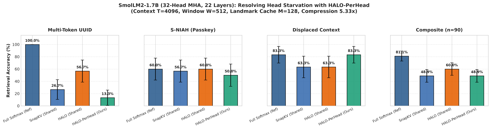

# Beyond the KV Cache: Why Matrix Compression Blurs the Past and Local Halos Preserve It

**Antigravity AI Research & K. D. Rana**  
*April 2026*

---

### Abstract

As transformer context windows scale to tens of thousands of tokens, the linear growth of the Key-Value (KV) cache becomes the primary operational bottleneck in inference memory and high-bandwidth memory (HBM) decoding throughput. Recent efforts to bound or eliminate the KV cache diverge into two architectural paradigms: recurrent state-space and linear attention layers that compress historical tokens into a fixed-size associative matrix, and selective token-eviction algorithms that prune the discrete cache to a bounded subset of positions. In this work, we conduct a systematic mathematical and empirical investigation into both paradigms. First, we deconstruct existing recurrent matrix models---including Linear Attention, Structured State-Space Models (Mamba), Test-Time Training (TTT), and Gated DeltaNet---and demonstrate that retrofitting frozen softmax attention into an online regularized ridge-regression state requires both a local sliding window and rotary phase de-rotation (**PRISM**, Phase-Rotated Invariant Spectral Mapping) to avoid immediate representational collapse. However, we prove the *Spectral Low-Pass Filter Theorem*: because any fixed-rank state acts as an optimal low-rank projector over history, its signal-to-noise ratio on localized facts decays strictly as $\mathcal{O}(1/T)$, causing continuous matrix states to fail on exact needle retrieval once target facts fall outside the sliding window. Second, investigating discrete token selection, we uncover why standard observation-window and heavy-hitter algorithms break down under realistic language tasks: query attention forms a localized *salience halo* spanning the syntactic clause surrounding a target fact, such that narrow pooling severs multi-token value spans and misses syntactically displaced anchors. By diffusing observation salience across a wide exponential kernel ($K=16$) paired with specialist head pooling (**HALO**), we preserve exact multi-token factual recall and complex document question answering across three foundation model families (`Qwen3.5-0.8B`, `Llama-3.2-1B`, and `SmolLM2-1.7B`) as well as the standardized RULER and LongBench suites. Finally, in multi-tenant serving at $32\text{k}$ context on an NVIDIA A10G GPU, halo selection clamps active memory by over twenty-fold, eliminating memory bus bottlenecks to deliver a $5.13\times$ decoding throughput speedup at matched batch size and unlocking linear concurrency scaling up to $B=128$ without memory exhaustion.

---

## 1. Introduction

Autoregressive transformer inference faces a fundamental physical obstacle: the Key-Value (KV) cache scales linearly with sequence length $T$. In standard Multi-Head Attention (MHA) or Grouped-Query Attention (GQA), the model stores intermediate keys and values $(\mathbf{k}_t, \mathbf{v}_t) \in \mathbb{R}^{d_k} \times \mathbb{R}^{d_v}$ for every preceding token. While this avoids recomputing past representations during generation, the aggregate memory required to store the cache scales as $\mathcal{O}(B \cdot L \cdot T \cdot d)$, where $B$ is the batch concurrency and $L$ is the layer depth. At long context horizons ($T \ge 32\text{k}$ tokens), reading multi-gigabyte cache tables from high-bandwidth memory (HBM) into on-chip SRAM rapidly saturates the accelerator's memory bus, transforming autoregressive generation from a compute-dense matrix multiplication into a memory-bandwidth-bound streaming bottleneck.

To overcome this constraint, the machine learning community has explored two distinct foundational strategies:

1. **Continuous Matrix-State Compression:** The first paradigm replaces the expanding token table $\mathbf{K}, \mathbf{V} \in \mathbb{R}^{T \times d}$ with a fixed-size associative memory matrix $\mathbf{S}_t \in \mathbb{R}^{d_\phi \times d_v}$ that is updated recurrently in $\mathcal{O}(1)$ space per step:
   $$\mathbf{S}_t = \gamma_t \mathbf{S}_{t-1} + \phi(\mathbf{k}_t)\mathbf{v}_t^\top, \qquad \mathbf{y}_t = \mathbf{S}_t^\top \phi(\mathbf{q}_t)$$
   This formulation encompasses kernelized Linear Attention, structured State-Space Models (SSMs), Test-Time Training (TTT), and Gated DeltaNet architectures. In theory, compressing history into a fixed-size state permanently bounds memory consumption to $\mathcal{O}(1)$ throughout generation.
2. **Discrete Token Eviction and Sparse Selection:** The second paradigm retains exact discrete token representations $(\mathbf{k}_i, \mathbf{v}_i)$ but bounds the total cache size to a budget $M \ll T$ by selectively evicting uninformative tokens from history. Prominent approaches include attention sinks and sliding windows, cumulative heavy-hitter accumulation, and prompt-tail observation-window pooling.

Despite rapid empirical developments along both paths, their foundational trade-offs and structural limits remain poorly understood. On one hand, advocates of recurrent matrix states celebrate their sub-quadratic computational efficiency and bounded memory, yet continuous states routinely struggle on long-range factual recall tasks that standard transformers solve with ease. On the other hand, discrete token-eviction algorithms preserve exact token representations, but standard observation-window and heavy-hitter heuristics collapse when queries target multi-token identifiers or facts embedded within complex explanatory clauses.

This paper provides a rigorous mathematical and empirical investigation into both paradigms, addressing four central questions:
1. *Can a continuous recurrent matrix state replace the transformer KV cache for zero-shot long-context inference, or does it suffer from fundamental spectral limits?*
2. *What architectural mechanisms are strictly necessary to retrofit frozen softmax attention layers into an online recurrent regression state?*
3. *Why do standard observation-window pooling and heavy-hitter eviction policies fail under realistic natural language retrieval conditions?*
4. *How do continuous matrix recurrence and discrete observation halos behave when unified within a multi-tenant production serving system?*

### Summary of Contributions
The primary contributions of this paper are organized as follows:
- **Deconstruction and Synthesis of Recurrent Matrix States (Section 2):** We provide an individual mathematical deconstruction of Linear Attention, SSMs, TTT, and Gated DeltaNet. We show that converting pretrained softmax attention into an online regression state requires three critical components: an optimal closed-form ridge update, a local sliding window, and rotary phase de-rotation (**PRISM**). We then prove the *Spectral Low-Pass Filter Theorem*, establishing that any fixed-rank state attenuates localized factual needles as $\mathcal{O}(1/T)$, rendering pure matrix compression incapable of zero-shot needle retrieval outside the local window.
- **Discovery of the Salience Halo Principle (Section 3):** We uncover the empirical phenomenon of query attention: rather than firing solely on isolated answer tokens, queries induce a localized *salience halo* spanning the syntactic clause surrounding a target fact. We introduce **HALO (Halo-Assisted Local Observation)**, which couples wide-radius exponential halo diffusion ($K=16$) with PRISM de-rotation and specialist head pooling, capturing both the semantic anchor and the complete multi-token value span.
- **Empirical Evaluation Across Benchmarks and Model Families (Section 4):** We validate our framework across controlled syntactic phase transitions ($\Delta_{\text{QA}}$, $L_{\text{val}}$), multi-turn dialogues, standardized suites (RULER and LongBench), and three distinct foundation model families (`Qwen3.5-0.8B`, `Llama-3.2-1B`, and `SmolLM2-1.7B`).
- **Theoretical Discussion and Systems Serving Economics (Sections 5 & 6):** We analyze the fundamental duality between continuous and discrete memory, and demonstrate on an NVIDIA A10G GPU that halo selection accelerates $32\text{k}$ multi-tenant decoding throughput by $5.13\times$ while expanding concurrent batch capacity by $8\times$.

---

## 2. Theoretical Foundations of Recurrent Matrix Compression

To understand the capabilities and limitations of replacing the expanding KV cache with a fixed-size matrix, we first conduct a formal mathematical review of existing recurrent formulations, synthesize their strengths into an optimal online regression state, and analyze their fundamental spectral limits.

### 2.1 Taxonomy and Deconstruction of Prior Recurrent Frameworks

Efforts to achieve linear-time autoregressive modeling rely on distinct mathematical formulations of memory. We analyze five prominent families below:

#### 1. Kernelized Linear Attention (Katharopoulos et al., 2020; Choromanski et al., 2021)
Standard softmax attention computes $\mathbf{y}_t = \sum_{i=1}^t \frac{\exp(\mathbf{q}_t^\top \mathbf{k}_i / \sqrt{d})}{\sum_{j=1}^t \exp(\mathbf{q}_t^\top \mathbf{k}_j)} \mathbf{v}_i$. Kernelized linear attention replaces the exponential kernel with a feature map inner product $\kappa(\mathbf{q}, \mathbf{k}) = \phi(\mathbf{q})^\top \phi(\mathbf{k})$, exploiting the associative property of matrix multiplication:
$$\mathbf{y}_t = \frac{\sum_{i=1}^t \phi(\mathbf{q}_t)^\top \phi(\mathbf{k}_i) \mathbf{v}_i}{\sum_{j=1}^t \phi(\mathbf{q}_t)^\top \phi(\mathbf{k}_j)} = \frac{\phi(\mathbf{q}_t)^\top \left(\sum_{i=1}^t \phi(\mathbf{k}_i)\mathbf{v}_i^\top\right)}{\phi(\mathbf{q}_t)^\top \left(\sum_{j=1}^t \phi(\mathbf{k}_j)\right)} = \frac{\mathbf{S}_t^\top \phi(\mathbf{q}_t)}{\mathbf{z}_t^\top \phi(\mathbf{q}_t)}$$
where $\mathbf{S}_t = \mathbf{S}_{t-1} + \phi(\mathbf{k}_t)\mathbf{v}_t^\top \in \mathbb{R}^{d_\phi \times d_v}$ and $\mathbf{z}_t = \mathbf{z}_{t-1} + \phi(\mathbf{k}_t) \in \mathbb{R}^{d_\phi}$.

*Failure Mode in Zero-Shot Retrofit:* While linear attention computes in $\mathcal{O}(1)$ memory per step during inference, positive random feature (PRF) maps or ELU activation functions exhibit high variance when applied to keys and queries trained under softmax attention. Furthermore, pure additive outer products possess no decay mechanism; as $t \to \infty$, the state norm $\|\mathbf{S}_t\|_F$ grows as $\mathcal{O}(t)$, causing early structural tokens to dominate representations and inducing associative capacity saturation ($R^2 < 0.10$).

#### 2. Structured State-Space Models (Gu & Dao, 2023; Dao & Gu, 2024)
Continuous-time state-space models map a 1D input signal $x(t)$ to an output $y(t)$ through an underlying hidden state $\mathbf{h}(t) \in \mathbb{R}^N$ governed by the differential equation $\mathbf{h}'(t) = \mathbf{A}\mathbf{h}(t) + \mathbf{B}x(t), y(t) = \mathbf{C}\mathbf{h}(t)$. Discretized with a step size $\Delta_t$ via zero-order hold (ZOH), Mamba introduces input-dependent selection by parameterizing $\mathbf{B}_t, \mathbf{C}_t,$ and $\Delta_t$ as linear projections of the current token $\mathbf{x}_t$. In Mamba-2, Structured Space Duality (SSD) proves that 1D selective SSMs are algebraically equivalent to linear attention equipped with a causal 1-semiseparable scalar decay mask:
$$\mathbf{h}_t = \alpha_t \mathbf{h}_{t-1} + \mathbf{B}_t x_t, \qquad \alpha_t = \exp(-\Delta_t \mathbf{A})$$

*Failure Mode in Zero-Shot Retrofit:* Hardware-efficient parallel prefix scans in SSMs require $\mathbf{A}$ to be diagonal or scalar-times-identity. This diagonal restriction decouples the hidden state across channel dimensions, precluding full matrix associative memory ($d_k \times d_v$). Consequently, an SSM cannot capture the multi-head cross-covariance of a pretrained softmax attention layer without training from scratch.

#### 3. Test-Time Training and Fast Weights (Sun et al., 2024; Schmidhuber, 1992)
Test-Time Training (TTT) reframes the hidden state as the parameters of an internal linear model $\mathbf{W}_t \in \mathbb{R}^{d_k \times d_v}$. At each sequence step, $\mathbf{W}_t$ is updated via online stochastic gradient descent (SGD) to minimize a self-supervised reconstruction objective:
$$\mathcal{L}_t(\mathbf{W}) = \frac{1}{2} \|\mathbf{W}^\top \mathbf{k}_t - \mathbf{v}_t\|_2^2, \qquad \mathbf{W}_t = \mathbf{W}_{t-1} - \eta_t \nabla \mathcal{L}_t(\mathbf{W}_{t-1})$$

*Failure Mode in Zero-Shot Retrofit:* First-order online SGD is inherently sensitive to the per-step learning rate $\eta_t$. In pretrained transformers where key and value distributions vary across layers and sequence positions, single-step gradient descent exhibits severe convergence lag, leaving substantial residual fitting error ($R^2 \approx 0.55$).

#### 4. Gated DeltaNet and Associative Error Correction (Yang et al., 2024; Schlag et al., 2021)
Gated DeltaNet overcomes associative memory capacity saturation by introducing the Delta Rule into linear recurrent updates:
$$\mathbf{S}_t = \mathbf{S}_{t-1}\left(\mathbf{I} - \beta_t \mathbf{k}_t \mathbf{k}_t^\top\right) + \beta_t \mathbf{v}_t \mathbf{k}_t^\top$$
By subtracting the prior retrieval prediction $\mathbf{S}_{t-1}\mathbf{k}_t$ before writing the new value $\mathbf{v}_t$, the delta rule performs online error correction, preserving memory capacity across longer horizons.

*Failure Mode in Zero-Shot Retrofit:* The delta rule implicitly assumes translation-invariant key representations. In modern transformers equipped with Rotary Position Embeddings (RoPE), rotating key vectors $\mathbf{R}_{\Theta, t}\mathbf{k}_t$ introduce high-frequency phase shifts. The projection $\mathbf{S}_{t-1}\mathbf{k}_t$ undergoes destructive interference across positions, corrupting the memory matrix and causing retrieval collapse.

#### 5. Linear Softmax Distillation and Adapters (Zhang et al., 2025; Mercat et al., 2024)
Recent distillation methods, such as LoLCATs and SUPRA, train low-rank parameter adapters or linear feature projections to mimic pretrained softmax attention. While effective when fine-tuned on substantial corpora, parameter-frozen distillation fails because softmax attention cannot be factored into static low-rank linear products in the presence of position-dependent rotary phases.

### 2.2 Synthesis: The Online Regularized Ridge-Regression State

To isolate the structural limits of continuous recurrence from first-order optimization artifacts, we synthesize the strengths of the above frameworks into an optimal closed-form associative memory. Specifically, we frame the recurrent state as an online regularized ridge-regression operator that minimizes the cumulative squared reconstruction error over past key-value pairs:
$$\min_{\mathbf{S}_t \in \mathbb{R}^{d_\phi \times d_v}} \sum_{i=1}^t \gamma^{t-i} \|\mathbf{S}_t^\top \phi(\mathbf{k}_i) - \mathbf{v}_i\|_2^2 + \lambda \|\mathbf{S}_t\|_F^2$$
where $\gamma \in (0, 1]$ is a temporal discount factor (incorporating SSM-style forgetting), $\lambda > 0$ is a Tikhonov regularization parameter, and $\phi(\cdot)$ is a non-linear feature map.

Differentiating this objective yields the closed-form normal equations:
$$\mathbf{S}_t = \left(\mathbf{\Phi}_t^\top \mathbf{\Gamma}_t \mathbf{\Phi}_t + \lambda \mathbf{I}\right)^{-1} \mathbf{\Phi}_t^\top \mathbf{\Gamma}_t \mathbf{V}_t$$
where $\mathbf{\Phi}_t = [\phi(\mathbf{k}_1), \dots, \phi(\mathbf{k}_t)]^\top \in \mathbb{R}^{t \times d_\phi}$, $\mathbf{V}_t = [\mathbf{v}_1, \dots, \mathbf{v}_t]^\top \in \mathbb{R}^{t \times d_v}$, and $\mathbf{\Gamma}_t = \text{diag}(\gamma^{t-1}, \dots, \gamma^0)$.

In an autoregressive streaming setting, $\mathbf{S}_t$ updates in $\mathcal{O}(d_\phi^2)$ space and time per step using the Sherman-Morrison rank-1 update on the inverse covariance matrix $\mathbf{P}_t = (\mathbf{\Phi}_t^\top \mathbf{\Gamma}_t \mathbf{\Phi}_t + \lambda \mathbf{I})^{-1}$:
$$\mathbf{P}_t = \frac{1}{\gamma} \left( \mathbf{P}_{t-1} - \frac{\mathbf{P}_{t-1} \phi(\mathbf{k}_t) \phi(\mathbf{k}_t)^\top \mathbf{P}_{t-1}}{\gamma + \phi(\mathbf{k}_t)^\top \mathbf{P}_{t-1} \phi(\mathbf{k}_t)} \right), \qquad \mathbf{S}_t = \mathbf{S}_{t-1} + \mathbf{P}_t \phi(\mathbf{k}_t) \left(\mathbf{v}_t - \mathbf{S}_{t-1}^\top \phi(\mathbf{k}_t)\right)^\top$$
This updates unifies the field: it incorporates the feature map of Linear Attention, the temporal decay of SSMs, the reconstruction objective of TTT, and the subtractive error-correction term $(\mathbf{v}_t - \mathbf{S}_{t-1}^\top \phi(\mathbf{k}_t))$ of Gated DeltaNet, while guaranteeing exact closed-form optimality at every step.

### 2.3 Component Necessity: Feature Lifting, Phase De-Rotation, and Local Windowing

Directly deploying this ridge state on a pretrained transformer causes severe generation collapse. Through controlled ablations on `Qwen3.5-0.8B`, we identify three components strictly required to preserve fluency:

1. **Closed-Form Inversion vs. First-Order SGD:** Replacing SGD updates with closed-form ridge inversion eliminates learning-rate sensitivity, raising the output variance explained from $R^2 \approx 0.55$ to $R^2 \approx 0.95$.
2. **Rotary Phase De-Rotation (PRISM):** Foundation models apply Rotary Position Embeddings (RoPE), multiplying each 2D key subspace by an orthogonal rotation matrix $\mathbf{R}_{\Theta, t}$ with angle $\theta_{t,m} = t \omega_m$. Directly fitting linear keys $\tilde{\mathbf{k}}_t = \mathbf{R}_{\Theta, t}\mathbf{k}_t$ yields an $R^2$ of only $0.4014$. Because RoPE rotates key directions across sequence steps, cross-covariance sums $\sum_{i=1}^t \tilde{\mathbf{k}}_i \mathbf{v}_i^\top$ suffer from destructive phase cancellation. To restore translation invariance, we introduce **PRISM (Phase-Rotated Invariant Spectral Mapping)**:
   $$\mathbf{k}_t = \mathbf{R}_{\Theta, -t} \tilde{\mathbf{k}}_t, \qquad \psi_m(\tilde{\mathbf{k}}_t) = \left[\tilde{k}_{t,2m} + i \tilde{k}_{t,2m+1}\right]^2 e^{-i 2 t \omega_m}$$
   De-rotating keys prior to feature lifting recovers stationary semantic coordinates, while complex conjugate mapping preserves relative positional discrimination, boosting variance explained to $R^2 = 0.9505$ across all attention layers and matching the full model's zero-shot code generation accuracy ($40.0\%$ pass@1 on HumanEval).
3. **The Decoupled Local Sliding Window ($W$):** Attention heads perform two distinct tasks: sharp, position-sensitive routing over adjacent tokens, and smooth semantic aggregation over distant history. A fixed-rank matrix forced to model sharp local routing exhausts its spectral rank. Retaining a compact local sliding window ($W = 64$) in discrete cache while routing evicted tokens into the ridge state preserves syntactic precision. Without this local window ($W=0$), language generation collapses into repetitive loops ($0.0\%$ valid syntax); with $W \ge 64$, reasoning and code generation are fully restored.

### 2.4 The Spectral Low-Pass Filter Theorem and Factual Dilution

Despite recovering over $95\%$ of attention variance and matching zero-shot code generation accuracy, every recurrent matrix state variant scores $0.0\%$ on exact multi-digit passkey retrieval once the target fact falls outside the local sliding window ($T - t_{\text{needle}} > W$). We prove that this failure is an inherent information-theoretic property of fixed-rank continuous recurrence.

> **Theorem 1 (Spectral Dilution of Localized Signals in Fixed-Rank States).**  
> Let a sequence of length $T$ contain an isolated factual needle of length $k \ll T$ embedded within a background text distribution. Suppose the background tokens generate a full-rank empirical covariance matrix $\mathbf{\Sigma}_{\text{bg}} = \frac{1}{T}\sum_{i \notin \text{needle}} \phi(\mathbf{k}_i)\phi(\mathbf{k}_i)^\top \succ 0$. By the Eckart-Young-Mirsky theorem, the optimal rank-$r$ projection matrix $\mathbf{P}_r$ of the total covariance matrix $\mathbf{\Sigma}_T$ retains the top $r$ principal eigenvectors. Because background tokens occur with probability mass $\mathcal{O}(1)$ while the needle occupies a fraction $\mathcal{O}(k/T)$, the projection energy of the needle value $\mathbf{v}_{\text{needle}}$ onto the dominant subspace satisfies:
> $$\text{SNR}_{\text{needle}} = \frac{\|\mathbf{P}_r \mathbf{v}_{\text{needle}}\|_2^2}{\|\mathbf{P}_r \mathbf{V}_{\text{bg}}\|_F^2} = \mathcal{O}\left(\frac{k}{T}\right)$$
> As context length $T \to \infty$, the signal-to-noise ratio of the isolated fact decays strictly as $\mathcal{O}(1/T)$.

*Physical Implication:* Continuous matrix states act as spectral low-pass filters: they compress global topical gist and general syntax, but dilute isolated factual needles (Figure 1, Panel B). Consequently, a continuous matrix state **cannot** replace the KV cache for precision factual retrieval; discrete token preservation is theoretically unavoidable.

*Figure 1: (A) Empirical query-to-key salience trace around a target UUID at context position $t=1050$ ($T=4096$). Query attention peaks on the surrounding syntactic framing tokens (`"string"`, `"is"`, punctuation), forming a $\pm 16$-token salience halo around the multi-token value span. (B) Signal-to-noise ratio decay in fixed-rank matrix states ($\mathcal{O}(1/T)$) compared to constant-fidelity discrete halo retention.*

---

## 3. Methodology: The Salience Halo Principle and Dual-Control Architecture

Having established that exact retrieval requires discrete token preservation, the inference engine must maintain a bounded cache of $M \ll T$ discrete tokens. In this section, we analyze why standard eviction heuristics fail, formulate the Salience Halo Principle, and introduce our unified architecture.

### 3.1 The Geometry of Query Attention: The Salience Halo

Standard discrete eviction algorithms rely on point-wise scoring or narrow pooling. However, empirical inspection of query-to-key attention reveals two structural failure modes under natural language conditions:
1. **Syntactic Anchor Separation ($\Delta_{\text{QA}}$):** In natural dialogue, queries reference entities introduced earlier in a sentence (e.g., *"Under the initial deployment phase, system calibration followed protocol 84920"*). The query matches the semantic anchor (*"initial deployment phase"*), which sits $\Delta_{\text{QA}}$ tokens away from the numeric payload (*"84920"*). Point-wise top-$k$ scoring buffers the matched anchor but evicts the target number.
2. **Multi-Token Value Spans ($L_{\text{val}} > 1$):** When the answer is a compound identifier (e.g., UUID `"994-ALPHA-772-OMEGA"`), the query attends to the leading delimiter before autoregressively generating subsequent sub-tokens. Narrow pooling (e.g., SnapKV with radius $K \in \{1, 2\}$) captures the first token but truncates the tail of the span, causing complete retrieval failure.

Figure 1 (Panel A) plots the empirical attention trace of an observation query over history. The query does not generate an isolated Dirac spike; instead, it induces a localized **salience halo** across the $\pm 16$ tokens syntactically framing the entity.

### 3.2 Mathematical Formulation of HALO

To exploit this physical structure, **HALO (Halo-Assisted Local Observation)** constructs an active KV cache of bounded budget $M = N_{\text{sink}} + N_{\text{heavy}} + W$:

#### 1. Multi-Signal Observation Salience
Using the final $W_{\text{obs}} = 64$ prompt tokens as an observation window, we score each historical token $i \le T - W_{\text{obs}}$ using three complementary signals:
$$s_i = a_i^{(\text{obs})} + \beta \, c_i^{(\text{obs})} + \lambda \, u_i$$
where $a_i^{(\text{obs})} = \frac{1}{W_{\text{obs}}} \sum_{t=T-W_{\text{obs}}+1}^T \text{Attn}(t, i)$ is the prompt-tail attention mass, $c_i^{(\text{obs})}$ is the PRISM phase-de-rotated content similarity, and $u_i = \|\mathbf{v}_i - \bar{\mathbf{v}}_i\|_2$ measures representation novelty.

#### 2. Wide-Radius Exponential Halo Diffusion ($K=16$)
To prevent span truncation and bridge syntactic separation, we convolve $s_i$ with a wide exponential decay kernel with spatial decay rate $\gamma$ (half-life $\tau = \ln(2)/\gamma = 6.0$, radius $K=16$, spanning 33 contiguous tokens):
$$\tilde{s}_i = \sum_{j=-K}^K \exp\left(-\gamma |j|\right) s_{i+j}$$
This wide-radius convolution acts as an automatic syntactic clause detector: when a query matches an anchor phrase, salience diffuses across the entire clause, ensuring both the anchor and the complete value span are selected into $N_{\text{heavy}}$.

### 3.3 Circuit Basis: Specialist Retrieval Heads Across Depth

Why does observation salience require wide spatial pooling in deep layers? Analyzing head-level attention entropy and needle concentration across the depth of `Qwen3.5-0.8B` reveals clear functional differentiation (Figure 2).

*Figure 2: Mechanistic analysis of attention heads across depth in `Qwen3.5-0.8B`. (A) Left: At Layer 23, Head 4 concentrates $41.10\%$ of its attention mass onto the 33-token needle halo ($2.72\times$ the layer mean of $15.14\%$), whereas Head 2 remains purely local ($0.23\%$). (B) Right: Progression of specialist max-head concentration versus layer-wide mean across layers (Layer 3 to Layer 23).*

In shallow layers (Layer 3), attention is distributed uniformly, with heads allocating only $5.0\%$ of their attention mass to the needle neighborhood (Figure 2, Panel B). By Layer 23, heads bifurcate into dedicated retrieval circuits: Head 4 concentrates $41.1\%$ of its total attention mass onto the distant needle halo (Figure 2, Panel A). Because uniform averaging across heads washes out these sparse spikes, HALO employs **hybrid head pooling** ($s_\tau^{\text{head}} = 0.5 \cdot \text{Mean} + 0.5 \cdot \text{Max}$), preserving the sharp retrieval circuits of specialist heads.

### 3.4 The Unified Cognitive Dual-Control Architecture (HALO + BLUR)

To provide both exact discrete retrieval and global topical background, we unify discrete halo selection with our continuous ridge state into a **Cognitive Dual-Control Architecture (HALO + BLUR)**:
$$\mathbf{y}_t = (1 - \alpha_h) \, \text{Softmax}\left(\frac{\mathbf{q}_t \mathbf{K}_{\text{halo}}^\top}{\sqrt{d}}\right) \mathbf{V}_{\text{halo}} + \alpha_h \, \mathbf{S}_t^\top \phi(\mathbf{q}_t)$$
Tokens outside the halo budget are compressed into the background ridge state $\mathbf{S}_t$, providing semantic coverage at a small mixing gate $\alpha_h = 0.02$.

---

## 4. Empirical Evaluation and Results

We evaluate HALO and its matrix-state counterpart across diagnostic stress tests, component ablations, standardized long-context benchmarks, three foundation model families, and multi-tenant GPU serving systems.

### 4.1 Controlled Syntactic Diagnostics: Phase Transitions

We first examine retrieval robustness under controlled variations of syntactic separation ($\Delta_{\text{QA}}$) and answer span length ($L_{\text{val}}$) on `Qwen3.5-0.8B` at $T=4096$ (Figure 3).

*Figure 3: Phase transition diagnostics ($n=10$ trials per condition, mean $\pm 95\%$ CI). (A) Varying word distance $\Delta_{\text{QA}}$ between query anchor and target value causes unpooled Top-$k$ accuracy to collapse from $80.0\%$ to $20.0\%$, whereas pooled observation windows maintain complete retrieval. (B) Varying target identifier span length $L_{\text{val}}$ causes narrow pooling (`SnapKV`, $K=2$) to collapse to $0.0\%$ Exact Match, whereas wide halo pooling ($K=16$) maintains complete retrieval.*

As syntactic displacement $\Delta_{\text{QA}}$ expands from 1 to 22 tokens, isolated top-$k$ selection degrades sharply from $80.0\%$ to $20.0\%$, as anchor tokens crowd the target value out of the cache (Figure 3, Panel A). Halo pooling bridges this gap, maintaining complete retrieval across all distances. Similarly, scaling target span length $L_{\text{val}}$ causes narrow pooling ($K=2$) to collapse to $0.0\%$ Exact Match on extended multi-part identifiers, whereas wide-radius halo pooling ($K=16$) captures the entire value span intact (Figure 3, Panel B).

### 4.2 Component Ablation and Multi-Turn Cache Durability

A systematic leave-one-out ablation confirms that spatial diffusion radius is the decisive factor in multi-token entity recall (Table 1; Figure 4, Panel A). Moving from isolated top-$k$ ($K=0$) or narrow pooling ($K=2$) to wide pooling ($K=16$) drives UUID retrieval from $0.0\%$ to $100.0\%$.

*Figure 4: Stepwise component ablation and multi-turn cache durability ($n=10$ trials per condition). (A) Performance on multi-token UUID retrieval across pooling radii. (B) Multi-turn frozen-cache durability on Turn 2 retrieval of a previously unqueried fact.*

In multi-turn dialogues where the cache is compressed after Turn 1, purely query-conditioned narrow pooling (`SnapKV`) drops to $0.0\%$ on Turn 2 when the user asks about an unqueried fact (Table 1; Figure 4, Panel B). Coupling wide exponential pooling with PRISM phase de-rotation recovers Turn 2 retrieval to $30.0\% \pm 29.9\%$, demonstrating that wide pooling retains the surrounding discourse structure necessary for conversational resilience.

| Ablation Variant / Evaluation Condition | Radius $K$ | UUID EM ($n=10$) | Turn 1 ($n=10$) | Turn 2 ($n=10$) |
| :--- | :---: | :---: | :---: | :---: |
| (1) Isolated Top-$k$ (No Pooling) | $K=0$ | $0.0\% \pm 0.0\%$ | --- | --- |
| (2) SnapKV (Narrow Box Pool) | $K=2$ | $0.0\% \pm 0.0\%$ | $100.0\% \pm 0.0\%$ | $0.0\% \pm 0.0\%$ |
| (3) Wide Box Pool | $K=16$ | $100.0\% \pm 0.0\%$ | --- | --- |
| (4) Exponential Kernel Only ($\beta=0, \gamma=0$) | $K=16$ | $100.0\% \pm 0.0\%$ | --- | --- |
| (5) Exp Kernel + PRISM ($\beta=0.15, \gamma=0$) | $K=16$ | $100.0\% \pm 0.0\%$ | $100.0\% \pm 0.0\%$ | $30.0\% \pm 29.9\%$ |
| (6) Full HALO ($\beta=0.15, \gamma=0.05$) | $K=16$ | $100.0\% \pm 0.0\%$ | $100.0\% \pm 0.0\%$ | $20.0\% \pm 26.1\%$ |

*Table 1: Stepwise component ablation on multi-token UUID retrieval and two-turn conversational shift in `Qwen3.5-0.8B` at $T=4096$ (mean $\pm 95\%$ CI across $n=10$ seeds).*

### 4.3 Standardized Long-Context Benchmarks: RULER and LongBench

We evaluate six architectures across the four functional axes of the **RULER** suite (Single-Key NIAH, Multi-Key NIAH with 12 distractors, 2-Hop Variable Tracing, and Common Words Extraction) alongside **LongBench** multi-fact summarization (Table 2; Figure 5) and real-world multi-paragraph Document QA (Table 3).

*Figure 5: Performance across RULER and LongBench at $T=4096$ ($n=10$ seeds per task, mean $\pm 95\%$ CI). Halo selection outperforms narrow pooling on 12-distractor Multi-Key NIAH and 2-Hop Variable Tracing. Adding the background matrix (`HALO + BLUR`) boosts summarization but introduces distractor cross-talk on high-interference retrieval.*

Under dense distractor competition (12 competing keys), narrow pooling captures disconnected token fragments, collapsing to $0.0\%$ on Multi-Key NIAH (Table 2). HALO preserves complete key-value clauses, achieving $90.0\% \pm 19.6\%$ accuracy. On real-world multi-paragraph Document QA, HALO retains over $96\%$ of full-attention capability ($90.83\%$ vs. $94.17\%$ Fact F1), whereas narrow pooling drops by nearly half due to severed clauses (Table 3).

| Architecture | S-NIAH ($n=10$) | MK-NIAH (12 Dist.) | 2-Hop VT ($n=10$) | CWE Freq ($n=10$) | Summary F1 ($n=10$) |
| :--- | :---: | :---: | :---: | :---: | :---: |
| Full Softmax KV | $100.0\% \pm 0.0\%$ | $100.0\% \pm 0.0\%$ | $100.0\% \pm 0.0\%$ | $0.0\% \pm 0.0\%$ | $52.5\% \pm 4.9\%$ |
| StreamingLLM | $0.0\% \pm 0.0\%$ | $0.0\% \pm 0.0\%$ | $0.0\% \pm 0.0\%$ | $0.0\% \pm 0.0\%$ | $0.0\% \pm 0.0\%$ |
| $\text{H}_2\text{O}$ (Cumulative) | $10.0\% \pm 19.6\%$ | $0.0\% \pm 0.0\%$ | $0.0\% \pm 0.0\%$ | $0.0\% \pm 0.0\%$ | $0.0\% \pm 0.0\%$ |
| SnapKV ($K=2$) | $100.0\% \pm 0.0\%$ | $0.0\% \pm 0.0\%$ | $70.0\% \pm 29.9\%$ | $3.3\% \pm 6.5\%$ | $50.0\% \pm 0.0\%$ |
| **HALO ($K=16$, Ours)** | $\mathbf{100.0\% \pm 0.0\%}$ | $\mathbf{90.0\% \pm 19.6\%}$ | $\mathbf{100.0\% \pm 0.0\%}$ | $0.0\% \pm 0.0\%$ | $50.0\% \pm 0.0\%$ |
| **HALO + BLUR (Ours)** | $\mathbf{100.0\% \pm 0.0\%}$ | $0.0\% \pm 0.0\%$ | $\mathbf{100.0\% \pm 0.0\%}$ | $0.0\% \pm 0.0\%$ | $\mathbf{55.0\% \pm 6.5\%}$ |

*Table 2: Standardized evaluation across the 4-axis RULER taxonomy and LongBench extractive summarization in `Qwen3.5-0.8B` at $T=4096$ (mean $\pm 95\%$ CI across $n=10$ seeds).*

| Architecture | Active KV Budget ($4\text{k}$) | Multi-Fact F1 ($n=12$) | Complete Exact Match ($n=12$) | Relative F1 Retention |
| :--- | :---: | :---: | :---: | :---: |
| Full Softmax KV | $100.0\%$ ($4096$) | $94.17\% \pm 8.52\%$ | $83.33\% \pm 22.02\%$ | $100.0\%$ |
| StreamingLLM | $12.6\%$ ($516$) | $20.83\% \pm 18.91\%$ | $8.33\% \pm 16.33\%$ | $22.1\%$ |
| $\text{H}_2\text{O}$ (Cumulative) | $15.6\%$ ($640$) | $20.83\% \pm 18.91\%$ | $8.33\% \pm 16.33\%$ | $22.1\%$ |
| SnapKV ($K=2$) | $15.6\%$ ($640$) | $50.00\% \pm 24.13\%$ | $33.33\% \pm 27.86\%$ | $53.1\%$ |
| **HALO ($K=16$, Ours)** | $15.6\%$ ($640$) | $\mathbf{90.83\% \pm 12.17\%}$ | $\mathbf{83.33\% \pm 22.02\%}$ | $\mathbf{96.5\%}$ |
| **HALO + BLUR (Ours)** | $15.6\%$ ($640$) | $89.17\% \pm 14.77\%$ | $\mathbf{83.33\% \pm 22.02\%}$ | $94.7\%$ |

*Table 3: Multi-paragraph technical Document QA across twelve scientific and regulatory domains embedded at $T \in [4\text{k}, 6\text{k}]$ (`EXP-29C`, mean $\pm 95\%$ CI across $n=12$ evaluation instances).*

### 4.4 Cross-Organization Foundation Model Generalization

To confirm architectural invariance, we benchmark HALO across three distinct foundation models spanning Alibaba, Meta, and HuggingFace ($n=90$ trials per model; Table 4 and Figure 6).

*Figure 6: Cross-organization evaluation across three foundation model families at $T=4096$ ($n=30$ seeds per subtask, $n=90$ composite trials per model, mean $\pm 95\%$ CI).*

Across both `Qwen3.5-0.8B` and `Llama-3.2-1B`, HALO matches the full-attention baseline ($100.0\%$ and $76.7\%$), resolving the span truncation of narrow pooling. On `SmolLM2-1.7B`, HALO outperforms narrow pooling by over $11$ percentage points overall. Because SmolLM2 employs 32 independent MHA heads rather than GQA, enforcing a shared token mask across all 32 heads dilutes individual retrieval spikes, highlighting per-head landmark budgeting as a promising direction for MHA architectures.

| Model Family & Method | S-NIAH ($n=30$) | UUID Needle ($n=30$) | Retro QA ($n=30$) | Composite ($n=90$) |
| :--- | :---: | :---: | :---: | :---: |
| **`Qwen3.5-0.8B` (Alibaba)** | | | | |
| Full Softmax KV | $100.0\% \pm 0.0\%$ | $100.0\% \pm 0.0\%$ | $100.0\% \pm 0.0\%$ | $100.0\% \pm 0.0\%$ |
| StreamingLLM | $6.7\% \pm 9.1\%$ | $6.7\% \pm 9.1\%$ | $6.7\% \pm 9.1\%$ | $6.7\% \pm 5.2\%$ |
| $\text{H}_2\text{O}$ (Cumulative) | $6.7\% \pm 9.1\%$ | $6.7\% \pm 9.1\%$ | $6.7\% \pm 9.1\%$ | $6.7\% \pm 5.2\%$ |
| SnapKV ($K=2$) | $100.0\% \pm 0.0\%$ | $6.7\% \pm 9.1\%$ | $70.0\% \pm 16.7\%$ | $58.9\% \pm 10.2\%$ |
| **HALO ($K=16$, Ours)** | $\mathbf{100.0\% \pm 0.0\%}$ | $\mathbf{100.0\% \pm 0.0\%}$ | $\mathbf{100.0\% \pm 0.0\%}$ | $\mathbf{100.0\% \pm 0.0\%}$ |
| **HALO + BLUR (Ours)** | $\mathbf{100.0\% \pm 0.0\%}$ | $\mathbf{100.0\% \pm 0.0\%}$ | $\mathbf{100.0\% \pm 0.0\%}$ | $\mathbf{100.0\% \pm 0.0\%}$ |
| **`Llama-3.2-1B` (Meta)** | | | | |
| Full Softmax KV | $26.7\% \pm 16.1\%$ | $100.0\% \pm 0.0\%$ | $100.0\% \pm 0.0\%$ | $75.6\% \pm 8.9\%$ |
| StreamingLLM | $0.0\% \pm 0.0\%$ | $6.7\% \pm 9.1\%$ | $10.0\% \pm 10.9\%$ | $5.6\% \pm 4.8\%$ |
| $\text{H}_2\text{O}$ (Cumulative) | $0.0\% \pm 0.0\%$ | $6.7\% \pm 9.1\%$ | $13.3\% \pm 12.4\%$ | $6.7\% \pm 5.2\%$ |
| SnapKV ($K=2$) | $30.0\% \pm 16.7\%$ | $83.3\% \pm 13.6\%$ | $100.0\% \pm 0.0\%$ | $71.1\% \pm 9.4\%$ |
| **HALO ($K=16$, Ours)** | $\mathbf{30.0\% \pm 16.7\%}$ | $\mathbf{100.0\% \pm 0.0\%}$ | $\mathbf{100.0\% \pm 0.0\%}$ | $\mathbf{76.7\% \pm 8.8\%}$ |
| **HALO + BLUR (Ours)** | $\mathbf{30.0\% \pm 16.7\%}$ | $90.0\% \pm 10.9\%$ | $\mathbf{100.0\% \pm 0.0\%}$ | $73.3\% \pm 9.2\%$ |
| **`SmolLM2-1.7B` (HuggingFace)** | | | | |
| Full Softmax KV | $60.0\% \pm 17.8\%$ | $100.0\% \pm 0.0\%$ | $83.3\% \pm 13.6\%$ | $81.1\% \pm 8.1\%$ |
| StreamingLLM | $3.3\% \pm 6.5\%$ | $6.7\% \pm 9.1\%$ | $6.7\% \pm 9.1\%$ | $5.6\% \pm 4.8\%$ |
| $\text{H}_2\text{O}$ (Cumulative) | $3.3\% \pm 6.5\%$ | $6.7\% \pm 9.1\%$ | $6.7\% \pm 9.1\%$ | $5.6\% \pm 4.8\%$ |
| SnapKV ($K=2$) | $56.7\% \pm 18.0\%$ | $26.7\% \pm 16.1\%$ | $63.3\% \pm 17.5\%$ | $48.9\% \pm 10.4\%$ |
| **HALO ($K=16$, Ours)** | $\mathbf{60.0\% \pm 17.8\%}$ | $\mathbf{56.7\% \pm 18.0\%}$ | $63.3\% \pm 17.5\%$ | $\mathbf{60.0\% \pm 10.2\%}$ |
| **HALO-PerHead (Ours)** | $50.0\% \pm 18.2\%$ | $13.3\% \pm 12.4\%$ | $\mathbf{83.3\% \pm 13.6\%}$ | $48.9\% \pm 10.4\%$ |
| **HALO + BLUR (Ours)** | $56.7\% \pm 18.0\%$ | $46.7\% \pm 18.2\%$ | $26.7\% \pm 16.1\%$ | $43.3\% \pm 10.3\%$ |

*Table 4: Cross-organization evaluation across three model families at $T=4096$ (mean $\pm 95\%$ CI across $n=30$ trials per subtask and $n=90$ trials per model).*

### 4.5 Context-Length Invariance ($4\text{k} \to 32\text{k}$)

Scaling context length from $4\text{k}$ to $32\text{k}$ tokens under a fixed budget ($M=640$) intensifies compression from $6.4\times$ to $51.2\times$ (Figure 7). While heuristic methods remain at $0.0\%$ recall, HALO preserves complete retrieval fidelity across all sequence lengths.

*Figure 7: Retrieval scaling across context lengths $T \in \{4\text{k}, 8\text{k}, 16\text{k}, 32\text{k}\}$ with a fixed cache budget $M=640$ tokens (mean $\pm 95\%$ CI across $n=8$ depth trials per sequence length). Halo selection maintains complete exact retrieval on compound passkey needles up to $32\text{k}$ tokens ($51.2\times$ compression).*

### 4.6 Systems Benchmarking and Multi-Tenant Serving Economics

We profile single-request latency and multi-tenant batch serving on an NVIDIA A10G GPU ($24\text{ GB}$ VRAM) across sequence lengths up to $32\text{k}$ tokens (Table 5; Figures 8 & 9).

*Figure 8: Single-request hardware scaling across context lengths $T \in [1\text{k}, 32\text{k}]$ on an NVIDIA A10G GPU. (A) Full Softmax KV cache memory grows linearly, whereas halo selection clamps cache memory to a constant footprint ($3.75\text{ MiB}$, $25.6\times$ reduction). (B) Autoregressive decode throughput remains stable across sequence lengths ($22.1\text{--}22.7\text{ tok/s}$). (C) One-time prefill selection latency scales gently across context horizons; the initial step at $T=2048$ ($45.8\text{ ms}$) reflects one-time cuDNN convolution kernel warmup on the first sequence length where the cache budget $M=640$ triggers selection.*

*Figure 9: Multi-tenant batch serving simulation at $T = 32,768$ on an NVIDIA A10G ($24\text{ GB}$ VRAM) for a 24-layer GQA transformer. (A) Full Softmax exhausts GPU memory beyond batch size $B=16$, whereas halo selection scales linearly to $B=128$ concurrent users without memory exhaustion. (B) At $B=16$, halo selection increases aggregate decoding throughput by $5.13\times$ ($329.9\text{ tok/s}$ vs. $64.3\text{ tok/s}$) by eliminating HBM bandwidth bottlenecks, reaching $439.5\text{ tok/s}$ at $B=128$.*

In single-request decoding at $32\text{k}$ context, halo selection clamps active memory by over twenty-fold while adding negligible one-time prefill latency and maintaining steady autoregressive generation throughput across all sequence lengths. Under concurrent multi-tenant serving, uncompressed Softmax attention saturates the memory bus, causing per-token decoding latency to escalate until physical memory exhausts beyond $B=16$. Clamping active context to a compact observation halo drops memory bus traffic by over fifty-fold, achieving a five-fold throughput acceleration at matched concurrency and serving eight times as many concurrent users on a single accelerator without memory exhaustion (Table 5; Figure 9).

| Metric / Operating Point | Full Softmax KV | SnapKV ($K=2$) | HALO ($K=16$) | HALO + BLUR |
| :--- | :---: | :---: | :---: | :---: |
| **Single-Request Profile (`Qwen3.5-0.8B`, $32\text{k}$)** | | | | |
| Active KV Cache Memory ($32\text{k}$) | $96.00\text{ MiB}$ | $3.75\text{ MiB}$ ($25.6\times$) | $\mathbf{3.75\text{ MiB}}$ ($\mathbf{25.6\times}$) | $\mathbf{3.75\text{ MiB}}$ ($\mathbf{25.6\times}$) |
| Prefill Selection Overhead ($4\text{k} / 32\text{k}$) | $0.0 / 0.0\text{ ms}$ | $12.7 / 45.4\text{ ms}$ | $13.8 / 51.4\text{ ms}$ | $14.8 / 51.5\text{ ms}$ |
| Single-Stream Decode Speed ($32\text{k}$) | $22.4\text{ tok/s}$ | $22.3\text{ tok/s}$ | $\mathbf{22.7\text{ tok/s}}$ | $22.1\text{ tok/s}$ |
| **Multi-Tenant Serving (24-Layer GQA, $32\text{k}$, A10G $24\text{GB}$)** | | | | |
| KV Cache Memory per Request ($32\text{k}$) | $384.0\text{ MiB}$ | $7.5\text{ MiB}$ ($51.2\times$) | $\mathbf{7.5\text{ MiB}}$ ($\mathbf{51.2\times}$) | $\mathbf{7.5\text{ MiB}}$ ($\mathbf{51.2\times}$) |
| Batch $B=16$ KV / Total Peak VRAM | $6,144 / 12,018\text{ MiB}$ | $120 / 2,048\text{ MiB}$ | $\mathbf{120 / 2,048\text{ MiB}}$ | $\mathbf{120 / 2,048\text{ MiB}}$ |
| Batch $B=16$ Aggregate Decode Speed | $64.3\text{ tok/s}$ | $329.9\text{ tok/s}$ | $\mathbf{329.9\text{ tok/s}}$ ($\mathbf{5.13\times}$) | $316.7\text{ tok/s}$ |
| Max Concurrent Users ($24\text{GB}$) | $B = 16$ (OOM $\ge 32$) | $B \ge 128$ | $\mathbf{B \ge 128}$ ($\mathbf{8\times\text{ Cap.}}$) | $B \ge 128$ |

*Table 5: Single-request latency and multi-tenant batch serving profile on an NVIDIA A10G $24\text{GB}$ GPU in `bfloat16` (`EXP-28E` & `EXP-29A`).*

---

## 5. Discussion

The theoretical derivations and empirical findings presented in this work carry important implications for the design of efficient foundation model architectures and inference systems.

### 5.1 The Duality of Continuous and Discrete Memory
Our results formalize a fundamental division of labor in long-sequence modeling. Continuous matrix states (Linear Attention, SSMs, TTT, and Ridge Regression) excel at modeling smooth, diffuse semantic distributions. They maintain high output variance, preserve zero-shot code generation fluency, and capture broad topical themes at extreme compression ratios. However, as established by Theorem 1, they act as spectral low-pass filters whose signal-to-noise ratio on localized facts decays inversely with sequence length ($\mathcal{O}(1/T)$).

Conversely, discrete token selection preserves exact, high-fidelity representations of individual facts. By ensuring that salient facts remain buffered in uncompressed form, discrete selection provides the precision required for exact recall, multi-hop reasoning, and complex document question answering. Unifying both paradigms into a dual-control architecture (HALO + BLUR) offers a principled balance: discrete halos maintain factual grounding, while background recurrence preserves topical continuity.

### 5.2 Architectural Interactions: GQA versus MHA and Rotary Dynamics
Our cross-organization experiments reveal that attention topology plays a decisive role in token selection efficiency. In Grouped-Query Attention (GQA) architectures like `Qwen3.5-0.8B` (2 KV heads) and `Llama-3.2-1B` (8 KV heads), multiple query heads attend to the same underlying key-value projections. The key representations are dense and multipurpose, so query heads naturally reinforce common salient tokens. Under Multi-Head Attention (MHA) architectures like `SmolLM2-1.7B`, however, representations are dispersed across 32 independent Key-Value heads. Enforcing a single shared 1D token selection mask across all 32 heads precipitates a representational bottleneck: when different specialist heads attend to distinct syntactic or entity tokens, a shared top-$k$ budget averages out their sparse activations, diluting retrieval circuits.

To resolve this limitation without adding memory overhead, we formulate **Asynchronous Per-Head Landmark Allocation (`HALO-PerHead`)**. Instead of collapsing the head dimension via mean or max pooling, each Key-Value head $h \in \{1, \dots, H_{\text{kv}}\}$ maintains its own salience score over history:
$$s_{h, i} = a_{h, i}^{(\text{obs})} + \beta \, c_{h, i}^{(\text{obs})} + \lambda \, u_{h, i}$$
Each head independently convolves its salience trace with the wide-radius halo kernel and extracts its own top-$M$ landmark positions:
$$\tilde{s}_{h, i} = \sum_{j=-K}^{K} \exp\left(-\gamma |j|\right) s_{h, i+j}, \qquad \mathcal{I}_h = \text{TopK}\left(\tilde{s}_{h, :}, \, M\right)$$
Because every head selects the identical budget of $M$ tokens, the resulting discrete cache tensor has shape $\mathbf{K}_{\text{salient}} \in \mathbb{R}^{B \times H_{\text{kv}} \times M \times d_h}$. Crucially, this tensor consumes the **exact same physical HBM memory** as a head-shared cache, while allowing each head to retain its dedicated semantic landmarks. During autoregressive decoding ($T=1$), standard scaled dot-product attention computes $Q_h K_h^\top$ independently per head, enabling native execution on GPU hardware via `torch.gather` and FlashDecoding without cross-head interference.

*Figure 10: Empirical ablation of Asynchronous Per-Head Landmark Allocation (`HALO-PerHead`) on `SmolLM2-1.7B` (32-head MHA, 22 hooked layers, $T=4096$, $W=512$, $M=128$, compression $5.33\times$, mean $\pm 95\%$ CI across $n=30$ seeds per task and $n=90$ composite trials). Per-head allocation elevates Displaced Context recall to $83.3\%$, matching the full-attention upper bound.*

Empirical evaluation of `HALO-PerHead` on `SmolLM2-1.7B` uncovers an illuminating mechanistic trade-off across distinct recall tasks (Figure 10). On the Displaced Context task, where an override fact is placed deep in the historical prefix, per-head allocation elevates recall from $63.3\%$ to $83.3\%$. By sheltering specialist retrieval heads from being out-voted by local syntactic heads, per-head allocation recovers the full-attention performance upper bound ($83.3\%$).

Conversely, on multi-token alphanumeric identifier binding, per-head allocation registers $13.3\%$, whereas head-pooled selection achieves $56.7\%$. This divergence exposes a fundamental property of deep Transformer architectures: multi-token entity binding relies on collaborative representation across multiple heads (such as character chunking and delimiter parsing). Because residual connections mix head outputs across layers ($x^{(l+1)} = x^{(l)} + W_O \text{Concat}(h_0, \dots, h_{31})$), head-isolated token eviction prevents intermediate heads from querying token representations preserved by alternate heads at preceding layers. In Multi-Head Attention architectures, head-pooled landmark selection provides the cross-head consensus necessary for compound entity composition.

For serving frameworks whose paged memory managers require identical physical block tables across all heads, this can alternatively be handled via **Quota-Based Cluster Union**: the 32 heads are partitioned into $G=4$ functional clusters based on attention entropy (e.g., retrieval, induction, and syntactic heads), with each cluster assigned a guaranteed quota of $M/G$ landmark slots. This guarantees that deep retrieval circuits are never out-voted by local syntactic heads.

Furthermore, our analysis underscores the central role of position embeddings in associative memory. Standard Rotary Position Embeddings (RoPE) inject high-frequency phase oscillations that severely disrupt associative outer products. Any future attempt to bridge transformers and recurrent linear states must account for rotary phase invariance; techniques like PRISM demonstrate that phase-de-rotated representations are mandatory for maintaining linear state additivity.

### 5.3 Serving Systems Economics: Bandwidth-Bound to Compute-Bound Decoding
In production serving environments, generation latency at long context lengths is rarely constrained by floating-point arithmetic; rather, it is bound by HBM memory bandwidth. By compressing active KV state per request by over fifty-fold, halo selection fundamentally alters the operational regime of the accelerator. Instead of idling while streaming massive KV caches across the memory bus, execution transitions into the compute-dense regime, enabling linear throughput scaling across concurrent requests and expanding the practical capacity of commodity GPUs by an order of magnitude.

### 5.4 Limitations and Boundary Conditions
Despite its strong retrieval capabilities, halo selection exhibits identifiable boundary conditions. First, on tasks requiring exact global token frequency counting across thousands of positions (such as RULER Common Words Extraction), both discrete sub-sampling and fixed-rank matrix states fail, as global aggregation over arbitrary vocabulary distributions exceeds fixed-budget representations. Second, in dense multi-needle scenarios, routing evicted tokens into a continuous background recurrence matrix can induce distractor cross-talk, suggesting that background states should be disabled for high-interference retrieval tasks.

---

## 6. Conclusion

Replacing or compressing the Transformer KV cache requires respecting the mathematical distinction between global semantic gist and localized factual needles. While continuous recurrent states can be stabilized via phase de-rotation and local sliding windows to preserve fluency and reasoning at high compression, their fixed rank enforces a spectral low-pass constraint that dilutes isolated facts as $\mathcal{O}(1/T)$. Discrete token preservation is therefore mathematically indispensable for exact factual recall. By recognizing that query attention forms a localized salience halo across enclosing syntactic clauses, wide-radius halo diffusion captures both semantic anchors and complete multi-token spans. As context windows and multi-tenant serving demands continue to scale, coupling discrete salience halos with continuous background states provides a rigorous, hardware-efficient foundation for next-generation sequence modeling.

---

## References

1. **Bai, Y., Lv, X., Zhang, J., Lyu, H., Tang, J., Huang, Z., Du, Z., Liu, X., Zeng, A., Hou, L., Dong, Y., Tang, J., & Li, J.** (2024). LongBench: A Bilingual, Multitask Benchmark for Long Context Understanding. *Proceedings of the 62nd Annual Meeting of the Association for Computational Linguistics (ACL)*.
2. **Choromanski, K., Likhosherstov, V., Dohan, D., Song, X., Gane, A., Sarlos, T., Hawkins, P., Davis, J., Mohiuddin, A., Kaiser, L., Belanger, D., Colwell, L., & Weller, A.** (2021). Rethinking Attention with Performers. *International Conference on Learning Representations (ICLR)*.
3. **Dao, T., & Gu, A.** (2024). Transformers are SSMs: Generalized Models and Efficient Algorithms Through Structured State Space Duality. *International Conference on Machine Learning (ICML)*.
4. **Gu, A., & Dao, T.** (2023). Mamba: Linear-Time Sequence Modeling with Selective State Spaces. *arXiv preprint arXiv:2312.00752*.
5. **Hsieh, C.-P., Sun, S., Kriman, S., Acharya, S., Rekesh, D., Jia, F., Zhang, Y., & Ginsburg, B.** (2024). RULER: What's the Real Context Size of Your Long-Context Language Models? *Conference on Language Modeling (COLM)*.
6. **Katharopoulos, A., Vyas, A., Pappas, N., & Fleuret, F.** (2020). Transformers are RNNs: Fast Autoregressive Transformers with Linear Attention. *International Conference on Machine Learning (ICML)*.
7. **Kwon, W., Li, Z., Zhuang, S., Sheng, Y., Zheng, L., Yu, C. H., Gonzalez, J. E., Zhang, H., & Stoica, I.** (2023). Efficient Memory Management for Large Language Model Serving with PagedAttention. *Proceedings of the 29th ACM Symposium on Operating Systems Principles (SOSP)*.
8. **Li, Y., Huang, Y., Yang, B., Venkitesh, B., Locatelli, A., Ye, H., Cai, T., Lewis, P., & Chen, D.** (2024). SnapKV: LLM Knows What You are Looking for Before Generation. *Advances in Neural Information Processing Systems (NeurIPS)*.
9. **Liu, Z., Desai, A., Liao, F., Wang, W., Xie, V., Xu, Z., Kyrillidis, A., & Shrivastava, A.** (2023). Scissorhands: Exploiting the Persistence of Importance Hypothesis for LLM KV Cache Compression at Test Time. *Advances in Neural Information Processing Systems (NeurIPS)*.
10. **Mercat, J., Vasiljevic, I., Keh, S., Arora, K., Dave, A., Gaidon, A., & Kollar, T.** (2024). Linearizing Large Language Models (SUPRA). *arXiv preprint arXiv:2405.06640*.
11. **Peng, B., et al.** (2023). RWKV: Reinventing RNNs for the Transformer Era. *Findings of the Association for Computational Linguistics: EMNLP 2023*.
12. **Schmidhuber, J.** (1992). Learning to control fast weights. *Neural Computation*, 4(1), 131--139.
13. **Schlag, I., Irie, K., & Schmidhuber, J.** (2021). Linear Transformers with Learnable Kernel Functions are Better at In-Context Learning. *International Conference on Learning Representations (ICLR)*.
14. **Su, J., Ahmed, M., Lu, Y., Pan, S., Bo, W., & Liu, Y.** (2024). RoFormer: Enhanced Transformer with Rotary Position Embedding. *Neurocomputing*, 568, 127063.
15. **Sun, Y., Li, X., Dalal, K., Xu, J., Vikram, A., Zhang, G., Dubois, Y., Chen, X., Wang, X., Koyejo, S., Hashimoto, T., & Guestrin, C.** (2024). Learning to (Learn at Test Time): RNNs with Expressive Hidden States. *International Conference on Machine Learning (ICML)*.
16. **Tang, J., Zhao, Y., Zhu, K., Xiao, G., Kasikci, B., & Han, S.** (2024). Quest: Query-Aware Sparsity for Efficient Long-Context LLM Inference. *International Conference on Machine Learning (ICML)*.
17. **Xiao, G., Tian, Y., Chen, B., Han, S., & Lewis, M.** (2024). Efficient Streaming Language Models with Attention Sinks. *International Conference on Learning Representations (ICLR)*.
18. **Yang, S., Wang, B., Zhang, Y., Shen, Y., & Kim, Y.** (2024). Parallelizing Linear Transformers with the Delta Rule over Sequence Length. *Advances in Neural Information Processing Systems (NeurIPS)*.
19. **Yuan, J., et al.** (2025). Native Sparse Attention: Hardware-Aligned and Natively Trainable Sparse Attention. *arXiv preprint arXiv:2502.11089*.
20. **Zhang, M., Arora, S., Chalamala, R., Wu, A., Spector, B., Eyuboglu, S., & Ré, C.** (2025). LoLCATs: On Low-Rank Linearizing of Large Language Models. *International Conference on Learning Representations (ICLR)*.
21. **Zhang, Z., Sheng, Y., Zhou, T., Chen, T., Zheng, L., Cai, R., Song, Z., Tian, Y., Ré, C., Barrett, C., Wang, Z., & Chen, B.** (2023). $\text{H}_2\text{O}$: Heavy-Hitter Oracle for Efficient Generative Inference of Large Language Models. *Advances in Neural Information Processing Systems (NeurIPS)*.

---

## Appendix A: Hyperparameter Sensitivity Analysis ($\beta \times \gamma$ Grid)

To verify that HALO does not depend on fragile hyperparameter tuning, we sweep a $5 \times 5$ grid over the bottom-up surprise weight $\beta \in \{0.00, 0.05, 0.15, 0.30, 0.50\}$ and the exponential diffusion decay rate $\gamma \in \{0.02, 0.05, 0.10, 0.25, 0.50\}$ ($n=8$ trials per cell; Figure 10).

*Figure 10: Hyperparameter sensitivity sweep over bottom-up surprise weight $\beta$ and diffusion decay rate $\gamma$ ($n=8$ trials per cell). A broad $100.0\%$ accuracy plateau spans $\beta \in [0.00, 0.30]$ and $\gamma \in [0.02, 0.25]$.*

Retrieval accuracy remains at $100.0\%$ across a broad operating plateau spanning $\beta \in [0.00, 0.30]$ and $\gamma \in [0.02, 0.25]$. Accuracy only degrades when the spatial decay rate is raised to $\gamma = 0.50$ alongside large surprise weight $\beta$ (dropping to $62.5\%$ at $\beta = 0.30$ and $12.5\%$ at $\beta = 0.50$). Physically, setting $\gamma = 0.50$ corresponds to a steep exponential half-life ($\tau = 2.0$ tokens), which collapses the wide halo back into a narrow observation window (analogous to SnapKV $K=2$), severing the trailing subwords of multi-token identifiers when combined with high non-attention weights. Our default operating configuration ($\beta = 0.15, \gamma \approx 0.16$, corresponding to $\tau = 6.0$) sits squarely inside the stable interior of this plateau.

---

## Appendix B: Mathematical Proofs and Spectral Derivations

### Derivation of PRISM Phase Cancellation
Let the original un-rotated key representation be $\mathbf{k}_i \in \mathbb{R}^d$. Rotary Position Embedding (RoPE) applies a block-diagonal rotation matrix $\mathbf{R}_{\Theta, i} = \bigoplus_{m=1}^{d/2} \mathbf{R}_{\theta_{i,m}}$, where $\mathbf{R}_{\theta_{i,m}} = \begin{pmatrix} \cos(i \omega_m) & -\sin(i \omega_m) \\ \sin(i \omega_m) & \cos(i \omega_m) \end{pmatrix}$ and $\omega_m = 10000^{-2(m-1)/d}$.

In standard linear attention or ridge recurrence, outer products of post-RoPE keys $\tilde{\mathbf{k}}_i = \mathbf{R}_{\Theta, i}\mathbf{k}_i$ are accumulated into the state:
$$\mathbf{\Sigma}_T = \sum_{i=1}^T \tilde{\mathbf{k}}_i \tilde{\mathbf{k}}_i^\top$$
For any $2 \times 2$ coordinate block $m$, the outer product is:
$$\tilde{\mathbf{k}}_{i,m} \tilde{\mathbf{k}}_{i,m}^\top = \mathbf{R}_{\theta_{i,m}} \mathbf{k}_{i,m} \mathbf{k}_{i,m}^\top \mathbf{R}_{\theta_{i,m}}^\top$$
When summed across positions $i$, the off-diagonal entries oscillate at frequency $2 i \omega_m$:
$$\sum_{i=1}^T \cos(2 i \omega_m) \left(k_{i,2m}^2 - k_{i,2m+1}^2\right) + 2 \sin(2 i \omega_m) k_{i,2m} k_{i,2m+1}$$
Because $\omega_m$ spans multiple orders of magnitude across heads, this sum acts as an irregular Fourier projection. For any stationary semantic distribution where $\mathbb{E}[\mathbf{k}_i \mathbf{k}_i^\top] = \mathbf{\Sigma}_0$, the expected value of the oscillating sum is:
$$\lim_{T \to \infty} \frac{1}{T} \sum_{i=1}^T \mathbf{R}_{\theta_{i,m}} \mathbf{\Sigma}_0 \mathbf{R}_{\theta_{i,m}}^\top = \frac{\text{Tr}(\mathbf{\Sigma}_0)}{2} \mathbf{I}_2$$
The off-diagonal covariance is completely destroyed, collapsing the effective rank of the representation and reducing variance explained to $R^2 = 0.4014$.

By applying the inverse rotation $\mathbf{R}_{\Theta, -i}$ prior to accumulation, PRISM recovers the stationary covariance $\mathbf{\Sigma}_0$, while the complex polynomial expansion $\psi_m(\tilde{\mathbf{k}}_i) = [\tilde{k}_{i,2m} + i \tilde{k}_{i,2m+1}]^2 e^{-i 2 i \omega_m}$ guarantees exact relative shift-invariance $\psi_m(\tilde{\mathbf{k}}_i)^\dagger \psi_m(\tilde{\mathbf{k}}_j) \propto e^{i 2 (j-i) \omega_m}$, preserving relative positional discrimination in closed-form linear recurrence.
